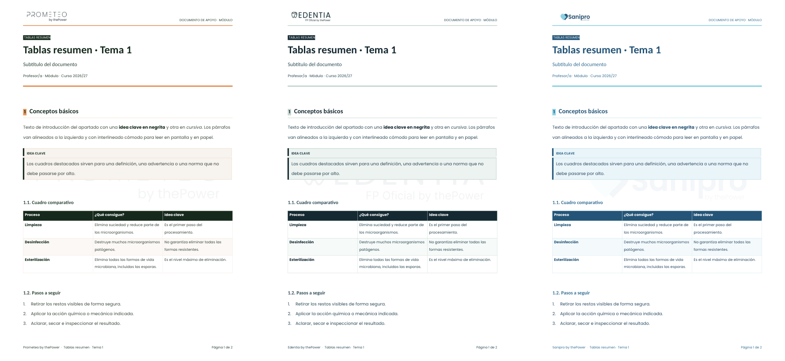
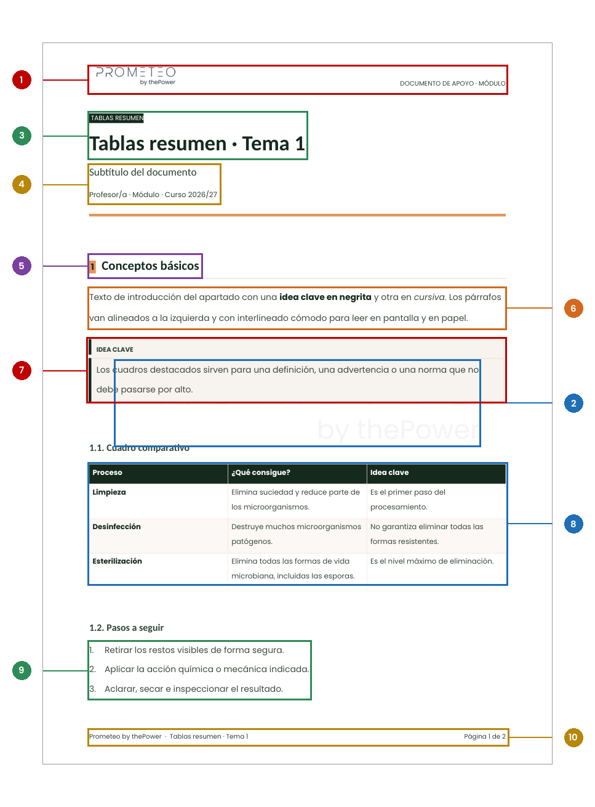
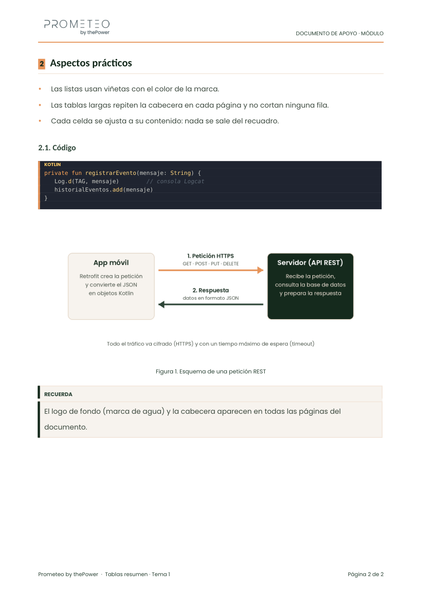

# 11 · Documentos en Word (`.docx`) y Google Docs

> Los documentos de apoyo, los anexos y los temarios también se entregan en Word, con **los mismos recursos estéticos** que el PDF (Poppins, colores de marca, cabecera con logo, pie con paginación, títulos con regla, cuadros destacados, tablas, listas, código y figuras) y con la **marca de agua** del logo. Igual que las presentaciones se descargan en **PPTX o PDF**, los documentos se descargan en **DOCX o PDF**. Este capítulo fija las normas y entrega **plantillas `.docx` listas** para las tres marcas.

## 11.1 Formatos de descarga

| Material | Formatos que debe poder descargarse | Notas |
|---|---|---|
| Presentación | **`.pptx`** y **PDF** | PDF para lo estático; `.pptx` si hay animaciones |
| Documento de apoyo, anexo, guía | **`.docx`** y **PDF** | El mismo contenido y la misma imagen de marca en ambos |
| Temario por unidad | `.md`, **PDF**, SCORM y, **como propuesta**, `.docx` | Hoy el motor oficial solo genera PDF |
| Test | `.xlsx` | Modelo `Test_FP` |
| Contenido para la web / editor de la plataforma | **HTML** (con botón de copiar en el código) | Véase [06 §6.3](06_markdown_texto_codigo_y_oro.md#63-bloques-de-código) |

En Google Docs: **Archivo › Descargar › Documento de Microsoft Word (.docx)** o **PDF (.pdf)**. En Layout Studio: opción **Formato: PDF / Word**.

> **Hechos actuales:** ninguno de los motores de documentos genera Word por sí mismo (`docx_a_pdf_marca.py` *lee* `.docx` y saca PDF). Las plantillas de este capítulo son la primera versión en Word. En Layout Studio las salidas Word existen, pero la portada, el índice y las fórmulas LaTeX son **solo PDF**.

## 11.2 Plantillas entregadas

Carpeta `plantillas_word/`:

| Archivo | Para qué |
|---|---|
| `plantilla_prometeo.docx`, `plantilla_edentia.docx`, `plantilla_sanipro.docx` | **Vacías**, con todos los estilos, la cabecera con logo, el pie y la marca de agua. Se abren y se escribe encima |
| `ejemplo_prometeo.docx`, `ejemplo_edentia.docx`, `ejemplo_sanipro.docx` | Con un documento de muestra (título, apartados, cuadro destacado, tabla, listas, código y figura) |

*Figura 11.1. El mismo documento en Prometeo, Edentia y Sanipro (Word renderizado a PDF con LibreOffice).*

## 11.3 Anatomía de la página en Word

*Figura 11.2. Documento de muestra de Prometeo. La geometría y los estilos son iguales en las tres marcas; cambian los colores y el logo.*

| Nº | Elemento | Especificación en Word |
|---|---|---|
| 1 | Cabecera | Logo a la izquierda (**7,5 mm de alto**) y la **etiqueta** a la derecha (Poppins 7,5 pt, mayúsculas, color `mid`) con tabulador derecho a 172 mm. Línea inferior de **1,25 pt** en color de acento |
| 2 | **Marca de agua** | Véase 11.4 |
| 3 | Píldora + título | Píldora: texto blanco 7,5 pt sobre fondo `dark` (sombreado de texto). Título: estilo **Título**, Poppins **25 pt** en negrita, color `dark`, interlineado 1,15 |
| 4 | Subtítulo y metadatos | Estilo **Subtítulo**: Poppins 12,5 pt, color `mid`. Metadatos 8,5 pt |
| 5 | Apartado | Estilo **Título 1**: Poppins 15 pt negrita, `dark`, 26 pt antes y 9 pt después, **línea inferior** en color `line`, no se separa del párrafo siguiente. El número va en un **chip** (texto `dark` sobre sombreado de acento) |
| 6 | Párrafo | Estilo **Normal**: Poppins **10 pt**, color `body`, interlineado **1,6**, 8 pt después, **alineado a la izquierda**, control de líneas viudas y huérfanas |
| 7 | Cuadro destacado | Estilos **Cuadro destacado etiqueta** + **Cuadro destacado**: sombreado `card`, borde de 0,75 pt `line` y **borde izquierdo de 3 pt en `dark`**; la etiqueta va en mayúsculas, 7,5 pt, negrita, `mid` |
| 8 | Tabla | Véase 11.6 |
| 9 | Lista numerada / viñetas | Estilos **Lista con números** y **Lista con viñetas**: Poppins 10 pt, interlineado 1,5, 4 pt después; **viñeta en color de acento** |
| 10 | Pie | Izquierda «{Marca} by thePower · {título corto}» y derecha «Página n de N» con campos `PAGE` y `NUMPAGES` (Poppins 7,5 pt, color `mid`) |

**Página:** A4 (21 × 29,7 cm); márgenes **29 mm** (arriba) · **19 mm** (laterales) · **21 mm** (abajo); cabecera a 10 mm y pie a 9 mm. Idioma del documento: **español (es-ES)**.

**Estilos de Word que se usan** (todos con Poppins): `Normal` · `Título` · `Subtítulo` · `Título 1` · `Título 2` (11,5 pt, `mid`) · `Título 3` (10 pt, `dark`) · `Lista con viñetas` · `Lista con números` · `Pie de ilustración` (8 pt, `mid`, centrado) · `Etiqueta` · `Cuadro destacado` · `Cuadro destacado etiqueta` · `Código`.

## 11.4 La marca de agua

**Norma:** todos los documentos —PDF y Word— llevan el **logo de la marca**, grande y muy tenue, **centrado en la página y detrás del texto, en todas las páginas**.

| Parámetro | Valor |
|---|---|
| Imagen | El logo de la marca (`PLANTILLAS_FP/4_LOGOS_Y_PALETAS/<marca>_logo.png`) |
| Ancho | **150 mm** (proporción original; sin deformar) |
| Opacidad | **5,5 %** (0,055). En el PDF de documento de apoyo es 0,055 y en el de anexos 0,06 |
| Posición | **Centrado respecto a la página** (horizontal y vertical) |
| Capa | **Detrás del texto**, sin ajuste de texto, anclada y bloqueada |
| Dónde va | En la **cabecera** del documento, de modo que se repite en todas las páginas |
| Nombre del objeto | «Marca de agua» (texto alternativo: «Logo de la marca como marca de agua») |

**Cómo está hecha en el `.docx` entregado:** imagen anclada en la cabecera (`wp:anchor`, `behindDoc="1"`, alineada al centro de la página) con la **transparencia incorporada al PNG** (canal alfa × 0,055). Se hace así, y no con el ajuste «atenuar» de Word, porque el atenuado **no se conserva** al abrir el archivo en Google Docs o LibreOffice.

| Programa | Cómo se pone la marca de agua |
|---|---|
| **Word** | Ya viene en la plantilla (cabecera). Para cambiarla: Insertar › Cabecera › Editar cabecera › seleccionar la imagen |
| **Google Docs** | Al importar el `.docx` conserva la imagen de la cabecera. Si se parte de un documento nuevo: **Insertar › Marca de agua › Imagen**, con el logo de la marca |
| **LibreOffice** | Se conserva como imagen detrás del texto (comprobado) |
| **PDF desde Word/Docs** | La marca de agua sale en todas las páginas (comprobado exportando con LibreOffice) |

> **Pendiente en los motores:** `renderizar_pdf_unidad.py` (temario Prometeo por unidad) **no tiene marca de agua**, y `generar_hoja_ruta.py` tampoco. La norma exige añadirla a todo documento.

## 11.5 Código en Word

Mismo criterio que en los demás formatos: estilo **Ayu Mirage**.

- Estilo de párrafo **Código**: fuente **Consolas** de 8,4 pt (en Mac, sin Consolas, se sustituye por una monoespaciada), sombreado **`#1F2430`**, texto base `#CBCCC6`, **borde izquierdo de 2,5 pt en el color de acento**, sangría de 3 mm, **sin espacio entre líneas** para que el bloque se vea continuo.
- **Cada línea es un párrafo** con el mismo estilo y la primera lleva la **etiqueta del lenguaje** (`KOTLIN`, `XML`…) en amarillo `#FFCC66`, 6,6 pt, negrita.
- **Colores de sintaxis** (por segmentos de texto): palabras clave `#FFA759` · tipos, funciones, atributos y etiquetas `#FFD580` · cadenas `#BAE67E` · números, constantes y operadores `#FFCC66` · comentarios `#5C6773` en cursiva.
- **Texto real con espacios normales** (nunca espacios duros ni imagen): se puede **seleccionar y copiar** y se pega como código válido.

Ejemplo (página 2 del documento de muestra):

*Figura 11.3. Bloque de código Ayu Mirage, figura con pie y cuadro destacado en Word.*

**Botón de copiar:** Word y PDF **no admiten botones funcionales de copiar**; el botón es propio de las salidas web (véase [06 §6.3](06_markdown_texto_codigo_y_oro.md#63-bloques-de-código)). Lo que sí se garantiza en `.docx` y PDF es que el código es texto seleccionable, con sus sangrías, sin caracteres especiales.

## 11.6 Tablas en Word

| Aspecto | Valor |
|---|---|
| Letra | Poppins 8,8 pt, interlineado 1,35 |
| Cabecera | Sombreado `dark`, texto blanco en negrita; **se repite en cada página** (propiedad «repetir como fila de encabezado») |
| Primera columna | Negrita, color `dark` |
| Filas | Impares en blanco, pares en `zebra`; **ninguna fila se parte** entre páginas (`cantSplit`) |
| Bordes | 0,5 pt, color `line` (todos los bordes, interiores y exteriores) |
| Márgenes de celda | 3 mm laterales y 1,1 mm arriba y abajo |
| Anchura | Ajustada al ancho útil (172 mm); columnas en proporción al contenido |

## 11.7 Listas, figuras y enlaces

1. **Viñetas** con el color de acento y **numeradas** que reinician en 1 en cada lista.
2. **Figuras** centradas, de ancho máximo 150–160 mm, con **pie de ilustración** debajo (8 pt, `mid`, centrado): «Figura 1. Esquema de una petición REST». La imagen y su pie van juntos en la misma página.
3. **Enlaces** en una palabra descriptiva y con color de enlace `#1155CC` subrayado en los documentos del estilo oro.
4. El texto de las listas y párrafos sigue las mismas reglas que en las presentaciones: frases de unas 20 palabras, segunda persona o imperativo, sin notas internas.

## 11.8 Tipografía y compatibilidad

- La fuente es **Poppins** (regular y **negrita**). Para que el archivo se vea igual en cualquier ordenador, **Poppins debe estar instalada** (o incrustada: Archivo › Opciones › Guardar › Incrustar fuentes en el archivo, solo TrueType).
- Los pesos **SemiBold** y **Medium** se resuelven con **Poppins + negrita** y Poppins normal: los nombres de familia «Poppins SemiBold» o «Poppins Medium» no los reconocen todos los programas y el texto sale con otra fuente.
- Si Poppins no está disponible, Word y Google Docs sustituyen la fuente; se avisa al usuario en vez de dejar que la sustitución pase desapercibida.
- Se comprueba siempre con una exportación a PDF (el mismo resultado visual que el PDF de documento de apoyo).

## 11.9 Estructura recomendada de un documento Word

1. **Título claro**, subtítulo y metadatos (Profesor/a · Módulo · Curso).
2. **Apartados numerados** con estilo `Título 1` (`1`, `2`…) y subapartados con `Título 2` (`1.1.`); no más de dos niveles.
3. **Un cuadro destacado** por cada definición o advertencia que no deba pasarse por alto.
4. **Tablas** con cabecera; si ocupan varias páginas, la cabecera se repite.
5. **Código** con el estilo `Código`, completo y con su lenguaje.
6. **Figuras** con pie y todo el texto dentro de su recuadro.
7. Al exportar: **PDF** (para leer e imprimir) y **DOCX** (para editar).

## 11.10 Comprobación antes de entregar un `.docx`

- [ ] Página A4, márgenes 29/19/21/19 mm, idioma es-ES.
- [ ] Cabecera con logo y etiqueta; pie con «Marca by thePower · título» y «Página n de N» (campos, no texto).
- [ ] **Marca de agua** visible y centrada en todas las páginas; no tapa el texto.
- [ ] Solo estilos de la plantilla (sin formato manual); Poppins en todo.
- [ ] Títulos con regla; apartados numerados; sin título al final de página.
- [ ] Cuadros destacados con etiqueta; tablas con cabecera repetida y filas sin partir.
- [ ] Código **Ayu Mirage**, completo, con espacios normales; texto seleccionable.
- [ ] Imágenes con pie, proporción original y ≥ 96 ppi.
- [ ] Exportado a PDF y comparado visualmente con el original.
