# Memoria de normas de maquetación · Prometeo, Edentia y Sanipro

**Versión:** 21 de octubre de 2026 · **Elaborada por:** Haridian Santana · **Para:** Layout Studio y para quien maquete material de profesorado.

Esta memoria reúne **todas las normas de maquetación** que hemos fijado y descubierto al maquetar presentaciones y documentos de las tres marcas: qué medidas tiene cada pieza, qué errores reales encontramos (76 catalogados), cómo se detectan y cómo se corrigen. Cada capítulo lleva **ejemplos visuales**: diagramas de anatomía con las medidas exactas de las plantillas oficiales, casos «antes → después» y paletas.

> **Regla de lectura:** lo que aparece aquí está leído de los archivos oficiales (plantillas `.pptx`, motores de maquetación, `paletas.json`) o de incidencias reales. Lo que no consta en ninguna fuente se dice «no consta»; nada se ha inventado. Las propuestas (por ejemplo, los `brand.json` para Layout Studio) están marcadas como propuesta.

## Mapa de la memoria

| Capítulo | Contenido | Ejemplos visuales |
|---|---|---|
| [01 · Marcas, paletas, tipografías y logos](#01-marcas-paletas-tipografías-y-logos) | Qué marca usar, colores oficiales y de las plantillas, contraste WCAG, Poppins Light → Thin, logos y su colocación, colores fuera de marca | Paletas de las 3 marcas |
| [02 · Presentaciones](#02-presentaciones-pptx-y-pdf-de-diapositivas) | Lienzo 720 × 405 pt, los 8 tipos de diapositiva con **todas las medidas**, tamaños de letra, portada, imágenes, tablas, código, cierre, motor a usar y control de calidad | **8 diagramas de anatomía** de diapositivas |
| [03 · Documentos](#03-documentos-pdf-a4-y-word) | Documento de apoyo A4, anexos Word → PDF, **temario Prometeo por unidad**, hojas de ruta y componentes del Proyecto Intermodular | Anatomía de documento, portada, índice y cuerpo del temario; las 3 marcas |
| [04 · Imágenes](#04-imágenes-esquemas-y-capturas) | Proporción, resolución, transparencias, reescalado, colocación, capturas y esquemas dibujados | Mal frente a bien; casos reales |
| [05 · Tablas](#05-tablas) | Colores por marca, cabecera, primera columna, partición, medidas | Tabla antes/después |
| [06 · Markdown, texto, código, cuadros, test y estilo «oro»](#06-markdown-fuente-texto-listas-código-cuadros-test-y-estilo-oro) | Convención del `.md` de unidad (1 160 + 51 unidades), listas, código, callouts, tests `.xlsx`, estilo oro `.docx`, problemas del origen | — |
| [07 · Portadas, numeración, nombres y entrega](#07-portadas-numeración-nombres-de-archivo-y-entrega) | Unidad/Tema/Sesión, nombres de archivo y de píldora, carpetas, formatos de entrega | — |
| [08 · Catálogo de problemas y casos visuales](#08-catálogo-de-problemas-de-maquetación-y-casos-visuales) | **76 problemas** con síntoma, causa, detección, corrección y norma; decisiones pendientes | Casos A–G antes/después |
| [09 · Listas de comprobación](#09-listas-de-comprobación-y-control-de-calidad) | Listas por tipo de material, comandos y umbrales numéricos | — |
| [10 · Layout Studio para Javier](#10-cómo-encaja-todo-esto-en-layout-studio) | Qué hace hoy la herramienta, diferencias con nuestras normas, `brand.json` propuestos, validaciones posibles | — |
| [11 · Documentos en Word y Google Docs](#11-documentos-en-word-docx-y-google-docs) | **Marca de agua**, plantillas `.docx` por marca, estilos, código Ayu Mirage, tablas, descarga en PDF o Word | Word en las 3 marcas, anatomía |

## Ficheros de apoyo

| Ruta | Para qué |
|---|---|
| `reglas_maquetacion.json` | Reglas y medidas en formato máquina (paletas, geometría de la plantilla Prometeo, tamaños, umbrales, nombres, formato del test) |
| `plantillas_word/` | **Plantillas Word** (`plantilla_*.docx` vacías y `ejemplo_*.docx`) de las tres marcas, con marca de agua, cabecera, pie y estilos |
| `layout_studio/componentes/bloque_codigo_ayu_mirage.html` | Bloque de código Ayu Mirage con **botón «Copiar»** (HTML autocontenido) |
| `layout_studio/brands/{prometeo,edentia,sanipro}/brand.json` | **Propuesta** de marcas oficiales en el formato de Layout Studio (colores mapeados desde `paletas.json`) |
| `layout_studio/ejemplo/unidad_ejemplo_completo.md` (+ `Imágenes/`) | `.md` de prueba con todos los elementos del corpus real |
| `img/` | Imágenes de la memoria: `plantillas/` (render de las 25 diapositivas oficiales), `anatomia/` (con medidas), `documentos/`, `casos/` y las figuras sueltas |

## Las once normas que más errores evitan

1. **Marca según la asignatura** (Farmacia = Sanipro; Higiene bucodental y Prótesis = Edentia; informática y marketing = Prometeo) y **solo colores de la paleta**.
2. **Poppins en todo** en la plataforma (Light cuerpo, SemiBold negrita y títulos); nunca Calibri, Arial, Times ni Inter. Cuidado con «Poppins Light» → «Thin» en los PDF.
3. **Tamaños** en diapositivas: títulos 24–25 pt · cuerpo 12–14 · tarjetas y tablas 11–12 · etiquetas 10–10,5. Si no cabe, **dividir en dos diapositivas, nunca encoger**.
4. **Una idea por diapositiva**, con título único; ningún texto encima de otro texto ni fuera de su caja.
5. **Portada:** ciclo arriba · «Unidad N:» (Light) + nombre (SemiBold) a **38 pt** · asignatura en minúsculas · profesor · fecha `dd / mm / aaaa`; el mismo término («Unidad» salvo que el profesor use «Tema») en portada, archivo y listado.
6. **Imágenes:** proporción original (> 6 % de deformación es un error), ≥ 96 ppi, completas, del tema y con fuente; sin cuadrados negros; sin reescalado con IA si llevan rótulos.
7. **Tablas** nativas, con cabecera oscura, primera columna en negrita y los colores de la marca; ≥ 11 pt en diapositivas.
8. **El código es texto** en estilo **Ayu Mirage**: completo, monoespaciado, ≥ 10 pt, seleccionable y con **botón de copiar en las salidas web**; nunca captura.
9. **El acento (naranja, verde menta, azul claro) nunca es color de texto sobre blanco** (contraste 1,5–2,4); solo relleno o texto sobre fondo oscuro.
10. **Todo documento lleva marca de agua** y se descarga en **PDF y Word** (las presentaciones, en PPTX y PDF).
11. **Nunca inventar contenido**, **mirar cada página** renderizada y **comunicar todo lo que se añade**.

## Glosario

| Término | Significado |
|---|---|
| Kicker / eyebrow | Línea pequeña en mayúsculas encima de un título («TEMA 1 · EXPLICACIÓN») |
| Píldora | Etiqueta redondeada del tipo de diapositiva («CONCEPTO») |
| Cornisa | Texto vertical en el margen lateral del temario («UT 2 · 0489») |
| Callout | Cuadro destacado con etiqueta |
| `dark` / `mid` / `body` / `card` / `line` / `accent` / `zebra` | Los siete colores de cada marca en `paletas.json` |
| ppi | Píxeles por pulgada efectivos de una imagen colocada |
| WCAG | Estándar de accesibilidad; el contraste mínimo recomendado es 4,5 |
| Thin | Peso «fino» de Poppins que sustituye por error a «Light» al exportar con LibreOffice |
| Motor | Script que genera el material (`rebuild_deck.py`, `renderizar_pdf_unidad.py`, `plantilla_documento.py`…) |
| UT / UD | Unidad de trabajo / unidad didáctica: se normaliza a «Unidad» |

## Cómo se ha elaborado y qué falta

- **Fuentes leídas:** plantillas `.pptx` oficiales (medidas por forma, 25 diapositivas), 7 motores y skills de maquetación (código y CSS literal), documentos de feedback a profesorado, la memoria de errores y decisiones del equipo, 1 160 + 51 `.md` de unidad (censo), y el código y la documentación de este repositorio y de la herramienta desplegada.
- **Todos los casos sin nombres de profesores:** se numeran como «caso».
- **Decisiones pendientes** (resumidas en [08 §8.9](#89-contradicciones-y-lagunas-detectadas-decisiones-pendientes)): qué hoja de estilo rige cada salida de Prometeo, paletas distintas en motores y herramienta, tamaño de portada y cuerpo mínimo en los motores de reconstrucción, formato de quiz, cierre por plantilla.
- **No constan:** `.md` de Sanipro en el corpus, motor de documentos para thePower/BePharma/Tecnio, y la especificación de las hojas de ruta de Sanipro y Edentia más allá del código.
- **No verificado por mí:** el resultado visual de Layout Studio al descargar (solo se comprobó que genera el PDF y cómo construye el índice); el comportamiento del pie de imagen y de las tablas en esa herramienta.

---

# 01 · Marcas, paletas, tipografías y logos

> Qué marca usar para cada asignatura, qué colores y tipografías tiene cada una, cómo se usan los logos y qué errores de color/contraste hemos encontrado. Todo lo que sigue sale de los archivos oficiales (`PLANTILLAS_FP/4_LOGOS_Y_PALETAS/paletas.json`, las 3 plantillas `.pptx` oficiales y los motores de maquetación) y de los problemas reales de maquetación de octubre de 2026.

## 1.1 Qué marca corresponde a cada material

| Marca | Familia | Se usa para |
|---|---|---|
| **Prometeo** | Informática, marketing, administración y finanzas, intermodular… | Todo el material de ciclos de informática (DAM, DAW, ASIR, SMR) y de marketing/administración |
| **Sanipro** | Sanitaria | TCAE, TES, Farmacia y Parafarmacia, Laboratorio Clínico y Biomédico, Dietética… |
| **Edentia** | Dental | Higiene Bucodental, Prótesis Dentales |
| thePower · BePharma · Tecnio | Otras marcas de la herramienta Layout Studio | **No tienen paleta oficial en ninguno de nuestros motores de maquetación**; ver [10_layout_studio_para_Javier](#10-cómo-encaja-todo-esto-en-layout-studio) |

Reglas:

1. **La marca la manda la asignatura**, no el profesor. Ejemplo conocido: Farmacia = Sanipro (azul). Si un profesor entrega un archivo con la marca equivocada (p. ej. una presentación de Farmacia con la plantilla de Edentia), se pasa a la marca correcta.
2. **Una sola marca por documento.** No se mezclan paletas dentro de un mismo archivo ni de una misma asignatura.
3. Todo el material de la plataforma (presentaciones, documentos de apoyo, hojas de ruta, componentes del Proyecto Intermodular) usa las **mismas paletas y Poppins**. La memoria que se pide al alumnado (Arial o Times 12, interlineado 1,5) es solo texto informativo y **no** es la tipografía de la plataforma.

## 1.2 Paletas oficiales

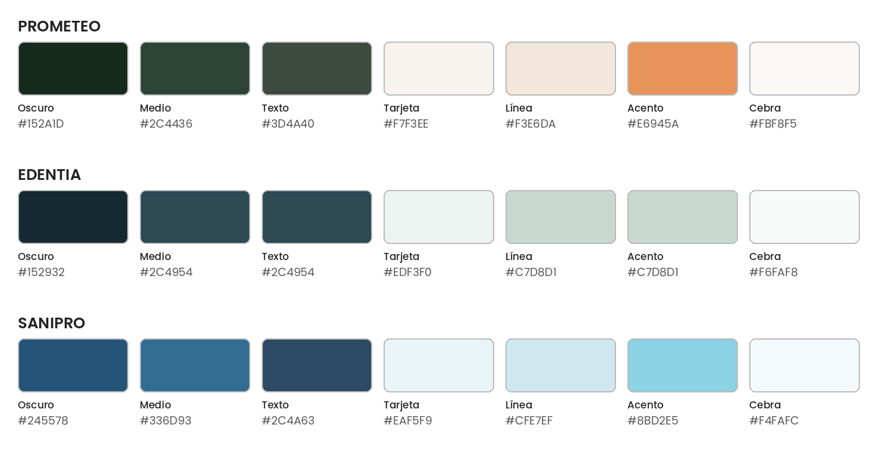

*Figura 1.1. Paletas de `paletas.json`. En Edentia, «Acento» y «Línea» comparten el mismo valor (`#C7D8D1`).*

| Token | Prometeo | Edentia | Sanipro | Uso |
|---|---|---|---|---|
| `dark` (oscuro) | `#152A1D` | `#152932` | `#245578` | Títulos, fondo de portada/cierre, cabecera de tabla |
| `mid` (medio) | `#2C4436` | `#2C4954` | `#336D93` | Subtítulos, etiquetas, pies |
| `body` (texto) | `#3D4A40` | `#2C4954` | `#2C4A63` | Cuerpo de texto en documentos |
| `card` (tarjeta) | `#F7F3EE` | `#EDF3F0` | `#EAF5F9` | Cuadros destacados y tarjetas |
| `line` (línea) | `#F3E6DA` | `#C7D8D1` | `#CFE7EF` | Bordes y separadores |
| `accent` (acento) | `#E6945A` | `#C7D8D1` | `#8BD2E5` | Viñetas, chips numéricos, regla del título |
| `zebra` (cebra) | `#FBF8F5` | `#F6FAF8` | `#F4FAFC` | Filas pares de tabla |

### Paleta completa de las plantillas de presentación (`.pptx`)

Extraída de los 3 `plantilla_*_oficial.pptx` (valores verificados contra los motores):

| Marca | Colores permitidos (hex, sin `#`) |
|---|---|
| Sanipro | `245578 336D93 5A7E90 6B8194 8A9BA8 8BD2E5 CFE7EF D8E9EF EAF5F9 F4FAFC FFFFFF` |
| Edentia | `152932 2C4954 4F6167 6E8187 7C8E93 C7D8D1 DCE7E1 EDF3F0 F1E8D9 F6FAF8 FFFFFF` |
| Prometeo | `E6945A FFFFFF 152A1D 6B7269 4A5449 F3E6DA FBF8F5 2C4436 F7F3EE 8C8377` |

Papel de cada color en las diapositivas (medido en las plantillas):

| Elemento | Prometeo | Edentia | Sanipro |
|---|---|---|---|
| Fondo de portada, sección y cierre | `152A1D` | `152932` | `245578` |
| Círculos decorativos de portada/cierre | blanco + `E6945A` | blanco + `DCE7E1` | blanco + `8BD2E5` |
| Texto de acento sobre fondo oscuro (ciclo, asignatura, fecha) | `E6945A` | `DCE7E1` | `8BD2E5` |
| Número grande de la sección | `2C4436` | _(véase [02](#02-presentaciones-pptx-y-pdf-de-diapositivas))_ | _(véase [02](#02-presentaciones-pptx-y-pdf-de-diapositivas))_ |
| Fondo de diapositiva de contenido | `FFFFFF` | `FFFFFF` | `FFFFFF` |
| Tarjeta de contenido | `FBF8F5` | `F6FAF8` | `F4FAFC` |
| Píldora del tipo de diapositiva (fondo) | `F7F3EE` | `EDF3F0` | `EAF5F9` |
| Título | `152A1D` | `152932` | `245578` |
| Etiqueta superior (kicker) | `4A5449` | `4F6167` | `6B8194` |
| Cuerpo (Poppins Light) | `6B7269` | `6E8187` | _hereda_ |
| Fondo de la diapositiva de actividad | `F7F3EE` | _(véase [02](#02-presentaciones-pptx-y-pdf-de-diapositivas))_ | _(véase [02](#02-presentaciones-pptx-y-pdf-de-diapositivas))_ |

### Discrepancias entre fuentes (decisión pendiente)

Los motores no usan exactamente los mismos valores. Para evitar incoherencias, **la referencia canónica es `paletas.json` + las plantillas `.pptx` oficiales**. Estas son las diferencias detectadas:

| Dónde | Marca | Qué dice | Diferencia con el canon |
|---|---|---|---|
| Hojas de ruta (`generar_hoja_ruta.py`) | Prometeo | fondo de página `#FAF0E7`, línea `#D08A4A`, texto `#1A2B1D` | Acento `#D08A4A` ≠ `#E6945A`; fondo de página en color (no blanco) |
| Hojas de ruta | Sanipro | fondo `#EAF7FB`, línea `#87E0F5`, texto `#003D6B` | Texto `#003D6B` ≠ `#245578`/`#2C4A63` |
| Hojas de ruta | Edentia | fondo `#F1E8D9`, línea `#DCE7E1`, texto `#152932` | Fondo crema (`#F1E8D9`) solo existe en la plantilla pptx, no en `paletas.json` |
| Componentes del Proyecto Intermodular | Edentia | etiqueta sobre oscuro `#F1E8D9` | `paletas.json` no tiene ese token |
| Motor de temario Prometeo (`renderizar_pdf_unidad.py`) | Prometeo | verde de tabla `#CBDECF`, crema `#FEFAF3`, `#F4EFE6` | Tokens propios del temario: no están en `paletas.json` |
| Skill `capturas-prometeo` | Prometeo | crema `#F3F0EA`, línea `#B9B9B4` | Distintos del crema del temario (`#FEFAF3`) |
| **Layout Studio** | Sanipro | primario `#1F6FA8`, oscuro `#003D6B`, claro `#B7E0F5` | **No coincide** con el Sanipro oficial (`#245578`, `#336D93`, `#8BD2E5`) |
| **Layout Studio** | Edentia | primario `#34667D`, oscuro `#152932`, caja suave `#F1E8D9` | Primario y caja suave distintos del canon |
| **Layout Studio** | Prometeo | medio `#E6945A`, claro `#B9BFBB`, caja suave `#FBEFE6`, cita `#FEFAF3` | Usa el naranja como «medio» y no tiene `#2C4436` |

Detalle de los valores de Layout Studio y recomendación de mapeo: [10_layout_studio_para_Javier](#10-cómo-encaja-todo-esto-en-layout-studio).

## 1.3 Contraste y legibilidad (WCAG)

Ratios calculados con los valores oficiales (1 = invisible, 21 = negro sobre blanco; mínimo recomendado **4,5** para texto normal):

| Marca | Combinación | Ratio | Nivel |
|---|---|---|---|
| Prometeo | Cuerpo `#3D4A40` sobre blanco | 9,33 | AAA |
| Prometeo | Título `#152A1D` sobre blanco | 15,21 | AAA |
| Prometeo | Etiqueta `#2C4436` sobre blanco | 10,57 | AAA |
| Prometeo | **Acento `#E6945A` como texto sobre blanco** | **2,40** | **FALLA** |
| Prometeo | Acento `#E6945A` sobre oscuro `#152A1D` (ciclo de la portada) | 6,34 | AA |
| Edentia | **Acento `#C7D8D1` como texto sobre blanco** | **1,48** | **FALLA** |
| Edentia | Acento `#C7D8D1` sobre oscuro `#152932` | 10,16 | AAA |
| Sanipro | **Acento `#8BD2E5` como texto sobre blanco** | **1,69** | **FALLA** |
| Sanipro | Acento `#8BD2E5` sobre oscuro `#245578` | 4,71 | AA |
| Sanipro | Etiqueta `#336D93` sobre blanco | 5,60 | AA |

Otros valores medidos en las plantillas `.pptx`:

| Marca | Elemento | Ratio | Comentario |
|---|---|---|---|
| Prometeo | Cuerpo `#6B7269` sobre `#FBF8F5` | 4,69 | AA justo |
| Prometeo | Pie de foto `#8C8377` sobre `#F3E6DA` | 3,05 | Por debajo de 4,5 |
| Sanipro | Etiqueta superior `#6B8194` sobre blanco | 4,04 | Por debajo de 4,5 (texto de 10,5 pt) |
| Edentia | Cuerpo `#6E8187` sobre `#F6FAF8` | 3,87 | Por debajo de 4,5 |

**Reglas que se derivan:**

1. **El color de acento no se usa nunca como color de texto sobre fondo claro.** Solo como relleno (viñetas, chips, reglas, barras) o como texto sobre el fondo oscuro de la marca.
2. El texto de cuerpo sobre fondo claro usa `body` o `dark`; los grises más claros solo en pies y etiquetas de 10 pt o más.
3. Texto blanco solo sobre `dark` (cabeceras de tabla, portada, cierre).
4. Si una herramienta calcula el contraste, el criterio de fallo es **< 4,5** para texto normal y **< 3** para texto de 18 pt en adelante.

## 1.4 Tipografía

| Uso | Familia | Peso | Dónde |
|---|---|---|---|
| Diapositivas (todas las marcas) | **Poppins** | SemiBold (títulos), Medium (etiquetas), Regular (nombres), Light (cuerpo de plantilla) | Plantillas `.pptx` |
| Documentos de apoyo (`plantilla_documento.py`) | Poppins | 400 (cuerpo), 500 (etiquetas), 600 (títulos y negritas) | PDF A4 |
| Temario Prometeo por unidad (`renderizar_pdf_unidad.py`) | Poppins | 300 (cuerpo), 600 y 700 (títulos y negrita) | PDF A4; fuentes incrustadas (Light, SemiBold, Bold) |
| Código | JetBrains Mono (temario) · Menlo/Consolas/Courier New (documentos y diapositivas) | 400 | Bloques de código |
| Documentos «estilo oro» (Word) | **Arial** | 12 pt cuerpo | `.docx` Letter (véase [03](#03-documentos-pdf-a4-y-word)) |
| Memoria del alumnado (solo informativo) | Arial o Times New Roman | 12 pt, interlineado 1,5 | No es tipografía de plataforma |

**Error conocido: «Poppins Light» se exporta como «Poppins Thin».** Al convertir a PDF con LibreOffice (`soffice --headless`), el tipo «Poppins Light» de las plantillas sale como `Poppins-Thin`: el texto queda gris y casi ilegible. Se detectó en ~30 PDF.

- **Prevención:** antes de exportar, sustituir en el XML de cada diapositiva `Poppins Light` y `Poppins Thin` por `Poppins` (atributos `latin`, `ea`, `cs`, `sym` y `buFont`). Script: `scripts/plantilla_oro/fix_poppins_weights.py`.
- **Detección:** escanear el PDF con PyMuPDF; es un fallo si hay spans cuyo nombre de fuente contiene «Thin» con tamaño ≥ 9 pt, o si más del 45 % del texto está en Thin.

## 1.5 Logos

Archivos en `PLANTILLAS_FP/4_LOGOS_Y_PALETAS/`:

| Marca | PNG alta resolución | SVG |
|---|---|---|
| Prometeo | `prometeo_logo.png` | `PROMETEO_{POSITIVO,NEGATIVO,ISOTIPO}.svg` |
| Edentia | `edentia_logo.png` | `EDENTIA_{POSITIVO,NEGATIVO,ISOTIPO}.svg` |
| Sanipro | `sanipro_logo.png` | `SANIPRO_NEGATIVO.svg`, `SANIPRO_POSITIVO.png`, `SANIPRO_ISOTIPO.png` |

Reglas:

1. **Sobre fondo oscuro, logo `NEGATIVO` (blanco).** Sobre fondo claro, logo normal (`POSITIVO`).
2. **Sin deformar.** Si una plantilla trae un logo blanco estirado, se corrige con alto = ancho × (alto original / ancho original). Esto pasó: los logos blancos de la plantilla de Sanipro venían estirados un 20 %.
3. **Tamaño y posición del logo en diapositivas** (medidas de las plantillas, en puntos, esquina superior derecha):

| Marca | Portada, sección, actividad y cierre | Diapositivas de contenido |
|---|---|---|
| Prometeo | x 578,7 · y 21,6 · 101,7 × 23,6 | igual |
| Edentia | x 580,1 · y 21,6 · 100,3 × 23,6 | igual |
| Sanipro | x 588,2 · y 23,0 · 92,2 × 20,7 | x 602,0 · y 26,1 · 78,4 × 17,6 |

4. **No copiar el XML `<p:pic>` de un logo de una diapositiva a otra**: la relación `r:embed` no viaja y el logo sale roto o invisible. Hay que extraer la imagen y volver a insertarla con `add_picture`.
5. **Marca de agua en documentos:** el logo de la marca, grande y muy tenue, centrado en todas las páginas (150 mm de ancho; opacidad 0,055 en `plantilla_documento.py` y 0,06 en `docx_a_pdf_marca.py`). Cabecera: logo de 7,5 mm de alto a la izquierda (documento de apoyo) o 9 mm arriba a la derecha (anexos de profesor).
6. En el temario Prometeo por unidad **no hay logo de imagen**: la marca es el texto «PROMETEO · by thePower» solo en la portada.
7. Los logos de `_IDENTIDAD` (ISOTIPOS + LOGOTIPO) son la fuente original; los de `4_LOGOS_Y_PALETAS` son la copia ordenada.

## 1.6 Colores fuera de la marca (qué vigilar)

Los `.pptx` que entregan los profesores traen colores del tema de Google (acentos verdes, azules `#729FCF`, etc.) que LibreOffice dibuja fuera de marca. Lo que se vigila:

- **Verdes en Prometeo:** bordes de tabla, portadillas y cabeceras de tabla en verdes que no son los corporativos. Detector en el PDF renderizado: píxel con `g > 100` y `g > r + 25` y `g > b + 25`.
- **Tablas:** cabecera `dark`, primera columna en el tono medio de la marca y filas en crema/cebra de la marca (véase [05_tablas](#05-tablas)).
- **Un profesor por marca:** no se mezclan colores de marca con los propios del profesor.
- Portada y cierre **editables** (texto real, no imagen), porque se editan los archivos después.

Ver el catálogo completo de problemas en [08_catalogo_de_problemas](#08-catálogo-de-problemas-de-maquetación-y-casos-visuales).

---

# 02 · Presentaciones (`.pptx` y PDF de diapositivas)

> Todo lo que hay que respetar al maquetar una presentación de Prometeo, Edentia o Sanipro: formato, tipos de diapositiva con sus medidas exactas, tamaños de letra, portada, imágenes, tablas, código, cierre y control de calidad. Las medidas están leídas de las plantillas oficiales (`PLANTILLAS_FP/1_PPT_plantillas_oficiales/`); las reglas, de las 83 incidencias reales catalogadas en [08_catalogo_de_problemas](#08-catálogo-de-problemas-de-maquetación-y-casos-visuales).

## 2.1 Formato

| Dato | Valor |
|---|---|
| Proporción | 16:9 |
| Tamaño del lienzo | **720 × 405 pt** (25,4 × 14,29 cm; 9 144 000 × 5 143 500 EMU; 1 pt = 12 700 EMU) |
| Tipografía | Poppins (véase [01](#01-marcas-paletas-tipografías-y-logos)) |
| Margen izquierdo de los contenidos | 39,6 pt |
| Margen derecho | 39,6 pt (los contenidos terminan en x = 680,4) |
| Zona útil hacia abajo | Hasta ≈ 0,93 del alto (y ≈ 376 pt); la tarjeta de contenido acaba en y = 363,6 |
| Archivos de entrada atípicos | 960 × 540 pt (33,9 cm) o 4:3. **Para comparar tamaños de letra con la plantilla hay que multiplicar por 0,75** |

Las tres plantillas son idénticas en geometría; cambian los **colores** y el **tamaño del logo** (véase [01](#15-logos)). Plantilla de partida: **nunca se edita el original oficial**, se trabaja siempre sobre una copia.

## 2.2 Tipos de diapositiva y orden en cada plantilla

Son 8 tipos. El **orden no es el mismo** en las tres plantillas (esto importa para cualquier herramienta que use la plantilla por índice):

| Tipo | Prometeo | Edentia | Sanipro |
|---|---|---|---|
| Portada | 0 | 0 | 0 |
| Sección | 1 | 1 | 1 |
| Concepto | 2 | 2 | 2 |
| Ejemplo | 3 | 3 | 3 |
| Actividad | 4 | 4 | 4 |
| Galería visual | **5** | 6 | 7 |
| Ejemplo visual | **6** | 5 | 5 |
| Ejemplo visual (2.ª variante) | — | — | 6 |
| Cierre («¿Preguntas?») | 7 | 7 | **8** |
| Total | 8 | 8 | 9 |

La 2.ª variante de «Ejemplo visual» de Sanipro: panel de imagen estrecho a la izquierda (197,6 × 405 pt) y una tarjeta de texto grande (459,6 × 314 pt) para un caso descrito en prosa, en lugar de 3 puntos.

En el motor `plantilla_oro` el cierre es `PRE=8` en Sanipro y `PRE=7` en Edentia y Prometeo; los identificadores internos «Google Shape;N» están desplazados una unidad en Edentia/Prometeo (`off=1`).

## 2.3 Anatomía y medidas de cada tipo (Prometeo; Edentia y Sanipro cambian colores y logo)

Cada tabla da, para cada elemento numerado en la figura, su posición, tamaño, tipografía y color en las tres marcas. «Texto X» es el color de la letra; «fondo X» el relleno de la forma.

### 2.3.1 Portada

Primera diapositiva de **cada** presentación. Un archivo = una unidad (o tema/sesión). Siempre editable (texto nativo).

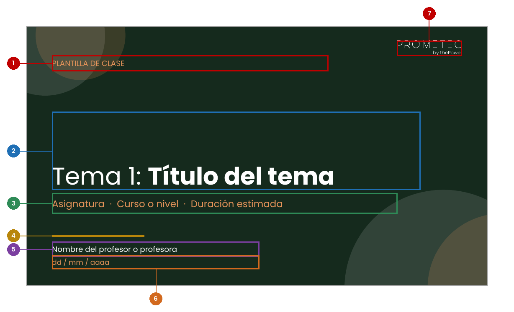

*Figura 2.1. Anatomía (geometría idéntica en las tres marcas; cambian colores y logo). Contornos y números solo sobre el borde de la diapositiva: no tapan texto.*

| Nº | Elemento | x · y (pt) | Ancho × alto (pt) | Tipografía | Prometeo | Edentia | Sanipro |
|---|---|---|---|---|---|---|---|
| 1 | Línea superior: ciclo formativo | 39.6 · 44.6 | 432 × 25.2 | Poppins Medium 12 pt | texto E6945A | texto DCE7E1 | texto 8BD2E5 |
| 2 | Título de la unidad | 39.6 · 133.2 | 576 × 122.4 | Poppins Light 38 pt | texto FFFFFF | texto FFFFFF | texto FFFFFF |
| 3 | Asignatura · curso · duración | 39.6 · 260.6 | 540 × 32.4 | Poppins 15 pt | texto E6945A | texto DCE7E1 | texto 8BD2E5 |
| 4 | Línea de acento | 39.6 · 327.6 | 144 × 0 | — | — | — | — |
| 5 | Nombre del profesor/a | 39.6 · 337 | 324 × 23 | Poppins 12 pt | texto FFFFFF | texto FFFFFF | texto FFFFFF |
| 6 | Fecha dd / mm / aaaa | 39.6 · 358.6 | 324 × 21.6 | Poppins Light 11 pt | texto E6945A | texto DCE7E1 | texto 8BD2E5 |
| 7 | Logo de la marca | 578.7 · 21.6 | 101.7 × 23.6 | — | — | — | — |

### 2.3.2 Sección (portadilla)

Portadilla para separar bloques grandes. Numeración correlativa 01, 02, 03… y «SECCIÓN N». Si la presentación es corta puede no llevar secciones.

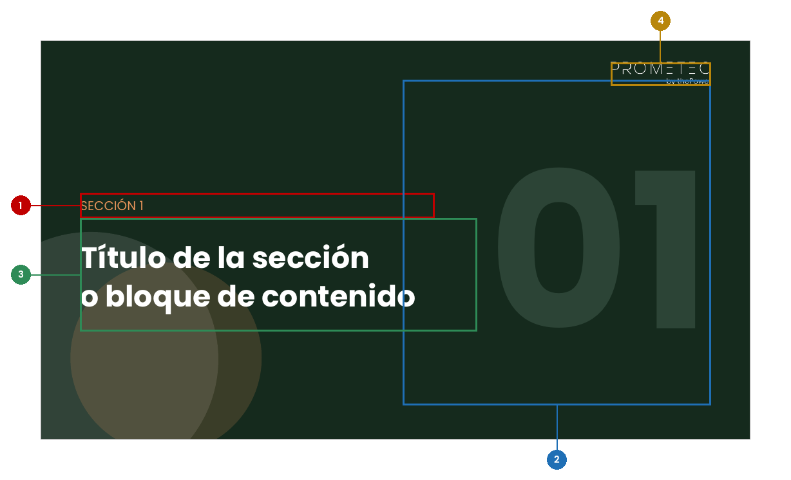

*Figura 2.2. Anatomía (geometría idéntica en las tres marcas; cambian colores y logo). Contornos y números solo sobre el borde de la diapositiva: no tapan texto.*

| Nº | Elemento | x · y (pt) | Ancho × alto (pt) | Tipografía | Prometeo | Edentia | Sanipro |
|---|---|---|---|---|---|---|---|
| 1 | Etiqueta «SECCIÓN N» | 39.6 · 154.8 | 360 × 25.2 | Poppins Medium 13 pt | texto E6945A | texto DCE7E1 | texto 8BD2E5 |
| 2 | Número grande (decorativo) | 367.2 · 39.6 | 313.2 × 331.2 | Poppins SemiBold 220 pt negrita | texto 2C4436 | texto 2C4954 | texto 336D93 |
| 3 | Título de la sección | 39.6 · 180 | 403.2 × 115.2 | Poppins SemiBold 30 pt negrita | texto FFFFFF | texto FFFFFF | texto FFFFFF |
| 4 | Logo de la marca | 578.7 · 21.6 | 101.7 × 23.6 | — | — | — | — |

### 2.3.3 Concepto

Diapositiva de explicación: una idea, definición o lista. Es la que más se usa. Si el texto no cabe a 12–14 pt, se parte en dos (con «(1/2)» y «(2/2)» en el título).

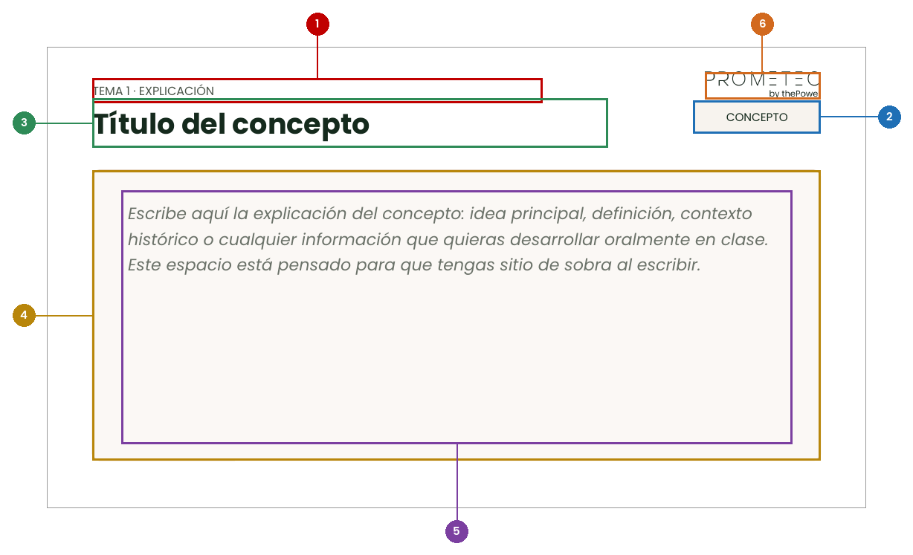

*Figura 2.3. Anatomía (geometría idéntica en las tres marcas; cambian colores y logo). Contornos y números solo sobre el borde de la diapositiva: no tapan texto.*

| Nº | Elemento | x · y (pt) | Ancho × alto (pt) | Tipografía | Prometeo | Edentia | Sanipro |
|---|---|---|---|---|---|---|---|
| 1 | Etiqueta superior (kicker) | 39.6 · 27.4 | 396 × 21.6 | Poppins Medium 10.5 pt | texto 4A5449 | texto 4F6167 | texto 6B8194 |
| 2 | Píldora del tipo de diapositiva | 568.8 · 46.8 | 111.6 × 28.8 | — | fondo F7F3EE | fondo EDF3F0 | fondo EAF5F9 |
| 3 | Título | 39.6 · 44.6 | 453.6 × 43.2 | Poppins SemiBold 25 pt negrita | texto 152A1D | texto 152932 | texto 245578 |
| 4 | Tarjeta de contenido | 39.6 · 108 | 640.8 × 255.6 | — | fondo FBF8F5 | fondo F6FAF8 | fondo F4FAFC |
| 5 | Cuerpo de texto | 64.8 · 126 | 590.4 × 223.2 | Poppins Light 14.5 pt | texto 6B7269 | texto 6E8187 | — |
| 6 | Logo de la marca | 578.7 · 21.6 | 101.7 × 23.6 | — | — | — | — |

### 2.3.4 Ejemplo / caso práctico

Caso práctico o aplicación de lo explicado antes. Misma tarjeta que «Concepto» con la píldora «EJEMPLO» y un icono circular.

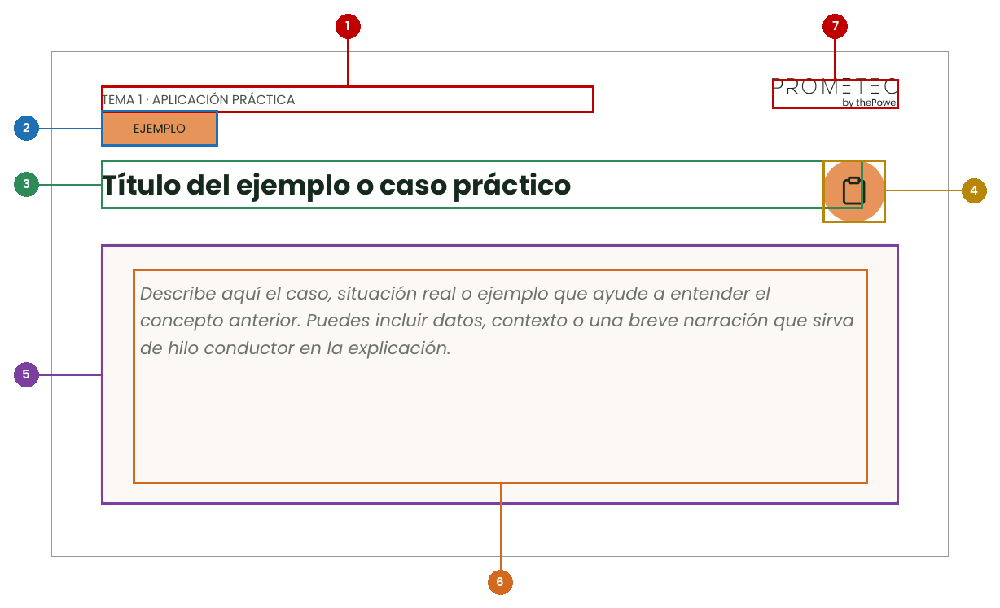

*Figura 2.4. Anatomía (geometría idéntica en las tres marcas; cambian colores y logo). Contornos y números solo sobre el borde de la diapositiva: no tapan texto.*

| Nº | Elemento | x · y (pt) | Ancho × alto (pt) | Tipografía | Prometeo | Edentia | Sanipro |
|---|---|---|---|---|---|---|---|
| 1 | Etiqueta superior (kicker) | 39.6 · 27.4 | 396 × 21.6 | Poppins Medium 10.5 pt | texto 4A5449 | texto 4F6167 | texto 6B8194 |
| 2 | Píldora «EJEMPLO» | 39.6 · 46.8 | 93.6 × 28.8 | — | fondo E6945A | fondo F1E8D9 | fondo 8BD2E5 |
| 3 | Título | 39.6 · 86.4 | 612 × 39.6 | Poppins SemiBold 22 pt negrita | texto 152A1D | texto 152932 | texto 245578 |
| 4 | Icono circular | 619.2 · 86.4 | 50.4 × 50.4 | — | fondo E6945A | fondo F1E8D9 | fondo 8BD2E5 |
| 5 | Tarjeta de contenido | 39.6 · 154.8 | 640.8 × 208.8 | — | fondo FBF8F5 | fondo F6FAF8 | fondo F4FAFC |
| 6 | Cuerpo de texto | 64.8 · 174.2 | 590.4 × 172.8 | Poppins Light 14 pt | texto 6B7269 | texto 6E8187 | — |
| 7 | Logo de la marca | 578.7 · 21.6 | 101.7 × 23.6 | — | — | — | — |

### 2.3.5 Actividad

Ejercicio con pasos numerados (hasta 3 por diapositiva en la plantilla) y chip de duración. Se rellena **todo** («__ minutos» no puede quedar sin rellenar).

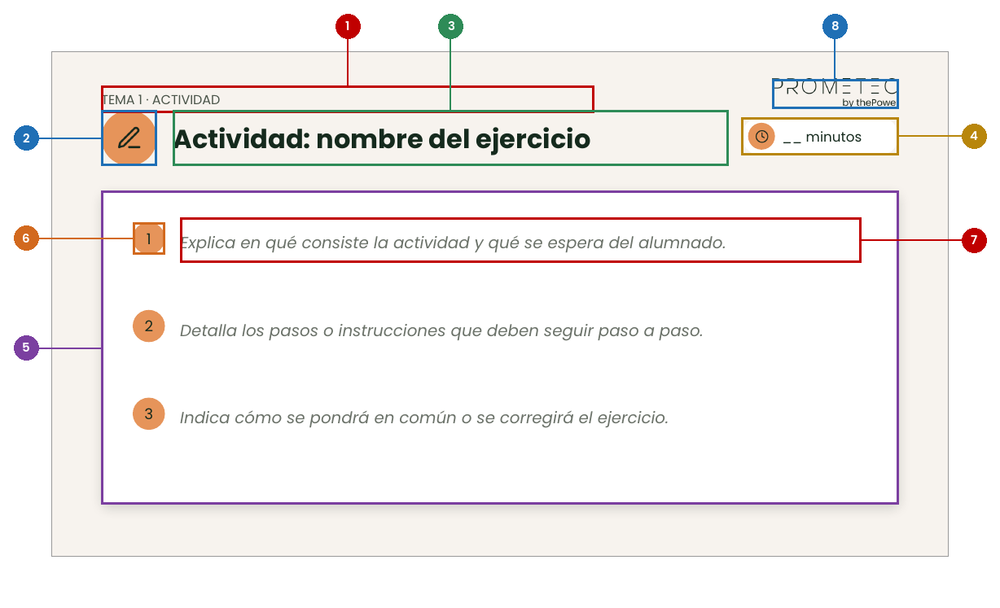

*Figura 2.5. Anatomía (geometría idéntica en las tres marcas; cambian colores y logo). Contornos y números solo sobre el borde de la diapositiva: no tapan texto.*

| Nº | Elemento | x · y (pt) | Ancho × alto (pt) | Tipografía | Prometeo | Edentia | Sanipro |
|---|---|---|---|---|---|---|---|
| 1 | Etiqueta superior (kicker) | 39.6 · 27.4 | 396 × 21.6 | Poppins Medium 10.5 pt | texto 4A5449 | texto 4F6167 | texto 6B8194 |
| 2 | Icono de actividad | 39.6 · 46.8 | 44.6 × 44.6 | — | fondo E6945A | fondo F1E8D9 | fondo 8BD2E5 |
| 3 | Título de la actividad | 97.2 · 46.8 | 446.4 × 44.6 | Poppins SemiBold 21 pt negrita | texto 152A1D | texto 152932 | texto 245578 |
| 4 | Chip de duración | 554.4 · 52.6 | 126 × 30.2 | — | fondo FFFFFF | fondo FFFFFF | fondo FFFFFF |
| 5 | Tarjeta blanca de pasos | 39.6 · 111.6 | 640.8 × 252 | — | fondo FFFFFF | fondo FFFFFF | fondo FFFFFF |
| 6 | Número del paso | 64.8 · 136.8 | 25.9 × 25.9 | — | fondo E6945A | fondo F1E8D9 | fondo 8BD2E5 |
| 7 | Texto del paso | 103 · 133.2 | 547.2 × 36 | Poppins Light 13 pt | texto 6B7269 | texto 6E8187 | texto 8A9BA8 |
| 8 | Logo de la marca | 578.7 · 21.6 | 101.7 × 23.6 | — | — | — | — |

### 2.3.6 Ejemplo visual (foto a sangre)

Una fotografía a sangre a la izquierda y hasta 3 puntos de «qué observar» a la derecha. Sanipro tiene dos variantes (véase 2.2).

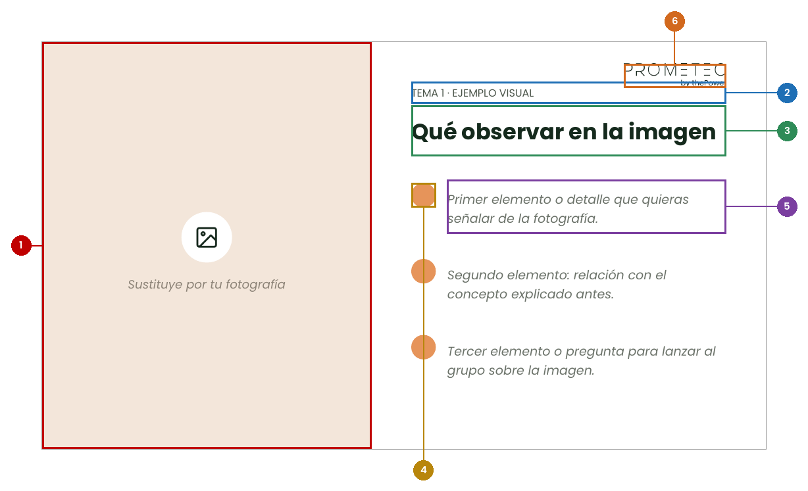

*Figura 2.6. Anatomía (geometría idéntica en las tres marcas; cambian colores y logo). Contornos y números solo sobre el borde de la diapositiva: no tapan texto.*

| Nº | Elemento | x · y (pt) | Ancho × alto (pt) | Tipografía | Prometeo | Edentia | Sanipro |
|---|---|---|---|---|---|---|---|
| 1 | Panel de imagen a sangre (izquierda) | 0 · 0 | 327.6 × 405 | — | fondo F3E6DA | fondo DCE7E1 | fondo CFE7EF |
| 2 | Etiqueta superior (kicker) | 367.2 · 39.6 | 313.2 × 21.6 | Poppins Medium 10.5 pt | texto 4A5449 | texto 4F6167 | texto 6B8194 |
| 3 | Título | 367.2 · 63.4 | 313.2 × 50.4 | Poppins SemiBold 22 pt negrita | texto 152A1D | texto 152932 | texto 245578 |
| 4 | Viñeta circular | 367.2 · 140.4 | 24.5 × 24.5 | — | fondo E6945A | fondo F1E8D9 | fondo 8BD2E5 |
| 5 | Texto del punto | 403.2 · 136.8 | 277.2 × 54 | Poppins Light 12.5 pt | texto 6B7269 | texto 6E8187 | texto 8A9BA8 |
| 6 | Logo de la marca | 578.7 · 21.6 | 101.7 × 23.6 | — | — | — | — |

### 2.3.7 Galería visual

Hasta 3 imágenes en fila con pie de foto. Cada imagen en su marco, sin deformar. No se usa para «guardar» imágenes sueltas lejos de su texto.

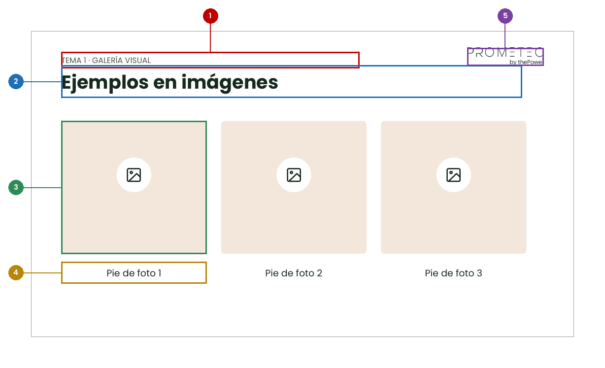

*Figura 2.7. Anatomía (geometría idéntica en las tres marcas; cambian colores y logo). Contornos y números solo sobre el borde de la diapositiva: no tapan texto.*

| Nº | Elemento | x · y (pt) | Ancho × alto (pt) | Tipografía | Prometeo | Edentia | Sanipro |
|---|---|---|---|---|---|---|---|
| 1 | Etiqueta superior (kicker) | 39.6 · 27.4 | 396 × 21.6 | Poppins Medium 10.5 pt | texto 4A5449 | texto 4F6167 | texto 6B8194 |
| 2 | Título | 39.6 · 44.6 | 612 × 43.2 | Poppins SemiBold 25 pt negrita | texto 152A1D | texto 152932 | texto 245578 |
| 3 | Marco de imagen (×3) | 39.6 · 118.8 | 193 × 176.4 | — | fondo F3E6DA | fondo DCE7E1 | fondo CFE7EF |
| 4 | Pie de foto | 39.6 · 306 | 193 × 28.8 | Poppins Medium 12.5 pt | texto 152A1D | texto 152932 | fondo CFE7EF |
| 5 | Logo de la marca | 578.7 · 21.6 | 101.7 × 23.6 | — | — | — | texto 5A7E90 |

### 2.3.8 Cierre

Última diapositiva: «¿Preguntas?» con el número de página. No se añade «Gracias», ni «Cierre de la unidad», ni un logo suelto.

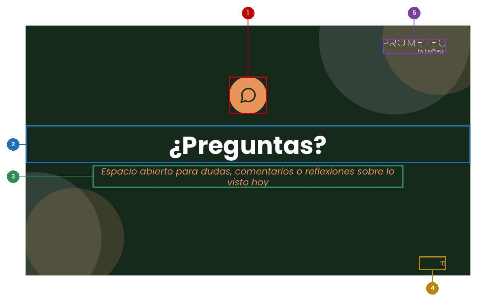

*Figura 2.8. Anatomía (geometría idéntica en las tres marcas; cambian colores y logo). Contornos y números solo sobre el borde de la diapositiva: no tapan texto.*

| Nº | Elemento | x · y (pt) | Ancho × alto (pt) | Tipografía | Prometeo | Edentia | Sanipro |
|---|---|---|---|---|---|---|---|
| 1 | Icono | 329.8 · 82.8 | 60.5 × 60.5 | — | fondo E6945A | fondo F1E8D9 | fondo 8BD2E5 |
| 2 | Título «¿Preguntas?» | 0 · 162 | 720 × 61.2 | Poppins SemiBold 40 pt negrita | texto FFFFFF | texto FFFFFF | texto FFFFFF |
| 3 | Texto de cierre | 108 · 226.8 | 504 × 36 | Poppins Light 15 pt | texto E6945A | texto DCE7E1 | texto 8BD2E5 |
| 4 | Número de diapositiva | 637.2 · 374.8 | 43.2 × 21.6 | Poppins Light 10 pt | texto E6945A | — | — |
| 5 | Logo de la marca | 578.7 · 21.6 | 101.7 × 23.6 | — | — | — | — |

### Reglas generales de las diapositivas de plantilla

1. **Los elementos de la plantilla no se mueven ni se redimensionan** (salvo para ajustar un título largo). Se rellenan sustituyendo su texto.
2. **Todo texto de ejemplo de la plantilla se sustituye o se elimina**: «Escribe aquí…», «__ minutos», «Sustituye por tu fotografía», «Pie de foto 1», «Título del ejemplo…», «PLANTILLA DE CLASE». No puede quedar ningún campo sin rellenar.
3. **La píldora del tipo** («CONCEPTO», «EJEMPLO»…) admite como máximo **14 caracteres**.
4. **El kicker** («TEMA 1 · EXPLICACIÓN») cambia con el tema/unidad y el tipo de diapositiva, y va en mayúsculas.
5. **Al clonar una diapositiva de la plantilla** hay que copiar también su fondo (`<p:bg>` vive en la propia diapositiva, no en el layout; si no, la copia sale con fondo blanco).
6. **El logo no se copia como XML** entre diapositivas: se extrae la imagen y se inserta de nuevo.

## 2.4 Tamaños de letra

Norma vigente (14-oct-2026), sobre un lienzo de 720 pt de ancho:

| Elemento | Mínimo | Máximo | Notas |
|---|---|---|---|
| Títulos | 24 pt | 25 pt | La plantilla usa 25 pt (Concepto), 22 pt (Ejemplo, ejemplo visual), 21 pt (Actividad). Si el título es largo, baja por tramos (≤40 caracteres → 22 · ≤56 → 18 · ≤66 → 16 · más → 14) y se marca como «decisión a revisar» |
| Cuerpo y listas | 12 pt | 14 pt | La plantilla usa 14–14,5 pt. **Si no cabe, se divide en dos diapositivas; no se encoge** |
| Tarjetas, tablas y esquemas | 11 pt | 12 pt | |
| Etiquetas, chips y pies | 10 pt | 10,5 pt | |
| Código | 10 pt | — | Ideal 11–13 pt en Consolas o Courier |
| Portada | véase 2.5 | | |

Reglas de texto:

1. **Una idea por diapositiva.** Si una diapositiva explica dos temas, se parte en dos. Los títulos de las partes llevan «(1/2)», «(2/2)» y los títulos no se repiten entre diapositivas consecutivas.
2. **No aparece letra diminuta.** Una diapositiva con más del 25 % del texto por debajo de 9,5 pt está mal. Ejemplo real: una presentación tenía el 72 % del texto por debajo de 8 pt equivalentes.
3. **Las tarjetas no se dejan vacías**: si el texto ocupa menos de la mitad de la tarjeta, se sube la letra (hasta ≈16 pt) o se reparte mejor el contenido.
4. **Todo el texto cabe dentro de su caja** y no toca los bordes. Ningún texto encima de otro texto. Se revisa en vista de presentación.
5. Alineación **a la izquierda** (el texto justificado deja huecos entre palabras en cajas estrechas).
6. **Poppins en todo**: Light para el cuerpo, SemiBold para la negrita y los títulos. Ni Calibri, Arial, Times ni Inter. Los fragmentos de código usan Consolas, Courier, Menlo o Cascadia.
7. **Viñetas nativas del programa** (• en el primer nivel y – en el segundo; sangrías 228 600 y 457 200 EMU), no el carácter escrito a mano; tampoco tabuladores ni espacios para alinear.
8. **Énfasis = negrita** (solo palabras completas). Sin cursiva dominante, sin resaltador «fosforito» y sin escribir en mayúsculas continuas. El texto de ejemplo gris claro de la plantilla (`#8A9BA8`) no es un estilo para el cuerpo.
9. **Mayúsculas solo** en el kicker y en las etiquetas. La asignatura de la portada va en minúsculas normales.
10. **Los títulos interrogativos llevan el signo de apertura «¿…?».**
11. **Enlaces en una palabra** («Ver vídeo»), no URLs que ocupan media diapositiva. Un vídeo que en PDF saldría como imagen fija lleva además un enlace en texto visible.
12. **Se escribe al alumnado**: segunda persona o imperativo, frases de unas 20 palabras como máximo, sin notas internas (ni «justificación en el material» ni instrucciones a una IA).
13. **Sin párrafos vacíos ni puntos sueltos** («.» como párrafo propio) ni diapositivas casi vacías.

## 2.5 La portada

Estructura (véase la figura 2.1 y su tabla):

1. **Línea superior = ciclo formativo** (Poppins Medium 12 pt, color de acento). Sustituye a «PLANTILLA DE CLASE»; no puede quedar ese rótulo.
2. **Título = 38 pt**, con «**Unidad N:**» (o «Tema N:» / «Sesión N:») en **Poppins Light** y el nombre en **Poppins SemiBold**. Si el nombre es largo se baja por escalón: 38 → 34 → 30 → 28 → 26 → 24 pt (máximo 3 líneas).
3. **Asignatura · curso o nivel · duración** (Poppins 15 pt, acento): en minúsculas normales, no en mayúsculas.
4. **Profesor/a** (Poppins 12 pt, blanco): con el nombre con el que firma (si firma con un diminutivo, se usa ese), no el inverso ni el completo si no lo usa.
5. **Fecha `dd / mm / aaaa`** (Poppins Light 11 pt): la fecha de entrada, no «Curso 2026/27» ni «2026 – 2027».
6. **Sin correo electrónico** del profesor.

**«Unidad» o «Tema».** Se usa **«Unidad»** siempre, salvo que el profesor use «Tema» (u otro término) en su propio material. **El mismo término** en la portada, en el nombre del archivo y en el listado de subida. El número es el **real** de la unidad, no un contador de orden.

Ejemplo correcto de contenido de portada:

```
TÉCNICO SUPERIOR EN DESARROLLO DE APLICACIONES MULTIPLATAFORMA     ← ciclo (12 pt, acento)
Unidad 2: Desarrollo de Aplicaciones Móviles                       ← «Unidad 2:» Light + nombre SemiBold, 38 pt
Programación multimedia y dispositivos móviles · 2.º DAM · 135 h   ← 15 pt, minúsculas
Nombre Apellidos                                                    ← 12 pt
21 / 10 / 2026                                                      ← dd / mm / aaaa
```

La portada y el cierre son **siempre texto editable** (no imagen), porque los archivos se editan después. Si un PDF entra sin número en la portada, se parchea rehaciendo la línea del título sin tapar lo que hay debajo.

## 2.6 Imágenes en diapositivas

Reglas completas en [04_imagenes](#04-imágenes-esquemas-y-capturas). Lo específico de diapositivas:

1. **Proporción original**: jamás estirar. Una deformación mayor del 6 % es un error. Escala uniforme (`min(ancho_caja/ancho, alto_caja/alto)`) y centrada en su marco.
2. **Galería**: 3 marcos de **193 × 176,4 pt** en y = 118,8, en x = 39,6 · 252,0 · 464,4 (separación 19,4 pt) con pie de foto debajo (Poppins Medium 12,5 pt). Zona de imágenes del motor: x 55 · y 112 · ancho 610 · alto 262.
3. **Ejemplo visual**: panel de imagen a sangre de **327,6 × 405 pt** a la izquierda (Sanipro: 327,6 × 405 y la 2.ª variante 197,6 × 405); el texto va a la derecha desde x = 367,2.
4. **La imagen va junto a su texto** (no en una galería aparte «para que quede mejor»). Se mantiene la agrupación que trae el profesor.
5. Antes de colocar una imagen o un recuadro se calcula su **caja** y se comprueba que **no se solapa** con ninguna otra forma de la diapositiva. Si no hay hueco limpio, no se fuerza: se marca para colocación manual.
6. **Transparencias**: no pueden salir como cuadrado negro. Una página negra solo es válida si es una foto/radiografía oscura.

## 2.7 Tablas en diapositivas

Detalle en [05_tablas](#05-tablas). Lo específico:

1. **Tabla nativa** (no imagen), dentro de la tarjeta: x = 39,6 pt (502 920 EMU) y 640,8 pt de ancho (8 138 160 EMU); filas de ≈ 23,6 pt (300 000 EMU); margen de celda izquierda/derecha 7,2 pt (91 440 EMU) y superior/inferior 3,6 pt (45 720 EMU).
2. **Una sola tabla por diapositiva** en el motor de reconstrucción; si el origen trae más, se usa otro motor o se rehace a mano.
3. **Letra ≥ 11 pt**. Si una tabla es muy densa (9–10 pt), se divide en dos diapositivas repitiendo la cabecera.
4. **Colores de la marca** (cabecera oscura, filas alternas): nunca los estilos por defecto de PowerPoint (lilas y azules).
5. Una tabla puede quedar «vacía» en el PDF si unas formas blancas con animación de salida la ocultan hasta el clic: en ese caso se entrega el `.pptx` o se quitan las formas.

## 2.8 Código y esquemas

1. **El código es texto**, en un bloque monoespaciado (Consolas o Courier) de **≥ 10 pt (ideal 11–13)**, **completo** y con sangría que enseñe la estructura. Nunca una captura de pantalla con letra diminuta. Si no cabe, se divide en dos diapositivas.
2. **Estilo «Ayu Mirage»** (norma del 21-oct-2026): bloque de **fondo oscuro `#1F2430`** con esquinas suaves, texto base `#CBCCC6`, palabras clave `#FFA759`, tipos y funciones `#FFD580`, cadenas `#BAE67E`, números y operadores `#FFCC66` y comentarios `#5C6773` en cursiva. La **etiqueta del lenguaje** (`KOTLIN`, `XML`…) va arriba a la derecha en `#5C6773`, 8 pt.
3. El texto va con **espacios normales** (no espacios duros) y en un solo cuadro de texto, para que se pueda **seleccionar, copiar y pegar** como código válido. En una diapositiva o PDF no hay botón de copiar (véase [06 §6.3](#63-bloques-de-código)).

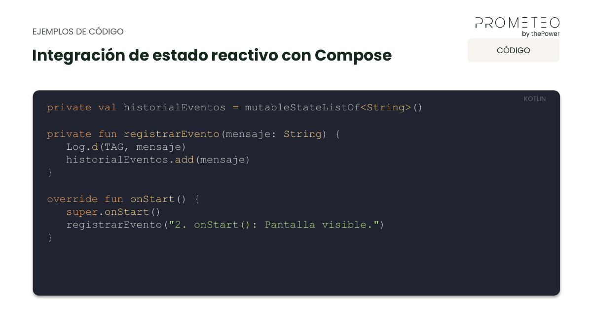

*Figura 2.9. Diapositiva con código Kotlin en estilo Ayu Mirage.*

4. Los esquemas se hacen con **formas nativas** (cajas, flechas) y texto real, no con imágenes con rótulos.
5. Si hay que leer texto de una imagen, se transcribe a elementos nativos y se avisa de que se ha leído de una imagen.

## 2.9 Cierre

1. La última diapositiva es la de la plantilla: **«¿Preguntas?»** con el texto «Espacio abierto para dudas, comentarios o reflexiones sobre lo visto hoy» (puede sustituirse por una frase propia breve) y el **número de diapositiva** de la plantilla.
2. No se añade «Gracias», «Cierre de la unidad», una diapositiva solo con un logo ni un número de página suelto.
3. Es una de las correcciones más repetidas: apareció en unos 14 de los 24 feedbacks revisados.

## 2.10 Qué motor usar (árbol de decisión)

Antes de tocar nada: **renderizar la página 1 y algunas intermedias y mirarlas**.

```
¿El archivo ya viene exportado desde la plantilla oficial (logo, paleta, portada «Tema N: Título»)?
 ├─ Sí → NO se reconstruye. Solo QA: erratas reales, colores sueltos, logo que falta, portada. Nunca redecorar.
 └─ No
     ├─ Es un .pptx nativo del profesor → PARCHE CONSERVADOR (restyle): plantilla + colores + tipografía de la marca;
     │    se conserva su distribución (qué va junto y qué va en su propia diapositiva).
     └─ Es un PDF (o Canva, Google sin plantilla) → RECONSTRUIR 1:1 sobre la plantilla oficial:
          extraer texto e imágenes página a página, tablas nativas, diagramas con formas nativas,
          cada imagen respetando su proporción. Sin inventar contenido ni reinterpretar el diseño.
```

Aviso: «Google Shape» en el nombre de las formas solo indica que el archivo se exportó desde Google Slides; **no** prueba que use la plantilla oficial.

Los PDF también se maquetan (decisión del 6-oct-2026) para que el material quede limpio sin perder la esencia del profesor: su contenido, su orden y sus ejemplos.

## 2.11 Exportación y entrega

1. **PDF para lo estático.** Si hay animaciones que ocultan contenido (por ejemplo, tapaderas que descubren una tabla), se entrega el **`.pptx`** (la plataforma lo acepta con animaciones).
2. **Poppins Light sale como Thin en el PDF**: sustituir en el XML `Poppins Light`/`Poppins Thin` por `Poppins` antes de exportar, o corregir después con `fix_poppins_weights.py` comprobando que el texto no cambia. Nunca entregar un PDF con spans «Thin» ≥ 9 pt.
3. **Peso**: una presentación muy pesada (16–24 MB) que la plataforma no acepta se recomprime (PNG > 60 KB → JPG al 84 %, máximo 1 600 px; si falla, 1 200 px), conservando transparencias y animaciones.
4. **Nombre del archivo corto, sin tildes, rayas ni comas** (algunos nombres hacen que un PDF no abra en la plataforma por la URL del CDN, con el mismo contenido): `<ASIGNATURA>_Presentacion_Unidad_<N>.pdf`.
5. **Nombre en la plataforma**: «Presentación Unidad N» / «Presentación Tema N» / «Presentación Sesión N» y nada más, en la carpeta **«Recursos extras»** de la asignatura.
6. **El original no se pisa**: va en `ORIGINAL - sin corregir/`; el trabajo se guarda en una copia con nombre distinto.
7. Lo ya subido sin fallo **no se rehace**; solo se corrige lo que está «muy mal» (letra Thin ilegible, texto cortado, fuera de plantilla).

## 2.12 Control de calidad de una presentación

Antes de dar una presentación por buena:

1. **Renderizar** con `soffice --headless --convert-to pdf` y `pdftoppm -jpeg -r 100` y **mirar cada diapositiva** una a una (no una muestra ni la miniatura).
2. **Diff de texto** origen frente a salida: cero palabras perdidas; baseline del texto de todas las formas antes de editar.
3. **Imágenes**: contar y comparar con el original (p. ej. 23 de 23); proporción (deformada > 6 %); resolución efectiva (ppi = píxeles / ancho en pulgadas; baja < 96 ppi).
4. **Colores**: extraer colores y compararlos con la paleta; detector de píxeles verdes en el PDF (a 30 dpi: `g > 100`, `g > r + 25`, `g > b + 25`; aviso si la media supera 0,002 de la página).
5. **Thin**: escanear los spans del PDF.
6. **Ortografía**: `hunspell -d …/dict-es/es_ES -l` sobre el texto y confirmar cada palabra en contexto. Corregir solo erratas evidentes y decirlo.
7. **Portada**: ciclo, «Unidad N: nombre» a 38 pt, asignatura en minúsculas, profesor, fecha `dd / mm / aaaa`, sin correo; cierre «¿Preguntas?».
8. **Coherencia**: mismo número y nombre de unidad en portada, cabeceras, mapa e índices y nombre de archivo.
9. **Placeholders**: ninguno («Sustituye…», «__ minutos», «PLANTILLA DE CLASE»).
10. **Todo lo que se añade** (etiquetas «TABLA»/«ESQUEMA», títulos nuevos, texto transcrito de una imagen) se comunica al profesor como «decisión a revisar».

---

# 03 · Documentos (PDF A4 y Word)

> Normas de maquetación de documentos: apuntes, tablas resumen, actividades, rúbricas, anexos, hojas de ruta, temarios por unidad y componentes del Proyecto Intermodular. Cada tipo tiene su motor y su aspecto. Todos los valores son literales del código (archivo y línea en `_fuentes/01_motores_documentos.md`).

## 3.1 Qué tipo de documento usa qué motor

| Tipo de documento | Marcas | Motor | Entrada → salida | Página |
|---|---|---|---|---|
| **Documento de apoyo** (tablas resumen, actividades, rúbricas, guías, anexos) | Prometeo · Edentia · Sanipro | `PLANTILLAS_FP/2_DOCUMENTOS/plantilla_documento.py` | `.md` o bloques → PDF | A4 |
| **Anexo escrito por un profesor en Word** | Prometeo · Edentia · Sanipro | `scripts/plantilla_oro/docx_a_pdf_marca.py` | `.docx` → PDF | A4 |
| **Temario por unidad Prometeo** («PDF por unidad») | Solo Prometeo | `scripts/maquetar_pdf_unidad/renderizar_pdf_unidad.py` (**motor OFICIAL**) | `.md` + imágenes → PDF | A4 |
| **Hoja de ruta de asignatura** (mapa de unidades, no el temario) | Prometeo · Edentia · Sanipro | `scripts/hojas_de_ruta/generar_hoja_ruta.py` | datos → PDF | A4 con fondo de marca |
| **Componentes del Proyecto Intermodular** | Prometeo · Edentia · Sanipro | `scripts/proyecto_intermodular/componentes_definitivos.py` | datos → HTML en línea | Editor de la plataforma |
| **Temarios «estilo oro»** | Prometeo | `goldgen.py` (python-docx) | contenido → `.docx` | Carta (Letter) |
| **Documento en Word** (apoyo, anexo, guía) | Prometeo · Edentia · Sanipro | script de generación de las plantillas `.docx` (no incluido) | plantilla → `.docx` y PDF | A4 — véase [11](#11-documentos-en-word-docx-y-google-docs) |
| Presentaciones | — | véase [02_presentaciones](#02-presentaciones-pptx-y-pdf-de-diapositivas) | | |

Hechos que conviene tener presentes:

- Todos los motores PDF usan **WeasyPrint** (HTML + CSS de medios paginados). Todos son **A4**; **ninguno genera Word** y ninguno usa tamaño Carta (solo el estilo oro de los `.docx`).
- **Todo documento lleva marca de agua** (norma del 21-oct-2026): el logo grande y tenue, centrado y detrás del texto en todas las páginas, en PDF y en Word. Hoy **la tienen** el documento de apoyo y el anexo; **no la tienen** el temario por unidad ni la hoja de ruta (cambio pendiente).
- **El código va en estilo Ayu Mirage** (norma del 21-oct-2026, véase [06 §6.3](#63-bloques-de-código)); los motores de PDF aún generan código claro (cambio pendiente).
- **Marcas con paleta en motores de documentos: Prometeo, Sanipro y Edentia.** thePower, BePharma y Tecnio no constan en ninguno.
- **La skill `maquetar-prometeo` no es el estándar**: es una propuesta de rediseño aparte. El motor oficial del temario Prometeo es `renderizar_pdf_unidad.py`.
- Una plantilla de **documento** no es una plantilla de **presentación**: ante «usa la plantilla» se confirma cuál. No se llama «anexo» a una presentación.
- Los **PDF originales de los profesores también se maquetan** (no se suben «tal cual»), sin perder su contenido.

## 3.2 Documento de apoyo A4 (`plantilla_documento.py`)

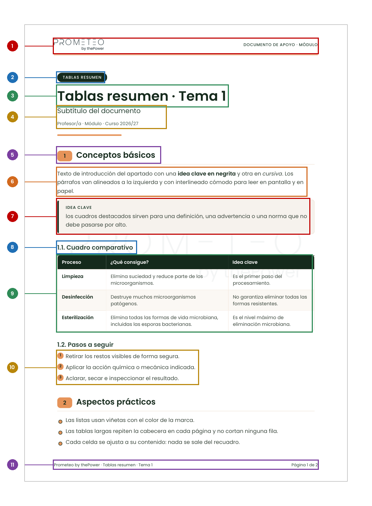

*Figura 3.1. Documento de apoyo de Prometeo (la geometría y los componentes son iguales en Edentia y Sanipro; cambian colores y logo).*

| Nº | Elemento | Especificación |
|---|---|---|
| 1 | Cabecera (se repite en todas las páginas) | Logo de la marca a la izquierda (**7,5 mm de alto**) y **etiqueta** a la derecha (Poppins 500, 7,5 pt, mayúsculas, `letter-spacing` 0,06 em, color `mid`). Línea inferior de **1,2 pt** en color de acento. Ancho 172 mm |
| 2 | Píldora de tipo de documento | Opcional. Poppins 500, 7,5 pt, mayúsculas, fondo `dark`, texto blanco, radio 10 mm |
| 3 | Título | Poppins **600, 25 pt**, interlineado 1,15, color `dark`, `text-wrap: balance` |
| 4 | Subtítulo y metadatos | Subtítulo 400, 12,5 pt, color `mid`; metadatos 400, 8,5 pt, color `mid` al 85 % |
| — | Regla decorativa | 42 mm × 3 pt, color de acento, esquinas redondeadas 2 pt |
| 5 | Apartado `h1` | 600, **15 pt**, color `dark`, margen superior 9 mm, línea inferior de 0,8 pt en color `line`. Si empieza por «N.» o «N.M.», el número va en un **chip** (fondo de acento, texto `dark`, mínimo 7 × 7 mm, radio 2,2 mm, 10 pt). Nunca queda al final de página sin texto detrás |
| 6 | Párrafo | Poppins **400, 10 pt, interlineado 1,6**, color `body`, **alineado a la izquierda**, margen inferior 2,8 mm, `orphans` y `widows` = 3 |
| 7 | Cuadro destacado (`> Etiqueta: texto`) | Fondo `card`, borde de 0,8 pt `line`, **borde izquierdo de 3 pt en `dark`**, radio 2 mm, relleno 3 × 4,5 mm. Etiqueta en 600, 7,5 pt, mayúsculas, color `mid`. No se parte entre páginas. Si la cita no tiene «Etiqueta:» de 2 a 30 caracteres, se titula «Importante» |
| 8 | Subapartado `h3` | 600, 10 pt, color `dark`, `letter-spacing` 0,02 em (el `h2` es 600 / 11,5 pt / `mid`) |
| 9 | Tabla | Véase [05_tablas](#05-tablas) |
| 10 | Listas | Viñeta: círculo de 1,9 mm relleno de acento y borde de 0,9 pt en `mid`. Numerada: círculo de 4,2 mm con el número en 600, 7 pt. Sangría 5,5 mm; hasta un nivel de anidado |
| 11 | Pie | Izquierda: «{Marca} by thePower · {título corto, máx. 60 caracteres}». Derecha: «Página n de N». Poppins 400, 7,5 pt, color `mid` |

**Página:** A4 con márgenes **29 mm (arriba) · 19 mm (laterales) · 21 mm (abajo)**.

**Marca de agua:** el logo de la marca, a **150 mm de ancho**, centrado, con **opacidad 0,055** y detrás del contenido, repetido en todas las páginas.

**Portada:** no es una página aparte; el título, el subtítulo y los metadatos van en la primera página sobre el contenido.

**Markdown que entiende** (entrada `.md`): `# ` el primero es el título del documento; después `#` y `##` → apartado (h1) y `###` → h2; listas con `-`, `*` o `•` y numeradas `1.` / `1)`; tablas con `|`; `> Etiqueta: texto` → cuadro destacado; `---` → línea; `**negrita**`, `*cursiva*` y `` `código` `` en línea. **Limitaciones:** no procesa imágenes ni bloques de código ``` desde Markdown (solo por la API: `("img", ruta, pie)` y `("code", texto, lenguaje)`), `####` cae como párrafo y no hay índice.

Salto de página manual: bloque `("pagina",)`. Ejemplo de entrada: `PLANTILLAS_FP/2_DOCUMENTOS/ejemplo.md`; PDF de muestra por marca: `ejemplo_{prometeo,edentia,sanipro}.pdf`.

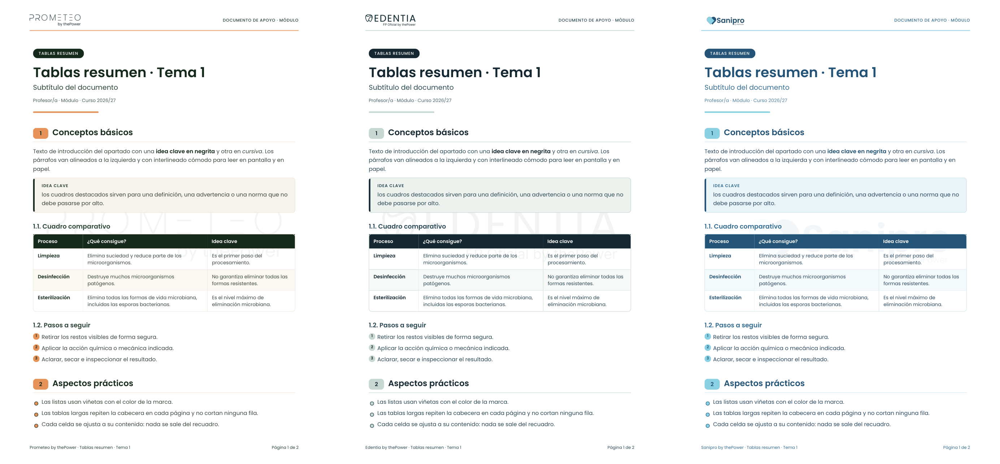

*Figura 3.2. El mismo contenido en Prometeo, Edentia y Sanipro.*

### Estructura recomendada de un documento de apoyo

1. **Título claro** + subtítulo (módulo, curso) + metadatos (profesor/a · fecha).
2. **Apartados numerados** (`## 1. …`) que no pasen de dos niveles (`### 1.1. …`).
3. **Un cuadro destacado** (`> Idea clave: …`) por cada definición o advertencia que no deba pasarse por alto; no más de uno por pantalla de contenido.
4. **Tablas** con cabecera; si son largas, la cabecera se repite en cada página y ninguna fila se parte.
5. **Todo dentro del recuadro**: el texto no se sale de celdas ni cuadros.

## 3.3 Anexo de profesor en Word → PDF (`docx_a_pdf_marca.py`)

Pasa un `.docx` a PDF de marca **sin tocar el texto**. Diferencias respecto al documento de apoyo:

| Aspecto | Valor |
|---|---|
| Página | A4, márgenes **30 / 20 / 24 / 20 mm** (arriba/lados/abajo) |
| Logo | Arriba a la **derecha**, 9 mm de alto; marca de agua al 6 % de opacidad, 150 mm, centrada |
| Pie | «{Marca} by thePower · {etiqueta}» a la izquierda y «Página n de N» a la derecha, 8 pt |
| Cuerpo | Poppins 400, **10,5 pt**, interlineado 1,6 |
| Título | 600, 24 pt; subtítulo 500, 13 pt; regla de 38 mm × 3 pt |
| `h1` | 600, 15 pt, con **barra izquierda de 3 pt en acento** |
| `h2` | 600, 12 pt, color `mid`; si es «DIAPOSITIVA N» o «Caso clínico N» va como **chip** oscuro con texto blanco |
| `h3` | 600, 11,5 pt, con el número en un círculo de 6,5 mm |
| Introducción | Primer párrafo de menos de 200 caracteres → caja `card` con borde izquierdo de 3 pt en `dark` |
| Tablas | 9 pt; cabecera `dark` con texto blanco; cebra; primera columna en 600; la tabla **sí puede partirse** entre páginas |

Heurísticas que aplica (sin cambiar el texto): une los párrafos partidos a mano; detecta título, `h1`/`h2` por estilo o por negrita corta; convierte viñetas escritas a mano (`•`, `·`, `▪`, `●`, `○`, `◦`, `-`, `–`, `—`) y párrafos numerados en listas; pone en negrita las etiquetas «Enfoque:», «Contenido sugerido:», «Tiempo de referencia:», «Objetivo:», etc.

**Limitaciones:** **las imágenes del `.docx` no se pasan**; no hay índice, ni bloques de código, ni cuadros por etiqueta.

## 3.4 Temario por unidad de Prometeo (`renderizar_pdf_unidad.py`)

Motor **oficial** de los temarios que ven profesorado y alumnado. El `.md` fuente **no se modifica**: es el formato de entrega en sí; el PDF se genera aparte, en una carpeta propia (nunca mezclado con los `.md`). Para lotes grandes se usa un script mecánico (sin LLM).

Uso:

```bash
python3 renderizar_pdf_unidad.py <unidad.md> <imagenes_dir> <codigo> <nombre_asignatura> <num_unidad> <destino.pdf> \
        [--foto-portada RUTA] [--sigla-ciclo SIGLA]
```

### Convención del `.md` de entrada

| En el `.md` | Resultado en el PDF |
|---|---|
| Primera línea `# Unidad N: Título` | Título de portada (no se repite en el cuerpo) |
| `# Objetivos de la unidad` | Caja con etiqueta **«RESULTADOS DE APRENDIZAJE»** |
| `# Introducción` | Caja con etiqueta **«ACTIVACIÓN Y REFLEXIÓN»** |
| `# 1. Título` (dígitos + punto + espacio) | Etiqueta **«SECCIÓN 1»** + H1; sus `##` pasan al índice como subentradas |
| Otro `# …` | H1 simple |
| `## …`, `### …` | h2 y h3 (el h3 **no** sale en el índice) |
| `` | Figura con pie (el texto alternativo es el pie) |
| `[CAPTURA: …]`, `[ESQUEMA: …]`, `[DIAGRAMA: …]`, `[TABLA/GRÁFICO: …]` en un párrafo propio | Marcador en **rojo `#C00000`, negrita** (señal de «imagen pendiente») |

> **Atención con las rutas de imagen.** El motor solo reescribe a ruta absoluta las imágenes cuya ruta empieza por **`Imágenes/`**. Con cualquier otra ruta (`imgs/…`, `./fig/…`) la imagen **no se carga**: sale solo el texto alternativo, duplicado como párrafo y pie. Comprobado con una prueba real.

### Anatomía

**Portada** (página a sangre, sin folio ni cornisa):

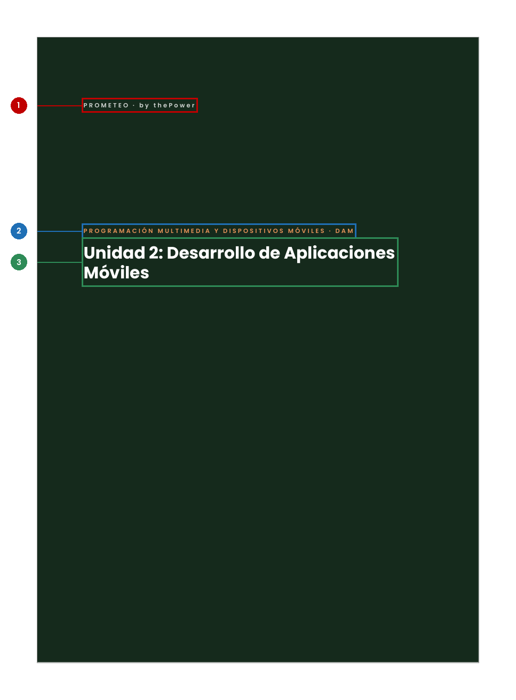

*Figura 3.3. Portada sin foto: fondo verde `#152A1D`, marca, kicker en terracota y título.*

| Nº | Elemento | Especificación |
|---|---|---|
| 1 | Marca | «PROMETEO · by thePower», 11 px, peso 600, `letter-spacing` 3 px, opacidad 0,8; margen inferior 5,5 cm |
| 2 | Kicker | 11 px, peso 600, `letter-spacing` 3 px, **terracota `#E6945A`**, mayúsculas. Con `--sigla-ciclo`: «{asignatura} · {sigla}» (sin línea de ruta en el cuerpo); sin sigla: «{código} · {asignatura}» (con línea de ruta en cursiva en el cuerpo) |
| 3 | Título | 30 px, peso 700, interlineado 1,18, blanco, ancho máx. 15 cm. Con foto de portada: 28 px, foto de 18,5 cm de alto con `object-fit: cover`, marca superpuesta con sombra de texto; **la foto se usa solo en portada** y se retira del cuerpo si estaba en él |

**Índice** (página propia):

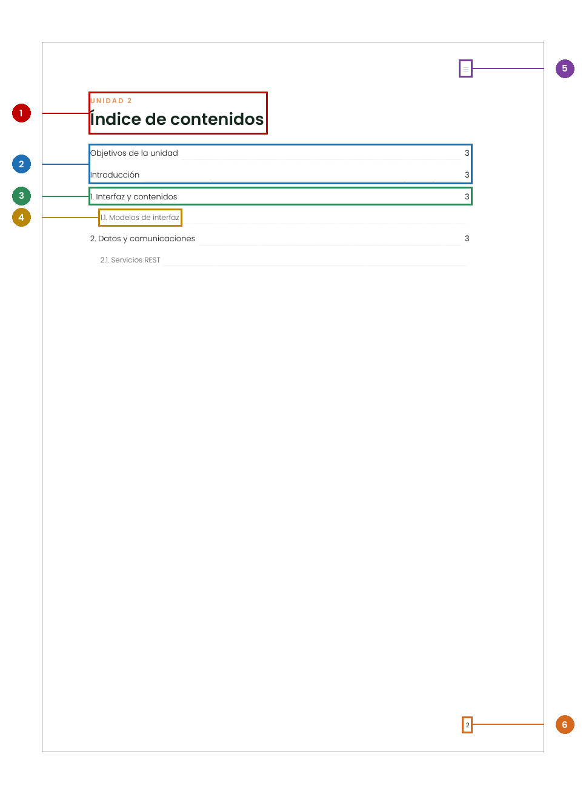

*Figura 3.4. Índice con número de página real (`target-counter`).*

El índice incluye los títulos de las cajas (Objetivos, Introducción), las secciones «N.» y sus `##`, y los demás `#`. **No incluye `###`.** Entradas a 12,5 px; subentradas a 11,5 px, color `#555` y 16 px de sangría; relleno punteado `1px dotted #B9B9B9`.

**Cuerpo:**

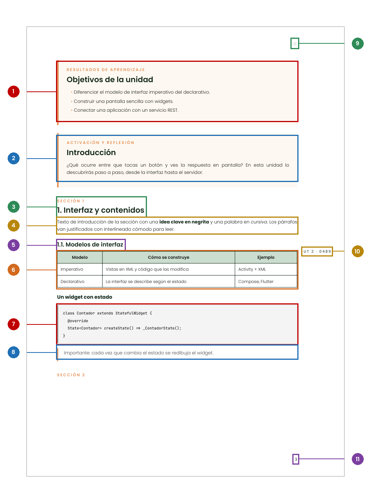

*Figura 3.5. Página de cuerpo (cajas, secciones, tabla, código y cita).*

| Nº | Elemento | Especificación |
|---|---|---|
| 1, 2 | Cajas «Objetivos» e «Introducción» | Fondo crema `#FEFAF3`, **borde izquierdo de 4 px en terracota**, relleno 16 × 20 px, no se parten entre páginas. Etiqueta terracota 10 px, 600, `letter-spacing` 2 px. Es el **único «callout»** del motor |
| 3 | Etiqueta de sección + H1 | «SECCIÓN N» terracota 10 px / 600 / `letter-spacing` 2 px; H1 **19 px**, peso 600, verde `#152A1D`, interlineado 1,28 |
| 4 | Párrafo | Poppins **300 (Light), 11,5 px, interlineado 1,62**, **justificado**, margen inferior 10 px; negrita en peso 700 y color verde |
| 5 | `h2` / `h3` | 14,5 px (margen superior 20 px) / 12,5 px en peso 700 (margen superior 16 px) |
| 6 | Tabla | 10,5 px; cabecera `#CBDECF` centrada en 600; bordes `1px solid #152A1D`; relleno 6 × 8 px; **no se parte entre páginas** |
| 7 | Código | **Hoy:** fondo `#F5F5F5`, borde `#D0D0D0`, borde izquierdo de 3 px en `#888`, JetBrains Mono 9,5 px, color `#000`; claro y sin resaltado. **Norma nueva: Ayu Mirage** (fondo `#1F2430`, sintaxis coloreada); cambio pendiente en el motor |
| 8 | Cita | Borde izquierdo de 3 px en terracota, color `#444` |
| 9 | Cabecera | Solo un «≡» gris `#CFCFCF` (14 px) arriba a la derecha |
| 10 | Cornisa | «UT N · CÓDIGO» en vertical en el margen derecho (9 px, `letter-spacing` 2 px, verde). Aparece en todas las páginas salvo portada e índice |
| 11 | Folio | Abajo a la derecha, Poppins 10 px, verde; numeración continua (la portada cuenta pero no la muestra) |

**Página:** A4 con márgenes **2,2 cm (arriba) · 3,1 cm (derecha) · 2,2 cm (abajo) · 2 cm (izquierda)**; el margen derecho es ancho porque aloja la cornisa. Tipografía Poppins 300/600/700 incrustada desde `plantilla/fuentes/` (no hay Regular 400 ni Medium 500: cualquier otro peso cae al más cercano).

**Imágenes:** figura al **100 % del ancho** (esquinas 2 px, no se parte entre páginas); pie en 10 px cursiva `#666`.

**Saltos:** portada, índice y cuerpo empiezan en página nueva. Cajas, figuras, tablas y bloques de código no se parten.

### Lo que este motor **no** hace (límites a conocer)

- **No evita títulos huérfanos**: una etiqueta «SECCIÓN 2» puede quedar al final de una página con su título en la siguiente (visible en la figura 3.5).
- Una tabla o un bloque de código **más alto que una página no se puede partir**.
- **No hay cierre ni contraportada, logo de imagen, test ni cuadros por etiqueta** (Importante, Nota…). **Tampoco hay marca de agua, que la norma exige** (pendiente).
- **Una sola marca**: Prometeo. No tiene parámetro de marca.
- El código no lleva colores de sintaxis y es claro: la norma pide ahora **Ayu Mirage** (pendiente).

## 3.5 Hoja de ruta de asignatura (`generar_hoja_ruta.py`)

Es un **mapa** de la asignatura (unidades, temas y objetivos), no el temario. Un PDF corto por asignatura.

| Aspecto | Valor |
|---|---|
| Página | A4, márgenes 2,3 / 2,2 / 2,3 / 2,2 cm, y **fondo de toda la página en color de marca** (no blanco) |
| Tipografía | Poppins (cuerpo 12,5 px, interlineado 1,6; se carga de Google Fonts: necesita red o Poppins instalada) |
| Primera página | Sin portada aparte: fila con el ciclo (izquierda, 11 px / 600) y el logo (derecha, 30 px de alto); `h1` con la asignatura (29 px / 700); kicker «Conoce los objetivos de la asignatura»; regla de 2 px |
| Cada unidad | Empieza en página nueva. `h2` «UNIDAD N: TÍTULO EN MAYÚSCULAS» (15 px / 700), «Resumen general de la unidad», «Temas y objetivos» (por tema: `h4`, párrafo y lista «Objetivos:» con sublista) |
| Cierre | Tabla «Unidad · Título · Temas principales» en página nueva (bordes de 1 px, sin fondo en la cabecera) |
| Paleta de página | Prometeo `#FAF0E7` (línea `#D08A4A`, texto `#1A2B1D`) · Sanipro `#EAF7FB` (`#87E0F5`, `#003D6B`) · Edentia `#F1E8D9` (`#DCE7E1`, `#152932`) |

Ojo: esta paleta **no coincide** con `paletas.json` (véase [01](#discrepancias-entre-fuentes-decisión-pendiente)).

## 3.6 Componentes del Proyecto Intermodular (HTML para el editor)

No son PDF: cada componente es un bloque HTML con estilos en línea para pegar en el editor de la plataforma. Tipografía Poppins. Tarjetas con **esquinas redondeadas** (8–18 px), a diferencia de las skills de capturas (esquinas rectas): son sistemas distintos.

Los 11 componentes: portada de sección · tarjetas de texto · tarjetas con idea clave · entrega con fecha (y progreso) · hoja de ruta (con progreso) · contacto de tutores · ficha de tutor · tabla de criterios · recurso con enlace · formato de la memoria del alumno · bloque de impacto suelto.

| Pieza | Estilo literal |
|---|---|
| Contenedor | `border-radius: 18px; border: 1px solid {linea}; background: {suave}; font-size: 15px; line-height: 1.6`; cabecera interna en el color oscuro con eyebrow (11 px, 600, `letter-spacing` 0,14 em, mayúsculas) y título de 26 px |
| Tarjeta | Fondo blanco, borde `{linea}`, `border-radius: 14px; padding: 16px 18px`; ancho por defecto `calc(50% - 7px)` |
| Cuadrito numerado | 24 × 24 px, radio 8 px, fondo `card`, 700, 12 px |
| Barra de progreso | Segmentos de 10 px de alto, radio 6 px, relleno de acento o gris `#E3E3E3`; **solo en la hoja de ruta** (decisión del 8-oct) |
| Bloque de impacto | Fondo oscuro, radio 16 px, texto blanco; etiqueta 11 px / 700; texto 22 px / 700; número grande opcional de 64 px en acento |
| Tabla de criterios | 14 px; cabecera oscura con texto blanco; filas con borde inferior `{linea}` |

La memoria que se le pide al alumnado (Arial o Times 12, interlineado 1,5) aparece solo como texto informativo en el componente 10: **no** es tipografía de la plataforma.

Diseño elegido: opción B (tarjetas) «pura», sin barras de progreso salvo en la hoja de ruta; la opción C (oscuro de impacto) solo para lo puntual (idea clave, fecha, avisos).

---

# 04 · Imágenes, esquemas y capturas

> Cómo se colocan, se preparan y se dibujan las imágenes en presentaciones y documentos. Incluye la comprobación automática de calidad (proporción, resolución, transparencias), las reglas de los marcadores `[CAPTURA: …]` y de las skills que dibujan capturas y esquemas, y los fallos reales encontrados.

## 4.1 Reglas de oro de una imagen

1. **Completa, del tema y con fuente.** Una imagen explica lo que dice la diapositiva o el apartado; no está cortada; si no es propia, lleva la fuente indicada.
2. **Proporción original.** Jamás se estira ni se aplasta. Error si la proporción de la caja difiere más de un **6 %** de la de la imagen.
3. **Resolución suficiente.** Mínimo **96 ppi efectivos** (ppi = píxeles / ancho en pulgadas). Recomendación a profesores: imágenes de **≥ 1 000 px de ancho**.
4. **Sin cuadrados negros.** Las transparencias se aplanan sobre blanco antes de insertar (véase 4.3).
5. **Nitidez.** Se usa siempre el original; si es pobre, se reescala (4.4).
6. **Texto es texto.** El código, las tablas y los rótulos no van como captura de pantalla: se transcriben a elementos nativos.
7. **Sin texto encima de la imagen** salvo que sea del propio dibujo. Los pies de figura van **debajo** (documentos) o en el elemento de pie de la plantilla (diapositivas).

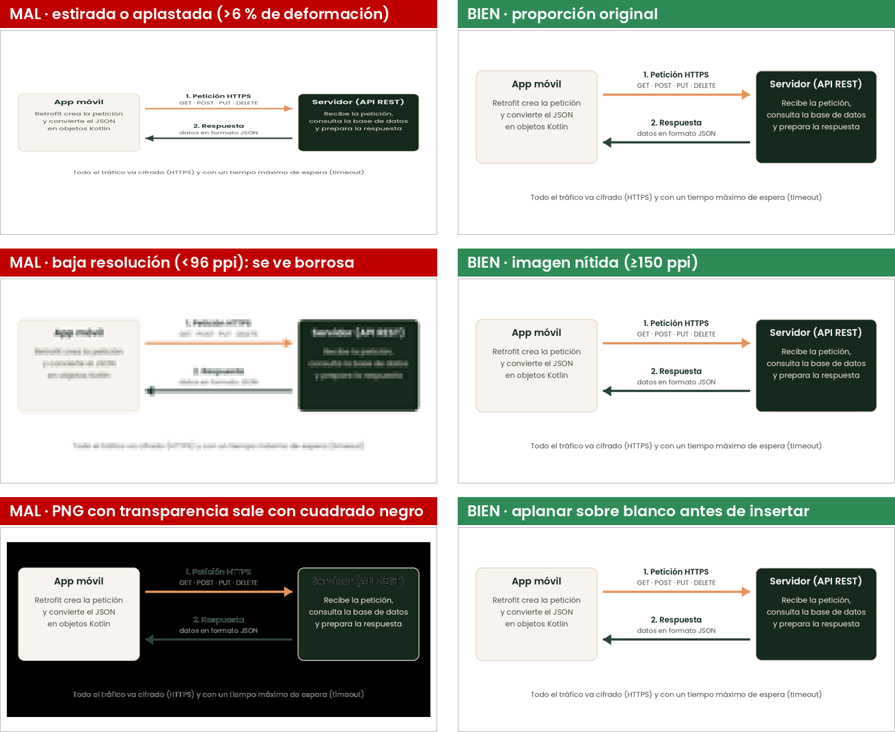

*Figura 4.1. Tres fallos clásicos (izquierda) y cómo deben verse (derecha): deformada, baja resolución y transparencia sobre fondo oscuro.*

## 4.2 Colocación

### En diapositivas

| Situación | Regla |
|---|---|
| Imagen suelta de contenido | Dentro de la tarjeta, escalada con `min(ancho_caja / ancho, alto_caja / alto)` y **centrada** |
| Galería | 3 marcos de **193 × 176,4 pt**, pie de foto debajo (Poppins Medium 12,5 pt) |
| Ejemplo visual | Panel de **327,6 × 405 pt** a sangre, a la izquierda; texto a la derecha desde x = 367,2 pt |
| Con texto del mismo bloque | **Junto a su texto**: no se separa en una galería aparte |
| Hueco ocupado | Se calcula su caja y se comprueba que **no solapa** ninguna otra forma. Si no hay hueco limpio, se marca para colocación manual |

Detalle completo en [02_presentaciones](#26-imágenes-en-diapositivas).

### En documentos PDF

| Motor | Imagen | Pie | Límite |
|---|---|---|---|
| `plantilla_documento.py` | Centrada, `break-inside: avoid`, máx. **150 mm** de alto y 100 % de ancho (80 % con la clase `s`); solo por API: `("img", ruta, pie[, "s"])` | Poppins 400, 8 pt, color `mid`, debajo | No procesa `![…]` desde Markdown |
| `renderizar_pdf_unidad.py` | Figura al 100 % del ancho; esquinas 2 px; no se parte | 10 px cursiva `#666`; el pie sale del texto alternativo | **Solo carga rutas que empiecen por `Imágenes/`** |
| `docx_a_pdf_marca.py` | — | — | **Las imágenes del `.docx` no se pasan** |

### Al decidir con un `.md` de temario

- La ruta es ``; carpeta de imágenes con los nombres exactos.
- Si la imagen aún no existe, se deja un **marcador**: `[CAPTURA: …]`, `[ESQUEMA: …]`, `[DIAGRAMA: …]` o `[TABLA/GRÁFICO: …]` en un párrafo propio. Se pinta en **rojo `#C00000`, negrita** (el naranja `#C0532A` queda solo para notas editoriales del estilo oro).

## 4.3 Transparencias y fondos

- **Problema:** un PNG con transparencia se pinta con un cuadrado negro si el motor pierde la máscara alfa; en 13 presentaciones auditadas hubo cuadrados negros y páginas negras.
- **Prevención:** al preparar una imagen, `RGBA`/`LA`/`P` → PNG (conserva la transparencia) y el resto → **JPEG calidad 86**, **máx. 1 500 px**.
- **Comprobación:** renderizar y mirar. Una página negra solo es válida si es una fotografía o radiografía oscura.

## 4.4 Reescalado y calidad

| Caso | Qué se hace |
|---|---|
| Imagen del PDF/Word original disponible | Se usa el **original** (nunca una captura) |
| Foto pobre sin original | Reescalado 4× con **Magnific** (`ultra-sublime`, ~216 créditos por imagen, a veces bloquea alguna) |
| **Imagen con rótulos o etiquetas** | **NO** se usa Magnific: altera el texto («Pericardio» → «Perkardio»; etiquetas diminutas → pseudotexto). Se **borran los rótulos y se reescriben con texto nativo**, o se recorta la zona sin etiquetas |
| Profesor que no reenviará mejor calidad | Se conserva tal cual y se avisa |
| Imagen vectorial WMF/EMF que no abre | Se convierte con `soffice --convert-to png` antes de colocarla |
| Pptx de 16–24 MB que la plataforma no acepta | PNG > 60 KB → JPG al 84 %, máx. 1 600 px (si falla, 1 200 px); 19,6 → 4,6 MB en un caso real |

## 4.5 Qué se comprueba automáticamente

| Comprobación | Herramienta y umbral |
|---|---|
| Proporción | PyMuPDF `get_image_info`; **deformada > 6 %** |
| Resolución | ppi = px / ancho en pulgadas; **baja < 96 ppi** |
| Imágenes decorativas contadas como contenido (logo, banda) | Mismo `xref` en ≥ 25 % de las páginas (n ≥ 8) |
| Fotos que faltan tras reconstruir | `comprobar_fotos.py`: hash perceptual 8 × 8 sobre imágenes de ≥ 3 % de la página; contar y comparar (p. ej. 23/23) |
| Colores de las figuras | No se recolorean figuras ajenas sin pedirlo (se avisa) |

Estadística real: en 59 presentaciones auditadas, 15 tenían imágenes deformadas o de baja resolución (hasta un 47 % de deformación en un banner).

## 4.6 Casos reales: imagen que no explica el tema

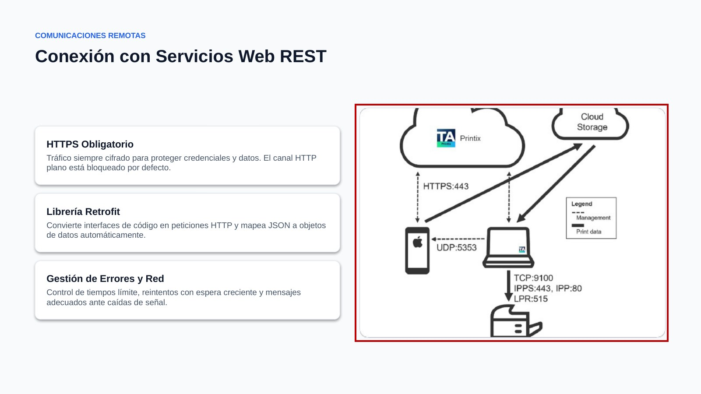

*Figura 4.2. Un esquema de impresión recortado en una diapositiva sobre servicios REST.*

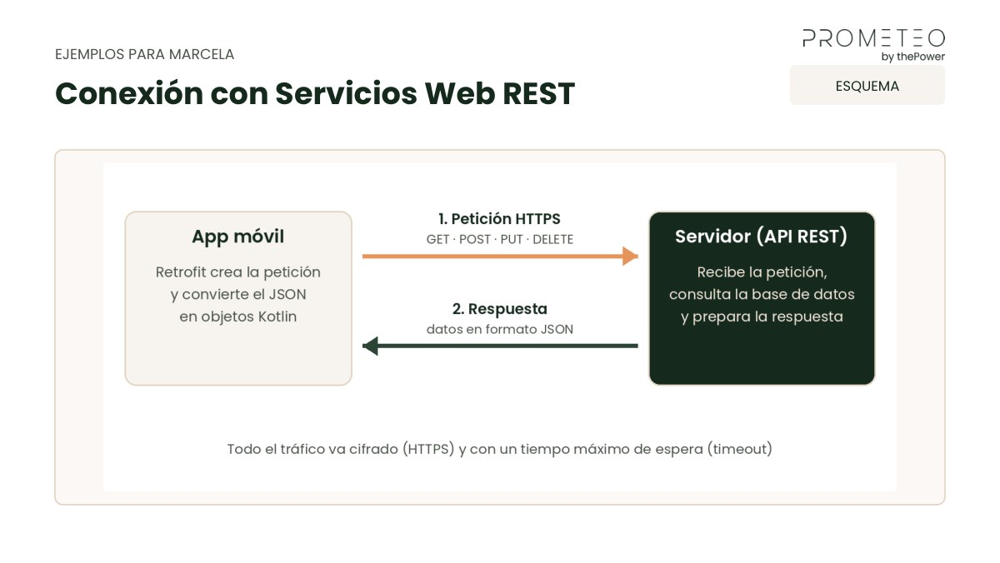

*Figura 4.3. El mismo hueco con un esquema propio (cliente, petición HTTPS, servidor, respuesta JSON), con formas nativas y texto real.*

## 4.7 Capturas y esquemas dibujados (skills `capturas-prometeo` y `capturas-sanipro`)

Cuando un temario tiene un marcador `[CAPTURA: …]`, `[ESQUEMA: …]` o `[DIAGRAMA: …]`, una skill lo convierte en un **PNG dibujado a 2×** con HTML y CSS (no es una captura real ni una foto).

| | `capturas-prometeo` | `capturas-sanipro` |
|---|---|---|
| Qué dibuja | Pantallas de aplicaciones informáticas: consola, Visor de eventos, explorador de archivos, navegador, editor de código o configuración, panel de métricas, analizador de tráfico, menú de arranque GRUB/UEFI, diálogos y asistentes, gestor de bases de datos, topología de red, rejillas de datos | Figuras sanitarias **planas**: recuadros de definición, grupos de constantes o conceptos (un color por ítem), mecanismos con flechas, silueta con puntos numerados, escalas de valores, tablas de datos |
| Lo que **no** hace | — | **No** redibuja ilustraciones anatómicas complejas (cortes de órganos, sistemas con etiquetas internas, vistas sagitales, fotos de dispositivos): se deja la imagen original del profesor |
| Paleta | `#152A1D` verde · `#E6945A` terracota · `#CBDECF` verde de tabla · crema `#F3F0EA` · línea `#B9B9B4` | `#245578` · `#336D93` · acento `#8BD2E5` (nunca como único color de texto) · tabla `#CFE7EF` · suave `#EAF5F9` |
| Ancho | 1 200 px (por defecto) | 1 000 px |

Reglas comunes (obligatorias):

1. **Nada inventado:** se dibuja solo lo que nombra el marcador o dice el material del profesor. Si falta un dato, se deja una **barra gris** (`.gris`).
2. **Que no parezca hecho con IA:** sin texto de relleno ilegible, sin palabras inventadas, **sin degradados, sin sombras, sin esquinas redondeadas y sin emojis**. El CSS lo fuerza (`border-radius: 0 !important; box-shadow: none !important`).
3. **El texto cabe y se lee:** ninguna etiqueta sale de su caja ni pisa otra.
4. **Iconos:** solo SVG de línea (`stroke-width: 1.5`, sin relleno), `#152A1D` (o blanco sobre oscuro). En topologías, rectángulos y texto: nada de iconos de banco de imágenes.
5. **Sin pie** en el PNG cuando el temario lo pone aparte (`--sin-pie`), para que no salga duplicado.
6. **Nombre del archivo:** `CÓDIGO-Uxx-TIPOnn.png` (p. ej. `0369-U04-CAP01.png`).
7. **Comprobación humana:** abrir el PNG y verificar que no hay texto fuera de caja, etiquetas pisadas, saltos de código perdidos ni demasiado hueco. El render falla automáticamente si el PNG pesa menos de 5 000 bytes o sale en blanco.

## 4.8 Esquemas y diagramas en las diapositivas

- Se hacen con **formas nativas** (cajas y flechas) y texto real, no con una imagen con rótulos.
- Una sola idea y un solo acento por rol: no cada esquema en un color distinto ni avisos en rojo.
- Texto dentro de las cajas, sin tocar los bordes; los números de paso en círculos de acento.
- Como regla de composición, que la forma exprese el orden (flechas, numeración), no solo el texto.


*Figura 4.4. Buen ejemplo: orden en la propia forma (flechas), un color por fase y tarjetas con nombre y frase corta.*


*Figura 4.5. Buen ejemplo: una regla («no hagas tareas pesadas en el hilo de la interfaz») convertida en algo que se ve. Con la letra más grande (véase el [catálogo](#08-catálogo-de-problemas-de-maquetación-y-casos-visuales)) sería perfecto.*

---

# 05 · Tablas

> Cómo deben ser las tablas en presentaciones y en documentos: colores por marca, cabecera, bordes, filas alternas, primera columna, partición entre páginas, tamaño de letra y errores frecuentes.

## 5.1 Reglas generales

1. **Tabla nativa, nunca imagen.** Una tabla pegada como imagen pierde nitidez, tiene la letra pequeña y no se puede editar.
2. **Colores de la marca.** Cabecera oscura (`dark`) con texto blanco; filas alternas con el color «cebra» o crema de la marca; bordes en el color de línea. **Jamás** los estilos por defecto de PowerPoint (lilas y azules) ni verdes, amarillos o azules ajenos a la marca.
3. **Cabecera clara**: una fila de cabecera siempre; en documentos largos la cabecera **se repite en cada página**.
4. **Primera columna en negrita** (peso 600) y color `dark`, salvo que la tabla tenga una sola columna.
5. **Dentro de su recuadro.** La tabla no se sale de la tarjeta ni roza el borde; el texto de cada celda cabe y se ajusta a su contenido.
6. **Letra legible**: en diapositivas **≥ 11 pt**; en documentos 8,8–10,5 pt según el motor. Si es muy densa, se **divide en dos** repitiendo la cabecera.
7. **Una idea por tabla.** Un cuadro comparativo, no un volcado de datos.
8. **Ninguna fila se parte** entre páginas (en documentos) y ninguna celda queda vacía sin motivo (si falta un dato se avisa; no se inventa).

## 5.2 Tabla frente a tabla: valores por motor

| Aspecto | Presentaciones (plantilla) | Documento de apoyo | Anexo Word → PDF | Temario Prometeo (unidad) |
|---|---|---|---|---|
| Letra | **≥ 11 pt** (ideal 11–12) | 8,8 pt, interlineado 1,45 | 9 pt, interlineado 1,4 | 10,5 px |
| Cabecera | Fondo `dark`, texto blanco | Fondo `dark`, texto blanco, 600, alineada a la izquierda | Fondo `dark`, texto blanco | **Verde claro `#CBDECF`**, negrita centrada |
| Primera columna | Color medio de la marca (`mid`) en Prometeo | 600, color `dark`, ancho mínimo 26 mm | 600, color `dark` | Sin negrita especial |
| Filas | Alternas `card`/`zebra` | Pares en `zebra` | Cebra | Sin cebra |
| Bordes | Color `line` | 0,6 pt `line`; contorno 0,7 pt, radio 2 mm | 0,6 pt `line` | **`1px solid #152A1D`** |
| Relleno de celda | Izq/der 7,2 pt · sup/inf 3,6 pt | 2,1 × 2,8 mm | — | 6 × 8 px |
| Cabecera repetida | n/a | **Sí** (`thead` repite) | **Sí** | No |
| Partición entre páginas | n/a | La fila no se parte (`tr` sin cortar), la tabla sí | La tabla puede partirse | **No se parte** (la tabla entera, o no cabe) |
| Pie/título | Opcional | `caption` solo por API (600, 9 pt, `mid`) | — | Marcador `[TABLA/GRÁFICO: …]` antes → pie en cursiva |
| Una sola columna | — | La primera columna en peso normal (clase `uno`) | — | — |

### Colores de tabla en presentaciones por marca

| Marca | Cabecera | 1.ª columna | Filas | Línea |
|---|---|---|---|---|
| Prometeo | `152A1D` (texto blanco) | `2C4436` | `F7F3EE` / `FBF8F5` | `F3E6DA` |
| Sanipro | `245578` (texto blanco) | `336D93` (tono medio) | `F4FAFC` (alternas) | `CFE7EF` |
| Edentia | `152932` (texto blanco) | `2C4954` | `EDF3F0` / `F6FAF8` | `C7D8D1` |

*(Prometeo y Sanipro están documentados en las incidencias reales; Edentia se deduce por analogía con la paleta oficial.)*

## 5.3 Medidas de una tabla en diapositiva

- Posición: x = **39,6 pt** y ancho **640,8 pt** (la anchura de la tarjeta), dentro de la tarjeta de contenido.
- Filas de **≈ 23,6 pt** (300 000 EMU); alto total máximo = alto de la tarjeta (255,6 pt).
- Margen de celda: **izquierda/derecha 7,2 pt**, **superior/inferior 3,6 pt**.
- Anchos de columna proporcionales a `longitud^0,7` del contenido (con un factor 1,6), para que las columnas con más texto no se aprieten.
- **Una sola tabla por diapositiva** en el motor de reconstrucción (si el origen trae más, otra vía).
- División: si la tabla no cabe a ≥ 11 pt, se parte por la mitad (`filas // 2 + 1`), repitiendo la cabecera y usando 10,5 pt como mínimo de último recurso.

## 5.4 Errores reales

### Tablas con colores ajenos a la marca

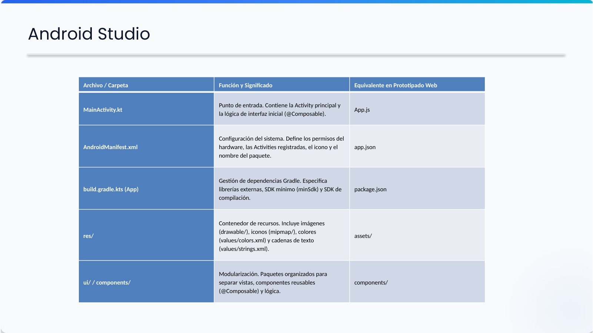

*Figura 5.1. Una tabla con el azul por defecto del programa dentro de una presentación de Prometeo.*

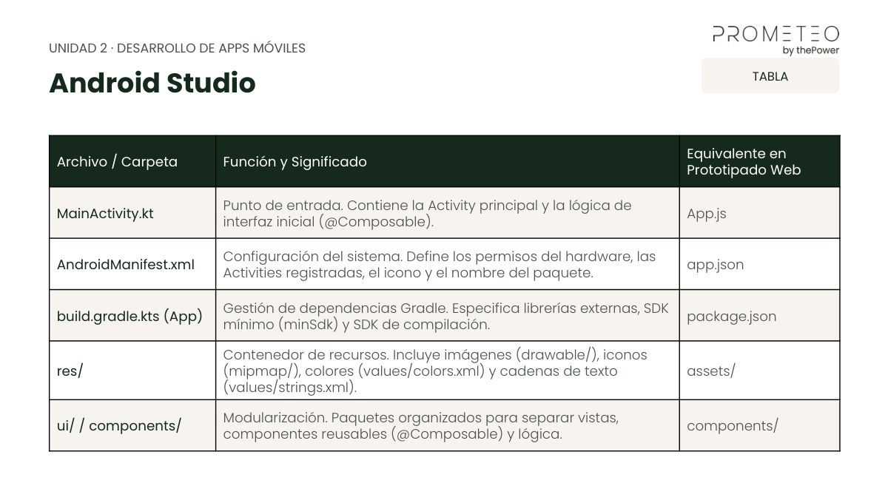

*Figura 5.2. La misma tabla con cabecera `152A1D`, primera columna en tono medio y filas crema.*

| Error | Causa | Detección | Corrección |
|---|---|---|---|
| Tablas con estilo por defecto (lilas, azules); cuadros con borde azul | Estilo de tabla por defecto | Extraer con python-pptx el color de celdas y bordes | Recolorear por rol a la paleta de la marca |
| Tabla que se sale del recuadro o roza el borde | Tabla o imagen sin ajustar | Render y cálculo de la caja | Tabla nativa dentro de la tarjeta |
| Tabla muy densa (9–10 pt) | Demasiado contenido | Tamaño medio < 11 pt | Dividir en dos o subir a 11–12 pt |
| Varias tablas por diapositiva; solo se conserva una | Límite del motor de reconstrucción | Contar las tablas del origen | Rehacer como documento o a mano |
| **Tabla vacía en el PDF** | Formas blancas con animación de salida que la ocultan hasta el clic; el PDF no ejecuta animaciones | Buscar formas con animación `exit` sobre tablas | Entregar el `.pptx` (la plataforma acepta animaciones) o quitar las «tapaderas» |
| Tablas pegadas como imagen, con tipografía serif | Pegado desde el chat o la web | Revisión | Transcribir a tabla nativa y avisar de que se leyó de una imagen |
| Título de tabla o etiqueta añadida por el maquetador | Decisión propia | — | Comunicarlo como «decisión a revisar» |
| Tabla repetida idéntica en dos diapositivas seguidas | Copia del autor | Comparar texto | No se borra sin permiso: se avisa |

### Una columna con comentarios para el profesor

Una tabla con una columna llamada «Justificación en el Material» (frases como «Indicado como un pilar central para el perfil de DAM») mezcla notas internas con contenido para el alumnado. Regla: **las columnas de una tabla hablan al alumnado**; se reescribe con «Por qué lo usamos».

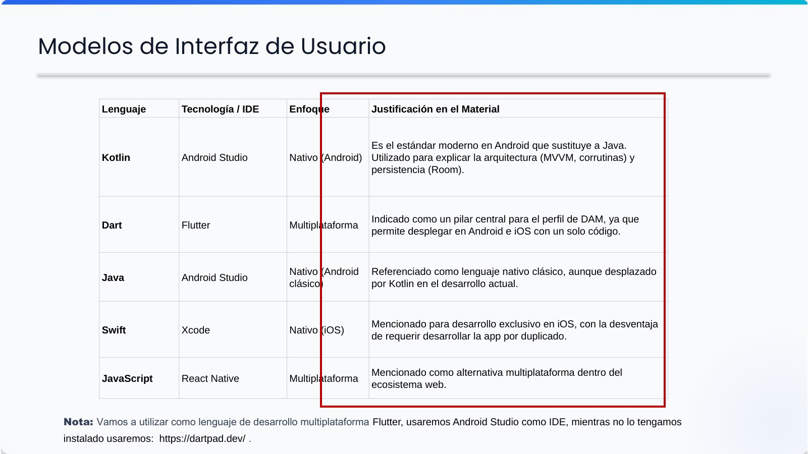

*Figura 5.3. Columna «Justificación en el Material».*

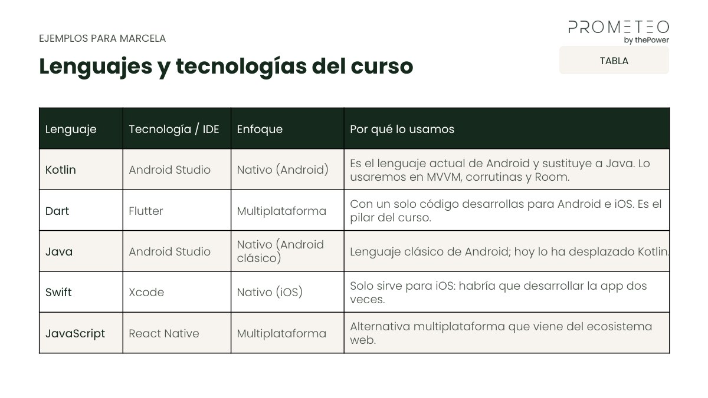

*Figura 5.4. Misma tabla con la columna «Por qué lo usamos».*

---

# 06 · Markdown fuente, texto, listas, código, cuadros, test y estilo «oro»

> Cómo se escribe el material de origen (Markdown), cómo se maqueta el texto corrido, las listas, el código, los cuadros destacados, las fórmulas y los tests, y las normas del estilo «oro» de los `.docx` de Prometeo. Datos verificados contra el corpus real (1 160 unidades `.md` de Prometeo y 51 de Edentia, censo del 21-oct-2026).

## 6.1 Las dos familias de Markdown de unidad

| Familia | Dónde | Estructura |
|---|---|---|
| **Prometeo** (canónica) | Corpus de unidades de Prometeo (1 160 unidades) | `# Unidad N: …` + Objetivos + Introducción + secciones + cierre (Mini proyecto, Ejercicio, Resumen profesionalizante) |
| **Edentia** (Higiene bucodental) | Corpus de unidades de Edentia (51 unidades) | `# Unidad N: …` + párrafo de apertura + `# N. Sección` / `## N.N.` y un rótulo `####` sobre cada tabla. **Sin** Objetivos, Introducción, Mini proyecto, Ejercicio ni Resumen |
| **Sanipro** | — | **No consta** ningún `.md` de Sanipro en el corpus (solo paleta, plantillas y tests) |

### Estructura obligatoria del `.md` de una unidad (Prometeo)

```markdown
# Unidad N: Título
# Objetivos de la unidad
**Al finalizar esta unidad, serás capaz de:**
- (viñetas; nunca numeradas)
# Introducción
**Preguntas para reflexionar:**
- …
(párrafos)
# 1. Apartado
## 1.1. Subapartado
# Mini proyecto guiado
# Ejercicio
# Resumen profesionalizante
```

Frecuencia de los `#` en las 1 160 unidades: `# Unidad N:` 1 160 · `# Objetivos de la unidad` 1 160 · `# Introducción` 1 160 · `# Resumen profesionalizante` 1 160 · `# Ejercicio` 1 135 · `# Mini proyecto guiado` 1 071 · `# Ampliación y actualización` 381 · `# Tendencias y actualización` 53 · `# Ejercicios prácticos` 11 · `# Test de autoevaluación` 10 · `# Test` 1.

Reglas observadas:

1. **Secciones numeradas con H1** (`# 1. Título`) y **subsecciones con H2** (`## 1.1. Título`), con numeración manual y punto final.
2. Objetivos, Introducción y los cierres son H1 **sin número**.
3. La norma dice «máximo dos niveles, nunca `###`»; el corpus tiene `###`/`####` en 41 unidades de Prometeo y en 43 de las 51 de Edentia (como rótulo de tabla).
4. «Unidad» o «Tema»: **«Unidad»** salvo que el material original use «Tema» (véase [07](#07-portadas-numeración-nombres-de-archivo-y-entrega)).
5. **No hay frontmatter** en ningún `.md` de unidad (0 de 1 160; 0 de 51). Los datos de módulo se leen de un `meta.json` aparte.

## 6.2 Texto corrido y listas

| Elemento | Convención | Notas |
|---|---|---|
| Énfasis | `**negrita**` para el término clave la **primera vez**; `*cursiva*` para extranjerismos y latinismos | Sin subrayado, sin color ni resaltador |
| Cabeceras fijas | `**Al finalizar esta unidad, serás capaz de:**` y `**Preguntas para reflexionar:**` | Líneas literales en negrita |
| Viñetas | `- texto`. En 313 unidades de Prometeo (y 49 de 51 de Edentia) van **separadas por una línea en blanco** (lista «suelta») | El maquetador debe tratar igual la lista pegada que la suelta |
| Numeradas | `1. texto`. **Cada lista reinicia en 1** | Regla explícita de la leyenda de formato y del motor oro |
| Mini proyecto | `- **Paso 1: Verbo…** texto` y una última línea `Entregable: …` | |
| Resumen | `Con este conocimiento, ahora estás preparado para:` + 8–10 viñetas en infinitivo | |
| Ejercicio | Enunciado + `Requisitos:` + 4–6 viñetas | |
| Enlaces | `[texto](url)`: solo 2 unidades de Prometeo | El renderizador de Layout Studio del repositorio público no los soportaba en origen; después se añadió soporte de hipervínculos |
| Fórmulas | **No se usan LaTeX** (0 en 1 160): van en prosa con `×`, `−`, `%` y negrita, o entre comillas invertidas | |
| Líneas en blanco | 536 unidades tienen 3 o más seguidas | Deben colapsarse a una |
| Regla horizontal | `---` solo como separador | En ningún caso como cabecera de metadatos |

Para el texto y las listas **de las diapositivas** véase [02](#24-tamaños-de-letra): viñetas nativas, énfasis en negrita, frases ≤ 20 palabras, escribir al alumnado.

## 6.3 Bloques de código

### Norma de código (decidida el 21-oct-2026): estilo **Ayu Mirage** con botón de copiar en las salidas web

| Aspecto | Valor |
|---|---|
| **Estilo** | **Ayu Mirage** en **todos** los formatos: bloque de fondo oscuro `#1F2430`, esquinas suaves (radio 7 px) y sombra ligera |
| Texto base | `#CBCCC6` |
| Colores de sintaxis | Palabras clave `#FFA759` · tipos, funciones, atributos y etiquetas `#FFD580` · cadenas `#BAE67E` · escapes `#95E6CB` · números, constantes y operadores `#FFCC66` · comentarios `#5C6773` **en cursiva** · error `#FF3333` |
| Etiqueta del lenguaje | Arriba, en mayúsculas (`KOTLIN`, `XML`…): amarillo `#FFCC66`, Poppins 600, 10,5 px, `letter-spacing` 0,09 em (en diapositivas: `#5C6773`, 8 pt, a la derecha) |
| Tipografía | `JetBrains Mono` (web y PDF), `Consolas` o `Courier New` (Word y diapositivas); 8,4–13 pt según el formato |
| **Botón «Copiar»** | **Solo en las salidas web** (HTML de la plataforma y vista web de Layout Studio): arriba a la derecha del bloque, con icono de portapapeles y la etiqueta «Copiar»; al pulsar copia **todo el código** y pasa a «¡Copiado!» durante 1,6 s |
| **PDF, Word y diapositivas** | **No admiten un botón funcional de copiar** (los visores de PDF de los navegadores no ejecutan scripts y los programas de Office no tienen portapapeles programable). Se garantiza en cambio que el código es **texto real, seleccionable y con espacios normales** (nunca espacios duros ni imagen), de modo que al copiarlo y pegarlo en un editor **sigue siendo código válido** |
| Completo | Con sus etiquetas de apertura y cierre (XML/HTML), con sangría real y **sin captura de pantalla** |
| Sin lenguaje | Si se desconoce, la etiqueta pone «CÓDIGO» y el texto sale sin colores de sintaxis |

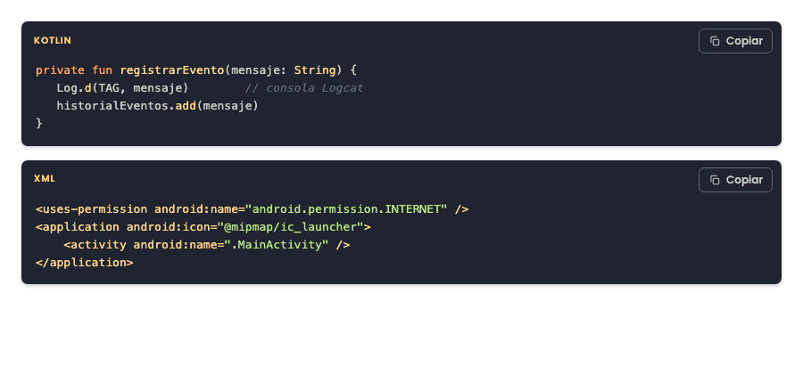

*Figura 6.1. Componente web: etiqueta del lenguaje, botón «Copiar» y colores Ayu Mirage (Kotlin y XML).*

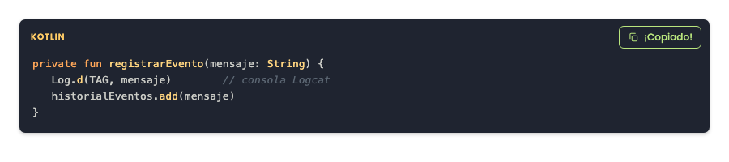

*Figura 6.2. Estado del botón después de pulsar.*

**Componente de referencia (HTML autocontenido, sin dependencias):** `layout_studio/componentes/bloque_codigo_ayu_mirage.html`. Se genera con `layout_studio/componentes/codigo_ayu.py` (`bloque_codigo(codigo, "kotlin")` devuelve el bloque; el botón usa `navigator.clipboard` y, si el navegador lo bloquea, un método alternativo con `execCommand('copy')`; es un `<button>` accesible con foco visible). Pensado para el editor HTML de la plataforma y para que Layout Studio lo incorpore a una salida web.

**Qué es posible en PDF y qué no.** Un botón verdaderamente funcional en un PDF solo existe en Adobe Acrobat/Reader (mediante un campo de formulario con JavaScript); **no funciona en Chrome, Edge, Safari ni en las vistas previas de la plataforma**. Por eso la norma no lo exige en PDF. Si hiciera falta en un material concreto, la alternativa es un **enlace junto al bloque** («Copiar el código») que abra la versión web del mismo bloque, donde sí está el botón.

### Resto de normas de código

| Aspecto | Valor |
|---|---|
| Sintaxis en el `.md` | Vallas ` ``` ` con el lenguaje (` ```bash `). En el corpus: `java` 657 · `bash` 273 · `js` 247 · `sql` 190 · `php` 179 · `html` 56 · `css` 42 · `xml` 35 · `powershell` 27 · `javascript` 26 · `yaml` 24. **Muchas vallas no llevan lenguaje**: la herramienta debe adivinarlo o pedirlo |
| Código en línea | Comillas invertidas simples; fondo `#F2F3F5` y texto `#1A1A1A` (o `#C7254E` en la leyenda de Prometeo) |
| **Trampa** | Dentro de una valla puede haber líneas que empiezan por `# ` (comentarios de Bash) o `$$` (SQL). **Un analizador que busque encabezados antes que vallas rompe la unidad**; hay que procesar las vallas primero |
| Diapositivas | Bloque monoespaciado **≥ 10 pt** (ideal 11–13), completo y con sangría (véase [02](#28-código-y-esquemas)) |
| Word | Párrafos con estilo `Código` y sombreado `#1F2430` (véase [11](#115-código-en-word)) |
| Código del estilo «oro» (`.docx` de temario) | Hoy: Consolas 10 pt, `#1A1A1A` sobre `#F2F3F5`, sin resaltado. **Debe pasar a Ayu Mirage** |

### Estado actual de los motores (qué cambia con la norma)

| Motor | Hoy | Con la norma Ayu Mirage |
|---|---|---|
| `renderizar_pdf_unidad.py` (temario Prometeo) | Fondo `#F5F5F5`, borde izquierdo `#888`, JetBrains Mono 9,5 px, sin resaltado | **Cambio pendiente** (el bloque `pre` y el resaltado con Pygments) |
| `plantilla_documento.py` (documento de apoyo) | Fondo `#F2F3F5`, borde izquierdo de acento, Menlo/Consolas 8,4 pt, sin resaltado | **Cambio pendiente**; ya admite el bloque `code` por API |
| `docx_marca.py` (Word) | **Ya en Ayu Mirage** | — |
| Diapositivas (constructor interno de diapositivas) | **Ya en Ayu Mirage** | — |
| Skill `maquetar-prometeo` (no oficial) | Ya en Ayu Mirage (Pygments) | Fuente del estilo |

## 6.4 Cuadros destacados (callouts)

La norma es **parca**: solo llevan caja **Objetivos** e **Introducción/Preguntas**. El resto son párrafos con una etiqueta inicial en negrita.

| Pieza | En el `.md` | Cómo se pinta |
|---|---|---|
| Objetivos | `# Objetivos de la unidad` + línea en negrita + viñetas | Caja crema `#FEFAF3`, borde izquierdo terracota 4 px, etiqueta «RESULTADOS DE APRENDIZAJE» |
| Introducción | `# Introducción` + `**Preguntas para reflexionar:**` | Misma caja, etiqueta «ACTIVACIÓN Y REFLEXIÓN»; la foto de portada va dentro, al final |
| Avisos, notas, «Importante» | Texto normal con etiqueta inicial en negrita: `**Importante.**` | Etiqueta de color, **sin caja** |
| Idea clave en documentos de apoyo | `> Idea clave: …` | Cuadro con barra lateral oscura (`plantilla_documento.py`) |
| «Copy to Claude» (Layout Studio) | `> **Etiqueta** ```` + valla | Caja etiquetada con el prompt literal |

Etiquetas de color en la skill `maquetar-prometeo`: `**Importante.**` en verde; `**Conclusión.**`, `**Nota.**` y `**Aviso.**` en terracota.

## 6.5 Test y soluciones

### Dentro del `.md` (antiguo; solo algunos módulos)

El test **ya no va en el `.md`** de la unidad: va aparte, en un `.xlsx` (6.7). Cuando aparece (10 unidades de Gestión Administrativa):

- Formato canónico (fijado el 16-ago): `**1. Enunciado completo en negrita**` seguido de las opciones **`a) …` `b) …` sin viñeta, cada una en un párrafo aparte**.
- Formatos antiguos que no valen: `**1.** enunciado` (solo el número en negrita) y `1. pregunta` con sublista `- A) …`.
- En el `.docx` oro: enunciado en negrita negra sin sangría; opciones `a) b) c) d)` normales, sin viñeta, sangría izquierda 0,63 cm.
- Solucionario: `# Soluciones — Unidad N: <título>` + `**1. Respuesta correcta: c) texto.**` + un párrafo de 50–90 palabras; en carpeta `Soluciones/` aparte.

### Quiz en Layout Studio

`**1.** ¿Pregunta?` seguido de una lista `- a) … - b) … - c) …` se colapsa en un bloque de quiz. **Desajuste con el corpus:** el corpus usa `**1. …**` + `a)` en párrafos, o `1. …` + `- A)`.

## 6.6 Marcadores de imagen y nombres de figura

Véase [04_imagenes](#42-colocación). Resumen: `` en línea propia; el texto alternativo es el pie. Nombres Prometeo `<CÓDIGO>-U<NN>-<TIPO><nn>.<ext>` con TIPO ∈ {ESQ, DIA, TAB, CAP, GRA, FOT}; Edentia `THB-L<n>-U<NN>-IMG<nn>.png`. Los marcadores `[CAPTURA/ESQUEMA/DIAGRAMA/TABLA…]` sin resolver se pintan en **rojo `#C00000`, negrita**; hoy no queda ninguno sin resolver en el corpus.

## 6.7 Tests `.xlsx` (Edentia, Sanipro; mismo modelo que Prometeo)

| Aspecto | Valor |
|---|---|
| Hoja | **Una sola**, llamada `Test_FP` (`A1:J91`) |
| Columnas (en este orden) | `Id` · `Question` · `Answer 1` · `Answer 2` · `Answer 3` · `Answer 4` · `Correct Answer` · `Answer Explain` · `UD` · `@` |
| Filas | 1 cabecera + **90 preguntas** (Id correlativo desde 1) |
| `Correct Answer` | El **texto idéntico** de una de las 4 respuestas (no la letra) |
| `UD` | Nº de unidad del libro de la que sale |
| `@` | Columna vacía (compatibilidad) |
| Formato de celda | **Ninguno**: sin negrita, relleno, anchos, ajuste de texto ni panel inmovilizado |
| Reparto | 4 unidades → 23·23·22·22 · 5 → 18 · 6 → 15 · 7 → 13×6 + 12 · 8 → 12·12·11×6 · 10 → 9 |
| Respuesta correcta | Repartida pareja entre las 4 posiciones (22–23 cada una), sin rachas de más de 2, y **no siempre la más larga** (objetivo ≤ 35 de 90) |
| `Answer Explain` | 480–655 caracteres; razona cada opción con «La primera/segunda/tercera/cuarta opción…» según la posición final y termina en `(UDn)`. Se **genera**, no se escribe a mano |
| Opciones | ±20 caracteres entre sí, 25–110 caracteres, paralelismo gramatical, sin «todas/ninguna de las anteriores» |
| Contenido | ≈ 50 % definiciones y ≈ 50 % casos prácticos; distractores = conceptos vecinos de la misma unidad |
| Fuente | **Todo sale del libro** de la asignatura. Hoja de fuentes aparte: carpeta `_FUENTES/<asignatura> - fuentes.xlsx` con hoja `Fuentes` (`Id · UD · Pregunta · Respuesta correcta · Páginas del libro · Cobertura de palabras · Revisar a mano`); cobertura < 0,75 → revisión manual |

## 6.8 Estilo «oro» de los `.docx` de Prometeo

Para temarios, MARCO NORMATIVO e ÍNDICE del profesor (motor `goldgen.py`, python-pptx/python-docx). **Es otro sistema distinto de los PDF Poppins**: no mezclar.

| Elemento | Valor |
|---|---|
| Página | **Carta/Letter 21,59 × 27,94 cm** (no A4); márgenes **2,54 cm** en los 4 lados |
| Cuerpo | Arial **12 pt**, negro `#000000`, justificado, interlineado sencillo, 0 pt antes / 6 pt después |
| Título | Arial 20 pt negrita, negro, centrado, 0/3 pt; formato directo (no estilo «Título») |
| Subtítulos | Arial 11 pt cursiva gris `#404040`, centrados (2 líneas: módulo y ciclo) |
| Caja azul (BOE, «→ Cubre:», «Fuente normativa:») | Párrafo con fondo `#EAF1FB`, texto `#2E75B6` cursiva 11 pt, sangría izquierda y derecha 6 pt, 8 pt antes y después |
| Nota editorial | «Nota editorial:» en negrita cursiva + texto en cursiva `#C0532A`, 12 pt, justificada, sin fondo; va **entre las dos cajas azules** |
| H1 | Arial 16 pt negrita (no cursiva), `#1F4E79`, 14 pt antes / 7 pt después |
| H2 | Arial 13 pt negrita, `#2E75B6`, 10 pt antes / 4,5 pt después |
| Marcadores de imagen | Arial 12 pt **negrita rojo `#C00000`** (no naranja); el naranja `#C0532A` es solo para la nota editorial |
| Código | Cada línea un párrafo; fondo `#F2F3F5`, Consolas 10 pt, `#1A1A1A`, sangría 6 pt, sin resaltado |
| Resumen | «Con este conocimiento…» en negrita 12 pt sobre banda `#EAF1FB`, sangría 6 pt, seguida de viñetas |
| Listas | Viñeta «•»: sangría 0,95 cm, francesa 0,53 cm, 3 pt después. Numeradas «1.» con la misma sangría; **cada lista nueva reinicia en 1** |
| Tablas (marco normativo e índice) | Borde `#CCCCCC` 0,5 pt; cabecera relleno `#D6E4F5` negrita 11 pt; fila TOTAL `#EAF1FB` negrita; celdas 11 pt; tabla centrada; enlaces `#1155CC` subrayado |
| Índice del profesor | `index_tema` negrita negra 12 pt (sangría 0,5 cm); `index_subtema` gris `#404040` 11,5 pt (sangría 1,3 cm) |

Paleta oro: cuerpo/título `#000000` · subtítulos `#404040` · H1 `#1F4E79` · H2 y texto de caja azul `#2E75B6` · fondo de caja y fila TOTAL `#EAF1FB` · cabecera de tabla `#D6E4F5` · nota editorial `#C0532A` · marcadores `#C00000` · código `#1A1A1A` sobre `#F2F3F5` · enlaces `#1155CC` · borde de tabla `#CCCCCC`.

Reglas de contenido del estilo oro: las cajas azules llevan «→ Cubre:» y «Fuente normativa:»; **«cubre» describe temas, nunca resultados de aprendizaje**; todo para la Comunidad de Madrid; el docx de unidad **convierte las tablas en marcador + prosa** (decisión del motor), solo las del marco normativo y el índice se pintan; salida a `./salida/` y validación con `validate.py` + render con `soffice` + `pdftoppm`.

### Tres hojas de estilo de Prometeo (no confundir)

| Documento | Página | Texto | Código |
|---|---|---|---|
| **Oro** (`goldgen.py`) | Letter, 2,54 cm | Arial 12; H1 16 `#1F4E79`; H2 13 `#2E75B6` | Consolas 10 |
| **Leyenda de formato** (mayo; destino Google Docs/InDesign) | A4, 1 pulgada | Arial 11; título 28; H1 18; H2 14 (todo negrita negro) | JetBrains Mono 10 sobre `#F5F5F5` con borde izquierdo `#888888` y colores IntelliJ Light |
| **PDF de unidad** (motor oficial) | A4; 2,2/3,1/2,2/2 cm | Poppins Light 11,5 px, justificado | JetBrains Mono 9,5 px, claro |

> **No consta** cuál de las tres prevalece para el caso «docx de temario». El estilo oro declara ser el canónico; el formato de test confirma que «manda `CLAUDE.md`» en tipografía.

## 6.9 Problemas típicos del Markdown de origen y su normalización

| Problema | Evidencia | Normalización conocida |
|---|---|---|
| El **formato nace en el `.docx`**, no en el `.md`; el volcado a texto plano pierde la negrita del enunciado del test | 810 documentos corregidos el 16-ago | Medir siempre en el `.docx`; reaplicar `**N. Enunciado**` tras regenerar |
| **Tablas perdidas** en el `.md` que existían en el `.docx` | script `repone_tablas.py` | Se reponen usando el docx como oráculo del orden; si el ancla no aparece, no se pone y se anota |
| **Vallas ``` perdidas** (órdenes de consola convertidas en prosa; 12 unidades) | `repone_vallas.py` | Toda línea en Consolas/JetBrains en el docx vuelve a un bloque de código, sin palabras nuevas |
| Word parte el texto en «runs»; un reemplazo ingenuo no encuentra nada | `arregla_docx_zar.py` | Buscar sobre el texto del párrafo y fusionar runs conservando el formato del primero |
| **Normativa o localidades de otra sede** (Madrid ↔ Aragón; códigos erróneos) | Instrucciones del proyecto | Corregir a Madrid: códigos 0623/0930/0931/1010; `BOE-A-2012-238` → `BOE-A-2011-19436`; 0929/150 h/Zaragoza → 0930/215 h/Madrid |
| Unidades con el «cuarteto» repetido por apartado (Caso de estudio · Herramientas y consejos · Mitos y realidades · Resumen final) | Normas de producción | Se elimina como sección; el contenido pasa a ejemplo/advertencia dentro del punto |
| **Resultados de aprendizaje (RA) en el material del alumno** | Normas de producción | Prohibido «RA1…»; el RA va solo en el índice del profesor |
| Marcadores `[CAPTURA/ESQUEMA/…]` sin imagen | Especificaciones | Rojo `#C00000`; sustituir por `` con la skill de capturas |
| Test sin clave o con clave desbalanceada | 892 preguntas sin clave en 22 módulos | Redistribuir y escribir el solucionario en la misma pasada |
| Formatos de test mezclados (691 / 64 / 55 variantes) | Referencia de formato canónico | Fijar `**N. Enunciado**` + `a)` en párrafos aparte |
| Cabecera de tabla en negrita redundante (758 unidades), listas sueltas (313), 3+ líneas en blanco (536), tabla sin rótulo en Prometeo y con `####` en Edentia | Censo del 21-oct | **No consta** normalización automática; el renderer de PDF no lo corrige |
| `#` dentro de vallas interpretados como encabezados | Ejemplo en una unidad de Programación (líneas 341–357) | Procesar las vallas antes que los encabezados |
| Marcador de conflicto de git (`>>>>>>>`) dentro de un `.md` | Una unidad de DAW | No verificado si es deliberado (ejemplo sobre control de versiones) |
| Figuras **verticales o estrechas** sin versión apaisada (78 en Higiene bucodental año 1) | Lista de pendientes | Se listan como pendientes; no se sustituyen si son ilustraciones del libro o fotos clínicas reales |
| Imágenes pesadas (> 20 MB) o con cuadrados negros | Normas | Redimensionar a 1 920 px, JPEG q ≈ 85–88; nunca subir > 20 MB |
| `Poppins Light` se exporta como Thin con LibreOffice | véase [01](#14-tipografía) | Cambiar a `Poppins` regular antes de exportar |
| Mezcla de «Unidad / Tema / Sesión / UT / UD» entre portada, archivo y listado | véase [07](#07-portadas-numeración-nombres-de-archivo-y-entrega) | «Unidad» salvo que el original diga «Tema»; el mismo término en los tres sitios |

---

# 07 · Portadas, numeración, nombres de archivo y entrega

> Cómo se numera una unidad, cómo se titula cada pieza, cómo se llaman los archivos y las carpetas, qué formatos se entregan y qué ve la plataforma. Todo lo que sigue está ya fijado por decisiones reales.

## 7.1 «Unidad», «Tema» o «Sesión»

1. El material usa **«Unidad N»** siempre, **salvo que el profesor use «Tema»** (u otro término) en su propio material. Entonces se respeta «Tema» (o «Sesión»).
2. **El mismo término en tres sitios**: en la **portada**, en el **nombre del archivo** y en el **listado de subida** (nombre de la presentación). No se mezclan («decídete: o unidad o tema»).
3. **El número es el real de la unidad**, no un contador de orden. Si un archivo no trae número real, el nombre va sin número; no se inventan unidades.
4. En el material de datos (`UT`, `UD`, «Sesión») se normaliza al término decidido antes de publicar.
5. Las unidades de un módulo se numeran desde 1; el título del `.md` es completo: «Unidad 2: El argumentario de ventas y la red comercial».

## 7.2 Portada: una por formato

| Formato | Qué lleva la portada | Fuente de los datos |
|---|---|---|
| **Presentación** | Ciclo · «Unidad N: nombre» a 38 pt · asignatura · curso · duración · profesor/a · fecha `dd / mm / aaaa` | Véase [02](#25-la-portada) |
| **Temario PDF por unidad** (Prometeo) | Marca «PROMETEO · by thePower» · kicker «ASIGNATURA · SIGLA DEL CICLO» · título de la unidad (30 px) | Primera línea `# Unidad N: …` del `.md` y los argumentos de la línea de comandos |
| **Documento de apoyo** | Píldora de tipo + título + subtítulo + metadatos «Profesor/a · Módulo · Curso» en la primera página | Argumentos de `render()` |
| **Anexo de profesor en Word** | Título (primer párrafo en negrita o `Heading` de menos de 160 caracteres), subtítulo y regla | El propio `.docx` |
| **Hoja de ruta** | Sin portada aparte: ciclo + logo + nombre de asignatura + «Conoce los objetivos de la asignatura» | Datos de la asignatura |
| **Estilo oro `.docx`** | Título 20 pt centrado + 2 subtítulos (módulo y ciclo) + cajas azules | `meta.json` aparte |

Reglas comunes:

1. **El nombre del profesor/a es el que firma** (con su diminutivo si firma así).
2. **La asignatura nunca va en mayúsculas** (sí el kicker o etiqueta).
3. **Sin correo electrónico** ni «Curso 2026/27» en lugar de la fecha.
4. **La portada es texto editable**, no una imagen.
5. **El cierre** en presentaciones es «¿Preguntas?» sin número suelto; en los PDF de unidad no hay cierre ni contraportada.

## 7.3 Nombres en la plataforma (Studio)

| Qué | Nombre | Dónde |
|---|---|---|
| Presentación | **«Presentación Unidad N»**, «Presentación Tema N» o «Presentación Sesión N» (y nada más) | Carpeta **«Recursos extras»** de la asignatura |
| Anexos y actividades | Se escriben igual de cortos: p. ej. «Apuntes Unidad 1» | «Recursos extras» |
| Ejercicios resueltos | «Presentación Sesión N — Actividades resueltas» (decisión previa; revisar si sigue vigente con la regla del nombre corto) | «Recursos extras» |

- **Nunca**: «— título del tema» detrás, número de orden de archivo, ni «Anexo» para una presentación.
- Si un profesor entrega varias presentaciones de la misma unidad, **no se duplica el mismo nombre**: se distinguen con una etiqueta corta entre paréntesis, por ejemplo «Presentación Unidad 1 (Ciclo de vida)», hasta que el profesor confirme si son partes o versiones.
- Los nombres de píldora van **sin** «— título» y sin tildes en el archivo (véase 7.4).

## 7.4 Nombres de archivo

| Tipo | Patrón | Notas |
|---|---|---|
| PDF de presentación | `<ASIGNATURA>_Presentacion_Unidad_<N>.pdf` | **Corto, sin tildes, rayas ni comas.** Un mismo contenido puede no abrir en la plataforma con un nombre largo o con símbolos (el nombre va en la URL del CDN): probar a renombrar, no a tocar el contenido |
| Presentaciones renombradas (solo algunos casos) | `Marca · Ciclo · Asignatura · NN — Título` | El `NN` es un contador de orden, **no** un número de unidad |
| Imágenes de unidad Prometeo | `<CÓDIGO>-U<NN>-<TIPO><nn>.<ext>` (TIPO: `ESQ`, `DIA`, `TAB`, `CAP`, `GRA`, `FOT`) | Ej.: `0369-U04-CAP01.png`; código de módulo: `1109`, `0373`, `1709`, `0623`, `MPOII-CMO312`… |
| Imágenes de unidad Edentia | `THB-L<n>-U<NN>-IMG<nn>.png` | Significado exacto de `THB` y `L<n>` sin documentar |
| Foto de portada de unidad | `<CÓDIGO>-U<NN>-portada.jpg` | 1 920 px de ancho, JPEG q ≈ 85–88; nunca > 20 MB |
| Documentos oro | `<código> - MARCO NORMATIVO - <asignatura>.docx` e igual para `ÍNDICE` | Carpeta `salida/` |
| SCORM | `<asignatura-slug>-unidad-N-scorm.zip` | Slug sin tildes ni «ñ»/«ó» (`gestio-n-administrativa-…`) |
| Tests | `<asignatura>.xlsx` (hoja `Test_FP`) y `_FUENTES/<asignatura> - fuentes.xlsx` | Véase [06](#67-tests-xlsx-edentia-sanipro-mismo-modelo-que-prometeo) |
| Capturas | `CÓDIGO-Uxx-TIPOnn.png` | Véase [04](#47-capturas-y-esquemas-dibujados-skills-capturas-prometeo-y-capturas-sanipro) |

**Acentos y `ñ`:** en los nombres de carpetas (`Imágenes`, `Año`) se comparan con normalización Unicode NFC; cualquier herramienta debe tratar NFC y NFD como iguales (en el corpus actual no hay nombres NFD).

## 7.5 Carpetas

### Del material de unidad (Markdown)

```
<MARCA|SEDE>/Año <N>/<CICLO>/<Asignatura> - Unidad <K>/
    Unidad <K>: <Título>/<p>. Unidad <K>: <Título>/
        Unidad <K>: <Título>.md
        Imágenes/<CÓD>-U<KK>-<TIPO><nn>.png
```

- `<p>` es «1» en 1 070 de las 1 160 unidades de Prometeo y «K» en 90 (no consta la razón); en Edentia siempre «1.».
- Las asignaturas transversales compartidas llevan sufijo de ciclo: «… - CI - Unidad K», «… - MKT - Unidad K», «… - DAM - Unidad K», «… - ASIR - Unidad K».
- En Zaragoza: carpetas por ciclo + código de módulo (`DAM · IFC302`, `MKT · COM304`, `SMR · IFC201`).


### De la entrega por formato (Prometeo)

Dos entregas (Madrid y Zaragoza) × cuatro formatos, **una unidad = un fichero**: `1 · Markdown` · `2 · Markdown e imágenes` · `3 · PDF` · `4 · SCORM`. Recomendación: SCORM si la plataforma lo acepta; si no, PDF. El Markdown es «para editar, no para el alumno». En `5. SUBIR`: `00 - Unidad 0…zip`, `01 - Unidad 1.zip`, `02 - Unidad 1 - PDF.pdf`… (impar = SCORM, par = PDF).


## 7.6 Formato de entrega de presentaciones

1. **PDF para lo estático; `.pptx` si hay animaciones** que ocultan contenido (la plataforma acepta pptx con animaciones).
2. **Los PDF de los profesores también se maquetan** en la plantilla de marca. Los **documentos** se descargan en **PDF y Word (`.docx`)**; las presentaciones, en **PPTX y PDF**.
3. Lo ya subido sin fallo **no se rehace**; solo lo que está «muy mal».
4. El archivo es **liviano** (recomprimir imágenes si es necesario) y **editable** (portada y cierre en texto).
5. Se entrega junto con un **listado «para copiar y pegar»** por asignatura: «Carpeta: Recursos extras» · «Nombre de las Presentaciones: Presentación Unidad 2.2 / Tema 1 / Sesión 1…» · datos generales (correo, ciclo, asignatura, curso, año) y una línea por archivo.

---

# 08 · Catálogo de problemas de maquetación y casos visuales

> 76 problemas reales de maquetación encontrados entre septiembre y octubre de 2026 en presentaciones, documentos y entregas de profesorado, con su causa, cómo se detecta, cómo se corrige y la norma que se deriva. Los casos no llevan nombre de profesor. Después, ejemplos visuales «antes → después» tomados de materiales reales.

## 8.0 Cómo leer el catálogo

- **ID**: `T` texto · `I` imágenes · `TB` tablas · `C` colores · `P` portadas · `E` estructura · `F` formato de entrega y exportación.
- **Detección**: la herramienta y el umbral que permiten comprobarlo automáticamente (útil para convertirlo en una validación).
- **Norma**: la regla que se aplica desde entonces.
- Siglas de herramientas internas: `RS` = `restyle_deck.py` (parche conservador) · `RD` = `rebuild_deck.py` (reconstrucción) · `P2P` = `pdf_to_pptx.py` · `FPW` = `fix_poppins_weights.py` · `NF` = `normalize_fonts.py` · `QA` = `qa_deck.py`.
- Frecuencia aproximada de los temas en 24 feedbacks revisados: portada ≈ 19 · letra y tamaño ≈ 18 · colores/paleta ≈ 16 · Poppins ≈ 14 · cierre «¿Preguntas?» ≈ 14 · viñetas escritas a mano ≈ 5 · campos sin rellenar ≈ 5 · solapes ≈ 3 · cursiva 2 · Thin 1.

### 8.1 TEXTO: tamaño, tipografía, estilo, ortografía

| ID | Síntoma | Causa | Detección | Corrección | Norma |
|---|---|---|---|---|---|
| T01 | Letra diminuta (5,6–10 pt) en tarjetas, tablas, pies, enlaces y código; mediana 7,9–10 pt; hasta 72 % del texto <8 pt | Originales con autofit/exceso de texto, diapositivas 960 pt, tarjetas con espacio de sobra | python-pptx: tamaño efectivo de cada run (×0,75 si 960 pt); PyMuPDF spans `size`; recuadros naranja si `size < 9,6` (script feedback c5) | Subir a rango; si no cabe, DIVIDIR en dos diapositivas (no encoger). Motor: `chunk()` prueba 14,5→11,5 pt y reparte por frases (`fine_blocks`, ≥12 pt al dividir); `ampliar.py` sube ≤11 pt a 12 pt solo si cabe en su tarjeta | Mínimos/máximos: títulos 24–25 · cuerpo y listas 12–14 · tarjetas/tablas/esquemas 11–12 · etiquetas y pies 10–10,5 · código ≥10 (ideal 11–13 Consolas/Courier) |
| T02 | Tarjetas enormes con 1–3 líneas de letra pequeña en la parte alta («tarjetas vacías») | Texto no escalado a la tarjeta | Visual + cociente texto/caja; RS `fit_text`: si `need < 0,5·h` | Subir la letra hasta ~16 pt (factor ≤1,6, solo si f>1,08 y máx. <15 pt actual) o repartir mejor el contenido | Aprovechar el espacio: letra grande antes que tarjeta vacía |
| T03 | Texto desbordado, cortado al borde o frases truncadas a mitad de palabra («de la s…») | Exportes de Canva/Google con cajas fijas; texto > caja | Render (soffice+pdftoppm -r 100) de CADA diapositiva; RS/NF estiman altura (`est_h`: ancho car. = 0,56·pt, interlínea 1,2) | Reducir hasta factor mín. 0,72 (suelo 8 pt) o crecer la caja si no tiene fondo; si el original está cortado NO se inventa: se completa solo por contexto y se confirma con el profesor (⚠) | Todo el texto dentro de su caja; nada pegado al borde; límite inferior de contenido 0,93·alto |
| T04 | Texto encima de texto (título de 2 líneas pisa subtítulo/eyebrow; etiquetas de esquema montadas) | Caja que no crece al partirse el título | Render por diapositiva; revisar en «vista de presentación» | Acortar título o dejar más alto; título 16–23 pt según longitud y caja más ancha (`title_size`: ≤40 car.→22, ≤56→18, ≤66→16, resto 14) | Una línea de título; etiquetas fuera de las imágenes (pie de figura) |
| T05 | Poppins Light sale **Thin** en el PDF (cuerpo gris casi ilegible), ~30 PDF | LibreOffice/macOS exporta «Poppins Light» como Poppins-Thin | PyMuPDF: spans con `"Thin" in font` y size ≥9; >45 % del texto en Thin = afectado | (a) Antes de exportar: typeface `Poppins Light/Thin` → `Poppins` en latin/ea/cs/sym/buFont; (b) a posteriori: `fix_poppins_weights.py` reescribe a nivel de carácter Thin→Light (`~/Library/Fonts/Poppins-Light.otf`) y verifica multiconjunto de caracteres por página (strict) | Nunca entregar un PDF con spans Thin; verificar texto idéntico antes/después |
| T06 | Tablas nuevas en Poppins Regular se ven más pesadas que el resto en Light | Mezcla de pesos para evitar Thin | Visual | Aceptado como decisión a revisar; preferible Light real + FPW | Un solo peso de cuerpo por deck (Light) |
| T07 | Fuente distinta de Poppins: Calibri, Arial, Times New Roman, Century Gothic/Avenir (78 % del texto), Aptos, Inter (20 % de un deck), Roboto/Raleway, Malgun Gothic, Abadi, Copperplate | Pptx de Office/Canva/Google o plantilla mal usada | python-pptx: `latin typeface` por run; % del texto por fuente | `normalize_fonts.py`: todo a Poppins Light, negrita→Poppins SemiBold, **×0,88** de tamaño (Poppins es más ancha) y reajuste de cajas; deja `Consolas/Courier/Cascadia/Menlo/Source Code` (código) | Poppins en títulos, cuerpo, tablas y cuadros; Light cuerpo / SemiBold negrita; código mono |
| T08 | Negrita que empieza/termina a mitad de palabra | Dos runs mal cortados al copiar/pegar en Google Slides | Regex sobre runs consecutivos (no basta mirar el render) | Reunir runs y re-aplicar negrita por palabra completa | Negrita solo en palabras completas |
| T09 | Viñetas escritas a mano («•», «●», «▪», «❑», «*») sin sangría; 83 de 133 listas | Texto pegado | Regex sobre inicio de párrafo (`BUL` en P2P) / revisión | Viñetas nativas del programa (`buChar`: • nivel 1, – nivel 2; marL 228600/457200, indent −228600; color de viñeta = color medio de marca) | Nunca escribir el símbolo a mano |
| T10 | Alineado con tabuladores/espacios que se descoloca | Maquetación manual | Revisión de párrafos con `\t` o espacios múltiples | Sangría del programa | Sangría nativa, no espacios |
| T11 | Texto justificado con huecos entre palabras | Justificado en cajas estrechas | Visual | Alineación a la izquierda | Cuerpo alineado a la izquierda |
| T12 | Cursiva en >50 % del texto (64 % en un caso) y gris claro cursiva ilegible (placeholder `8A9BA8`) | Estilo del original / texto de ejemplo de la plantilla tomado como estilo | python-pptx `i=1` por run; color `8A9BA8` | Quitar cursiva (`i=0` en `mk()`), color oscuro `2C4A63` | Cursiva solo para una palabra o cita; nunca gris claro en cuerpo |
| T13 | Resaltador «fosforito» (verde, amarillo, azul) para énfasis; marcas rosas sueltas | Hábito del autor | Revisión de `highlight`/fills de runs | Negrita para la idea clave | Sin resaltador; énfasis = negrita |
| T14 | Texto TODO EN MAYÚSCULAS, títulos casi invisibles | Tema de origen | Revisión | Pasar a mayúscula inicial normal; **el subject de portada NO va en mayúsculas** (se quitó `.upper()`); solo eyebrow/etiquetas en mayúsculas | Mayúsculas solo en eyebrow/etiqueta |
| T15 | Títulos interrogativos sin «¿…?» de apertura | Descuido | Revisión visual (README); RD: título que acaba en `?`, `…`, `...` se trata como frase/«quote» | Añadir «¿» sin cambiar el sentido | Signos de interrogación de apertura siempre |
| T16 | Erratas y palabras pegadas («Fundameto», «formamás», «corporativode», «antígenoanticuerpo», «Wharen», «resite», «de como») | Tipeo; guion perdido en título | `hunspell -d …/dict-es/es_ES -l` (QA lista desconocidas + palabras ≥4 letras del origen que faltan); confirmar CADA palabra en contexto | Corregir solo erratas evidentes y decirlo (p. ej. «cómo», «desecho», «kcal» en minúscula, subíndices O₂/CO₂/H₂O, «4 kcal/g», mayúscula tras punto) | Corregir erratas sin tocar contenido; informar al profesor |
| T17 | Errores internos de coherencia: fecha mal («jueves 25/09» siendo viernes), nombre del autor invertido en portada, etiqueta que no corresponde al contenido («Crear usuario» ante comandos de grupo), título de unidad distinto en mapa e índices | Descuido | Lectura contra el original; cálculo de calendario | Corregir lo seguro y anotar; preguntar si es duda de contenido | Un mismo título/número de unidad en toda la presentación |
| T18 | Puntos sueltos «.» como párrafo propio fuera de recuadro (19–20 por deck) | Residuo de conversión | lxml: párrafos cuyo texto de runs sea exactamente «.» | Eliminarlos | Sin párrafos vacíos/puntos sueltos |
| T19 | Notas internas o instrucciones a una IA visibles al alumnado («Clave pedagógica», prompts, «Busca el anexo…») | Notas dejadas en la diapositiva | Revisión; búsqueda de «nota», «prompt», «Sustituye» | Quitar de la diapositiva o pasar a notas del orador | Nada del profesor/IA a la vista del alumno |
| T20 | Texto «para el profesor» (columna «Justificación en el Material») y frases largas/técnicas | Redacción | Lectura | Hablar al alumnado: imperativo/2.ª persona, ≤20 palabras, una idea por viñeta | Escribir al alumnado, no sobre el material |
| T21 | Enlaces largos que ocupan media diapositiva | URL pegada | Revisión | Hipervínculo sobre una palabra («Ver vídeo»); si es un vídeo que en PDF sale como imagen fija, añadir enlace en texto | Enlace en una palabra + enlace visible para vídeos |
| T22 | Índices con foco: resto de secciones cubiertas al 92 % y casi ilegibles | Transparencia excesiva | Revisión | Opacidad del resto al 40 % | Lo no activo debe seguir leyéndose |
| T23 | Texto que no contrasta con el relleno (texto oscuro sobre caja oscura) y palabras largas partidas dentro de cajas de color | Colores heredados | RS pase final: luminancia `lum` (0,2126R+0,7152G+0,0722B) | Si fondo L<0,4 y texto L<0,55 → `FFFFFF`; si fondo L>0,75 y texto L>0,65 → `1F2A33`; palabra más larga ×(pt·0,62) > ancho caja → reducir (factor ≥0,5, suelo 8 pt) | Contraste automático texto/fondo |

### 8.2 IMÁGENES

| ID | Síntoma | Causa | Detección | Corrección | Norma |
|---|---|---|---|---|---|
| I01 | Imágenes descolocadas (solapan otro contenido, quedan solas en galería) y texto perdido al añadir recuadros | Editar plantilla con python-pptx sin control | Antes: baseline del texto de todos los shapes; después: diff. Calcular bbox (EMU) de la imagen y comprobar que no solapa; render tras cada edición | Si no hay hueco limpio, NO forzar: marcar para colocación manual | Colocar solo con bbox sin solape; diff de texto = 0 palabras perdidas |
| I02 | Imagen deformada (proporción distinta al original) — hasta 47 % en un banner; 15 de 59 decks auditados con deformadas/bajas | Caja con otra proporción | Proporción original vs. caja con PyMuPDF `get_image_info`; **deformada >6 %** | `put_img`: escala uniforme `min(mw/w,mh/h)` y centrada; cada imagen conserva su proporción | Jamás estirar: caja ≈ proporción de la imagen |
| I03 | Imagen de baja resolución | Original pobre | ppi efectivo = px / ancho en pulgadas; **baja <96 ppi** (casos 45–105 ppi) | Original del PDF si existe; si no, reescalado 4× Magnific `ultra-sublime` (~216 créditos/imagen, URL firmada, puede bloquear alguna); mantener tal cual si la profesora no reenvía | Imágenes ≥96 ppi efectivos; sugerencia a profesor: ≥1 000 px de ancho |
| I04 | Magnific altera el texto dentro de imágenes («Pericardio»→«Perkardio», etiquetas → pseudotexto) | IA generativa | Comparar original vs. reescalada | No usar en imágenes con rótulos: quitar etiquetas y reescribirlas con texto nativo (tapar y rotular) o recortar zona sin texto | Magnific solo en fotos/dibujos sin texto |
| I05 | Cuadrados negros donde había transparencia (13 decks) y páginas negras | `pdf_to_pptx` perdía la máscara alfa (smask) | Revisar render; imágenes mode RGBA; ahora P2P combina smask | Regenerar con motor corregido; `prep_img`: RGBA/LA/P → PNG, resto JPEG q86, máx. 1500 px | Sin cuadrados negros; solo páginas oscuras legítimas (radiografías/fotos) |
| I06 | Logos blancos de la plantilla estirados un 20 %; logo roto/invisible al clonar; logos de baja calidad; logo ausente en diapositivas de solo imagen | `r:embed` no viaja al copiar `<p:pic>`; plantilla con logo estirado | Visual; proporción w/h | Alto = ancho·h/w; extraer blob y `add_picture` (nunca copiar el XML `<p:pic>`); usar logos hi-res (`4_LOGOS_Y_PALETAS`) | Logo con su proporción y hi-res en todas las diapositivas |
| I07 | Fondo de diapositiva en blanco tras duplicar | `<p:bg>` vive en el XML de la diapositiva, no en el layout | Render | `duplicate_slide` copia `<p:bg>` a mano | Copiar fondo al clonar |
| I08 | Imágenes decorativas/repetidas (logo, banda) contadas como contenido; marcador «Imagen del material base · pág. N» | Cabeceras/pies del original | Mismo xref en ≥25 % de páginas (n≥8) en P2P; RD: hash repetido ≥max(6; 0,15·N) | Filtrar; descartar marcadores `PLACE` | Decoración fuera, contenido dentro |
| I09 | Imagen que no explica el tema, recortada/incompleta, sin fuente; captura de terminal ilegible ocupando media diapositiva | Selección descuidada | Lectura del contenido | Imagen completa, del tema y con fuente si no es propia; recortar y ampliar la parte útil; esquema propio con formas | Imagen: completa, pertinente y con fuente |
| I10 | Código o texto como **captura** (copiar iconos, etiquetas «PNG»), tablas como imagen (tipografía serif) | Pegado desde chat/web | Revisión | Transcribir a texto/bloque de código/tabla nativa y avisar de que se leyó de una imagen | Texto = texto, no imagen |
| I11 | Pptx pesado (19,6 MB; 16,9 MB; 24 MB) que Studio no acepta | Imágenes sin optimizar | Tamaño de archivo | Recomprimir: PNG >60 KB → JPG 84 %, máx. 1600 px (si falla, 1200); transparencias y animaciones intactas; 19,6→4,6 MB; 16,9→7,1 MB | Pptx liviano; optimizar imágenes |
| I12 | Fotos del original ausentes tras la reconstrucción | Filtros demasiado agresivos | `comprobar_fotos.py`: aHash 8×8 de imágenes ≥3 % de página; las del original sin pareja se revisan a ojo | Reponer | Contar y comparar imágenes de contenido (p. ej. 23/23) |
| I13 | Imagen de vector (WMF/EMF) que no abre | Formato | Excepción al abrir con PIL | Convertir con `soffice --convert-to png` | Convertir vectores antes de colocar |
| I14 | Imágenes de baja calidad conservadas por decisión | Profesor no va a reenviar | — | Mantener tal cual (confirmado) | Conservar, avisar |

### 8.3 TABLAS

| ID | Síntoma | Causa | Detección | Corrección | Norma |
|---|---|---|---|---|---|
| TB01 | Tablas con estilos por defecto de PowerPoint (lilas/azules), cuadros con borde azul, verdes/amarillos/azules fuera de marca | Estilo de tabla por defecto | python-pptx: colores de celdas/bordes | Sanipro: cabecera `245578` con texto blanco, filas alternas `F4FAFC`, línea `CFE7EF`. Prometeo: cabecera `152A1D`, 1.ª columna `2C4436`, filas `F7F3EE/FBF8F5`, bordes y fondos de portadilla de paleta (`recolor.py`) | Tablas con la paleta de la marca; cabecera oscura |
| TB02 | Tabla que se sale del recuadro o roza el borde; tablas pegadas como imagen (pierden nitidez y letra pequeña) | Imagen o tabla sin ajustar | Render; bbox | Tabla nativa dentro de la tarjeta (`add_table` en 502920 EMU, ancho 8 138 160); columnas proporcionales `len^0,7·1,6`; filas 300 000 EMU; celdas: margen izq/der 91 440, sup/inf 45 720 | Tablas nativas dentro de la tarjeta |
| TB03 | Tabla muy densa, texto pequeño al proyectar (9–10 pt) | Demasiado contenido | Tamaño medio en tabla <11 pt | Dividir en 2 diapositivas (`half=len(rows)//2+1`, cabecera repetida, 10,5 pt) o subir a 11–12 pt | Tablas ≥11 pt; dividir si no cabe |
| TB04 | Varias tablas por diapositiva: el motor solo conserva una | Limitación de `rebuild_deck` | Conteo de tablas del origen | Rehacer como documento (`plantilla_documento.py`/`find_tables`) o a mano | 1 tabla/diapositiva en el motor; si hay más, otra vía |
| TB05 | Tabla vacía en el PDF (formas blancas «tapaderas» con animación de salida que la ocultan hasta el clic) | PDF no ejecuta animaciones | Detectar formas con animación `exit` sobre tablas | Subir el pptx (Studio acepta pptx y animaciones; probado) o quitar las tapaderas; en PDF puede salir vacía | Si hay animaciones, entregar pptx; no exportar PDF ciego |
| TB06 | Títulos de tabla/rótulos añadidos por el maquetador | Decisión propia | — | Avisar como «decisión a revisar» | Todo lo añadido (etiquetas TABLA/ESQUEMA) se comunica |

### 8.4 COLORES FUERA DE PALETA

| ID | Síntoma | Causa | Detección | Corrección | Norma |
|---|---|---|---|---|---|
| C01 | Verdes/azules/lilas/amarillos/rojos ajenos a la marca en tarjetas, esquemas, portadillas, bordes (p. ej. ~85 diapositivas con lila en un deck) | Acentos del tema Google/Office (`accent1 4472C4/729FCF`, `accent6 70AD47`…) pintados por LibreOffice | python-pptx: extraer colores y compararlos con la paleta; **detector de píxeles verdes en el PDF** (a 30 dpi: `g>100 & g>r+25 & g>b+25`, aviso si media >0,002 de la página) | Normalizar por rol al tono oficial más cercano (no al primero parecido); `recolor.py` | Solo colores de la paleta de la marca; avisar en el feedback con foto ahora/así |
| C02 | Avisos en rojo; esquemas cada uno en un color distinto | Estilo propio | Revisión | Azul oscuro + negrita (Sanipro) / paleta verde-crema-naranja (Prometeo) | Un solo acento por rol |
| C03 | Mezcla de marcas (deck con logo Edentia que corresponde a Sanipro) | Entrega en marca equivocada | Logo/paleta | Cambiar a la marca de la asignatura (Farmacia = Sanipro; Higiene bucodental/Prótesis = Edentia; informática/marketing = Prometeo) | Marca según ciclo |
| C04 | Gráficos/figuras ya en colores propios (teal/morado/verde/naranja) | Figuras de terceros | — | Dejar «tal cual» y avisar | No recolorear figuras ajenas sin pedirlo |

### 8.5 PORTADAS

| ID | Síntoma | Causa | Detección | Corrección | Norma |
|---|---|---|---|---|---|
| P01 | Rótulo «PLANTILLA DE CLASE» / «GUÍA DE CLASE» sin sustituir; falta el ciclo | Plantilla sin personalizar | Texto de la diapositiva 1 | Línea superior = **ciclo** (12 pt) | Ciclo arriba, nunca «PLANTILLA DE CLASE» |
| P02 | Título pequeño; «UT1:» o sin número; término distinto del nombre del archivo | Portada de origen | Revisar portada y nombre | Título **38 pt** con «Unidad N:/Tema N:» en Light y el nombre en SemiBold; si es largo baja 34/30/28/26/24 (máx. 3 líneas) | «Unidad» siempre salvo que el profesor use «Tema»; mismo término en portada = archivo = listado |
| P03 | «Curso 2026/27», «2026 - 2027» o el correo del profesor en lugar de la fecha | Valor por defecto del motor (`year='2026/27'`) | Texto de portada | Fecha `dd / mm / aaaa` (fecha de entrada), sin correo; «1.º» en el curso | Fecha dd / mm / aaaa |
| P04 | Portada sin nombre del profesor, sin asignatura o con nombre invertido; diminutivo | Falta de datos | Lectura | Asignatura · curso/nivel · duración en minúsculas normales (NO mayúsculas), profesor con el nombre con el que firma | Nombre y asignatura visibles |
| P05 | Campos sin rellenar: «Duración estimada», «__ minutos», «Título del ejemplo…», «Sustituye por tu fotografía», «Pie de foto» | Plantilla a medias | Búsqueda de placeholders | Rellenar o eliminar la diapositiva/recuadro; quitar texto oculto | Cero texto de plantilla |
| P06 | Portada/cierre como imagen: no editable; portada ausente (empieza en calendario interno) | Parche rápido | — | Portada y cierre SIEMPRE EDITABLES (texto nativo); calendario interno con profesores fuera; abrir con portada | Portada/cierre editables |
| P07 | Cierre: «Gracias», «Cierre de la Unidad», diapositiva solo con logo, sin cierre, o número de página suelto («15») | Diseño propio | Última diapositiva | Terminar con «¿Preguntas?» de la plantilla, sin número suelto; RD descarta el cierre del origen y añade el de la plantilla | Cierre «¿Preguntas?» sin nº |
| P08 | Portadillas «Sección 1» repetido o numeración 01,02,01,01; «Tema 1:» en cada portadilla | Plantilla copiada | Lectura | Numerar 01,02,03…; «Sección N» | Numeración correlativa |
| P09 | Cabecera de las diapositivas dice «UNIT 1» en un deck «Unit 2» | Copia | Lectura | Cabeceras = unidad real («UNIDAD 1») | Cabecera = portada |

### 8.6 ESTRUCTURA

| ID | Síntoma | Causa | Detección | Corrección | Norma |
|---|---|---|---|---|---|
| E01 | Diapositivas casi vacías / texto de relleno «x» / «Espacio abierto para dudas» | Plantilla sin usar | RD: bloques `x+`; `nchar≤110` con título corto → sección/cita; páginas vacías o negras | Descartar vacías y avisar; portadilla corta sin título → sección oscura; frases cortas → diapositiva de cita (26/22/18/15 pt según 70/120/200 car.) | Nada de diapositivas vacías ni relleno |
| E02 | Dos ideas en una diapositiva → letra pequeña; páginas muy cargadas | Mucho contenido | nchar alto; T01 | Una idea por diapositiva: dividir (con título «(1/2)», «(2/2)» renumerado automáticamente) | Una idea por diapositiva |
| E03 | Títulos idénticos en diapositivas consecutivas | Copias | RD: `prev_title`/`base_of` | Añadir subtítulo diferenciador («Ejemplo», «Tabla comparativa») o (n/N) | Títulos únicos que digan en cuál estás |
| E04 | Diapositivas repetidas idénticas | Copia del autor | Comparar texto | NO se borra (fiel) salvo decisión: marcar ⚠ y preguntar | Avisar de repetidas |
| E05 | Estructura mezclada: versiones paralelas de la misma unidad; tres versiones | Entrega sin orden | Cruzar con índice del módulo | Preguntar si son partes o versiones | Una unidad = un archivo claro |
| E06 | Fuera de plantilla: fondo blanco con Arial, sin cabecera ni etiqueta; temas Office/turquesa/rosa; 4:3 | Autor no usa plantilla | Render + shapes «Google Shape;N» | Decidir: pptx ya en plantilla → solo QA/parche; sin plantilla → `restyle_deck` (1:1) o `rebuild_deck` desde PDF | Mirar la **página 1** antes de decidir; «Google Shape» NO implica plantilla |
| E07 | Reconstruir un pptx nativo pierde portadillas, fotos, tarjetas; reconstruir un PDF ya perfecto es downgrade | Elegir motor incorrecto | — | Pptx nativo → parche conservador (no `rebuild_deck`); `rebuild_deck` solo con fuente PDF | Fidelidad al layout del profesor; sin reinterpretar |
| E08 | Imágenes separadas de su texto en galería aparte | Reconstrucción creativa | — | 1:1 con la página; imagen junto a su texto | No inventar estructura |
| E09 | Uso de la plantilla oficial: cuadros sueltos, 0 placeholders, layouts genéricos → «jaleos de formato» | Plantilla sin máster | Inspección | Propuesta: plantilla con máster y layout «Concepto» (pendiente de OK) | (pendiente) |
| E10 | Índice de unidad inexistente / estructura poco constante | — | — | Estructura recomendada: portada · introducción y objetivos · contenido · ejemplo práctico · errores frecuentes · resumen · actividad/entregable · cierre y dudas | Mismo orden en todas las unidades |

### 8.7 FORMATO DE ENTREGA, NOMBRES, EXPORTACIÓN

| ID | Síntoma | Causa | Detección | Corrección | Norma |
|---|---|---|---|---|---|
| F01 | Vídeo incrustado aparece como imagen fija en PDF | PDF no reproduce | — | Enlace en texto debajo | Enlace visible |
| F02 | PDF exportado pierde animaciones | PDF estático | — | Si hay animaciones: pptx (probado 16-oct); PDF para lo estático | Studio acepta pptx con animaciones |
| F03 | Un PDF no abre en la plataforma con un nombre y sí con otro (mismo hash) | Nombre del archivo en la URL de CDN | Probar renombrar | Nombre corto, sin tildes, rayas ni comas: `<ASIG>_Presentacion_Unidad_<N>_<M>.pdf` | No tocar el contenido: renombrar |
| F04 | Nombre de píldora largo o con «— título»; nº de orden confundido con nº de unidad | Convención antigua | — | **«Presentación Tema/Unidad/Sesión N»** y nada más, en la carpeta «Recursos extras» | Nombre corto + Recursos extras |
| F05 | Se reconstruye todo y se reemplaza lo ya subido sin fallo | — | — | Lo subido sin fallo NO se rehace (solo "muy mal": Thin ilegible, texto cortado, fuera de plantilla) | Cambiar lo mínimo |
| F06 | Se pierde el original | — | — | Originales en `ORIGINAL - sin corregir/`; trabajo en copia con nombre distinto; versiones previas en backups | Nunca pisar el original |
| F07 | PDF también a maquetar (antes «PDF tal cual») | Decisión 6-oct | — | Extraer texto e imágenes del PDF página a página y reconstruir; sin inventar | PDF también en plantilla de marca |
| F08 | Dos tipos de plantilla: presentación ≠ documento | Confusión | — | Ante «usa la plantilla» confirmar cuál | Documento ≠ presentación; no llamar «Anexo» a una presentación |
| F09 | Tipografía de la memoria del alumno (Arial/Times) usada en plataforma | — | — | Plataforma = Poppins | Poppins en plataforma |
| F10 | Feedback sobre MIS versiones, no sobre el original; texto sobre texto en las capturas del feedback | — | — | Auditar el ORIGINAL; cada punto con foto ahora/así; contornos rojos sin texto encima | Feedback con originales y sin texto pisado |

## 8.8 Casos visuales (antes → después)

Cada caso muestra, con un **contorno rojo** sin texto encima, lo que falla en la diapositiva original y cómo queda cuando se aplica la norma, con los mismos textos.

### Caso A · Letra muy pequeña y tarjetas casi vacías (T01, T02)


*Antes: tres tarjetas altísimas con tres líneas de texto de menos de 8 pt en la parte de arriba.*


*Después: las mismas tres tarjetas con el texto a tamaño legible (≥ 12 pt).*


*Antes: tres capas con el texto en un rincón de tarjetas muy grandes.*


*Después: texto ocupando la tarjeta.*


*Antes: diez comprobaciones con letra de unos 6 pt.*


*Después: dos columnas con los mismos textos a tamaño legible.*

### Caso B · Dos ideas en una diapositiva (E02)


*Antes: almacenamiento local y modelo de hilos en la misma diapositiva.*


*Después (1/2): el almacenamiento, en una tabla.*


*Después (2/2): la idea «Así no / Así sí» con la letra grande.*

### Caso C · Texto encima de texto (T04)


*Antes: el nombre de cada caja y su descripción están escritos uno sobre otro.*


*Después: título y texto de cada caja separados.*


*Antes: los títulos «Recomposición automática» y «Doble canal de salida» se montan sobre el texto de debajo.*


*Después (1/2): el código, solo y con letra grande.*


*Después (2/2): lo que hace el código en tres tarjetas, sin solapes.*

### Caso D · Código incompleto (T19/I10)


*Antes: el fichero de configuración sin las etiquetas de apertura (`<manifest`, `<uses-permission`…), con la letra pequeña y mucho margen vacío.*


*Después: el mismo fragmento completo, con sangría y la letra a tamaño legible (propuesta con las líneas originales más las etiquetas que faltaban).*

### Caso E · Imagen que no es del tema (I09)

Véanse las figuras 4.2 y 4.3 en [04_imagenes](#46-casos-reales-imagen-que-no-explica-el-tema).

### Caso F · Notas internas y tablas (T20, TB01)

Véanse las figuras 5.1 a 5.4 en [05_tablas](#54-errores-reales).

### Caso G · Buenos ejemplos que conviene repetir


*Un flujo de 7 pasos con orden visible (flechas), un color por fase y tarjetas con nombre y frase corta.*


*Una regla convertida en dibujo: la barra roja (la app se congela) frente a la verde (sigue atendiendo al usuario).*


*Dos modelos de interfaz explicados con un esquema de dos pantallas.*


*Ejemplo de acceso a un recurso con el error típico y su solución.*

## 8.9 Contradicciones y lagunas detectadas (decisiones pendientes)

Cosas que **no están resueltas** en las fuentes y que una herramienta o una norma deberá fijar:

1. **Portada en los motores de reconstrucción:** `rebuild_deck.py` y `restyle_deck.py` usan título de **30 pt** y `year='2026/27'` por defecto; la norma (13-oct) es **38 pt** y fecha `dd / mm / aaaa`. Hay que pasar los valores en la configuración.
2. **Título de contenido:** el motor baja a 22/18/16/14 pt; la norma de tamaños dice 24–25 pt (las reducciones se justifican por longitud y se comunican).
3. **Cuerpo mínimo:** el motor admite 11,5 pt (y 10,5 pt como último recurso); la norma dice **≥ 12 pt** (11–12 solo en tarjetas y tablas).
4. **Thin:** coexisten dos soluciones (cambiar a «Poppins» regular antes de exportar, o corregir en el PDF con `fix_poppins_weights.py`). Se prefiere Light real.
5. **«Nunca inventar»** frente a frases cortadas completadas por contexto: se hizo con aviso de confirmación.
6. **«Solo PDF» a la plataforma** frente al hallazgo del 16-oct de que la plataforma acepta pptx con animaciones.
7. **Cierre:** en Sanipro es la diapositiva 8 (de 9) y en Edentia/Prometeo la 7 (de 8).
8. **Tres hojas de estilo para Prometeo** (oro Letter/Arial 12; leyenda A4/Arial 11; PDF de unidad A4/Poppins): no consta decisión escrita sobre cuál rige cada salida.
9. **`###`/`####` en el corpus** pese a la norma de «dos niveles»; **`IMG` y `DIAG`** como tipo de imagen no están en la lista oficial (`ESQ, DIA, TAB, CAP, GRA, FOT`).
10. **Quiz en el `.md`:** tres formatos distintos (canónico, el de Gestión Administrativa y el que acepta Layout Studio).
11. **Tablas:** el `.docx` de unidad las convierte en marcador + prosa; el PDF y Layout Studio las pintan.
12. **Colores:** los motores no usan los mismos valores para la misma marca (véase [01](#discrepancias-entre-fuentes-decisión-pendiente)).
13. **Sanipro:** ningún `.md` de unidad en el corpus; solo identidad, plantillas y tests.
14. **Código:** el motor oficial de temario genera código **claro**; la decisión del 21-oct es **Ayu Mirage** en todos los formatos y botón de copiar en las salidas web.
15. **Marca de agua:** exigida en todo documento (PDF y Word); la tienen el documento de apoyo y el anexo, pero no el temario por unidad ni la hoja de ruta.
16. **Word:** ningún motor genera `.docx` por sí mismo; las plantillas del capítulo [11](#11-documentos-en-word-docx-y-google-docs) son la primera versión.

---

# 09 · Listas de comprobación y control de calidad

> Listas para comprobar un material antes de entregarlo o publicarlo, con los comandos y umbrales que ya usamos. Sirven tanto para una persona como para convertirlas en validaciones automáticas.

## 9.1 Principios

1. **Mirar, no suponer.** Renderizar y mirar cada página; nunca dar por bueno algo solo por la miniatura o por una muestra.
2. **Cambiar lo mínimo.** Lo que ya está bien y publicado no se rehace.
3. **Nunca inventar contenido.** Si algo está cortado o dudoso, se deja y se marca para preguntar.
4. **Todo lo que se añade se comunica** (etiquetas, títulos nuevos, texto transcrito de una imagen).
5. **Auditar siempre el original**, no la versión que uno mismo ha maquetado.

## 9.2 Presentación (`.pptx` o PDF de diapositivas)

**Antes de empezar**

- [ ] Renderizar la **página 1 y varias intermedias**: ¿ya viene en plantilla oficial? Si sí, solo QA.
- [ ] Marca correcta para la asignatura (Farmacia = Sanipro; Higiene bucodental y Prótesis = Edentia; informática y marketing = Prometeo).
- [ ] Original guardado en `ORIGINAL - sin corregir/`; trabajo en copia con otro nombre.

**Texto**

- [ ] Poppins en todo (Light cuerpo, SemiBold negrita y títulos); código en monoespaciada.
- [ ] Tamaños: títulos 24–25 · cuerpo 12–14 · tarjetas y tablas 11–12 · etiquetas y pies 10–10,5 · código ≥ 10 pt.
- [ ] Ninguna diapositiva con más del 25 % del texto por debajo de 9,5 pt.
- [ ] Una idea por diapositiva; títulos únicos; «(1/2)» y «(2/2)» si se parte.
- [ ] Sin texto encima de otro texto ni fuera de su caja; revisado en vista de presentación.
- [ ] Viñetas nativas, sin tabuladores ni espacios; sin cursiva dominante ni resaltador; énfasis en negrita en palabras completas.
- [ ] Títulos interrogativos con «¿…?».
- [ ] Sin párrafos vacíos, puntos sueltos ni diapositivas casi vacías.
- [ ] Sin notas internas, instrucciones a una IA ni «justificación para el profesor».
- [ ] Enlaces en una palabra; vídeos con enlace visible.
- [ ] Ortografía comprobada con hunspell y revisada en contexto.

**Portada y cierre**

- [ ] Ciclo arriba (nunca «PLANTILLA DE CLASE»); «Unidad N: nombre» a 38 pt (Light + SemiBold); asignatura en minúsculas; profesor (como firma); fecha `dd / mm / aaaa`; sin correo.
- [ ] «Unidad» o «Tema»: el mismo término en portada, nombre de archivo y listado.
- [ ] Cierre «¿Preguntas?» sin número suelto; portada y cierre como texto editable.
- [ ] Ningún campo de plantilla sin rellenar («__ minutos», «Sustituye por tu fotografía», «Pie de foto»).

**Imágenes y tablas**

- [ ] Imágenes completas, del tema y con fuente; proporción original (deformación ≤ 6 %); ≥ 96 ppi.
- [ ] Sin cuadrados negros; sin imágenes solapadas; contar y comparar con el original.
- [ ] Imágenes con rótulos: **no** reescaladas con IA.
- [ ] Tablas nativas con la paleta de la marca, dentro de su tarjeta, ≥ 11 pt; una por diapositiva.
- [ ] Logo con su proporción en todas las diapositivas.

**Colores y exportación**

- [ ] Solo colores de la paleta de la marca; detector de píxeles verdes en el PDF sin avisos.
- [ ] Sin texto «Thin» en el PDF.
- [ ] Si hay animaciones que ocultan contenido: entregar `.pptx`.
- [ ] Peso razonable (recomprimir imágenes si la plataforma no acepta el archivo).

**Entrega**

- [ ] Nombre en la plataforma: «Presentación Unidad/Tema/Sesión N», en «Recursos extras».
- [ ] Diff de texto origen/salida: **0 palabras perdidas**.
- [ ] Decisiones propias comunicadas al profesor.

### Comandos útiles

```bash
# Renderizar a PDF y a imágenes para mirar cada diapositiva
soffice --headless --convert-to pdf --outdir salida/ archivo.pptx
pdftoppm -jpeg -r 100 salida/archivo.pdf salida/p

# Ortografía (diccionario de LibreOffice)
hunspell -d /Applications/LibreOffice.app/Contents/Resources/extensions/dict-es/es_ES -l texto.txt

# Poppins Light -> Thin: corregir antes de exportar
python3 scripts/plantilla_oro/fix_poppins_weights.py entrada.pdf salida.pdf
```

Si LibreOffice no abre un `.pptx` generado por una herramienta externa (por ejemplo, metadatos de la librería de Python en lugar de PowerPoint o Google Slides y «0 diapositivas» declaradas), guardarlo de nuevo con la librería python-pptx suele repararlo para poder renderizarlo.

## 9.3 Documento PDF o Word (apoyo, anexo, hoja de ruta, temario)

- [ ] Marca correcta; página A4; márgenes del motor; pie «Página n de N» (documentos de apoyo y anexos).
- [ ] Título, subtítulo y metadatos; apartados numerados hasta dos niveles.
- [ ] Un cuadro destacado por idea que no deba pasarse por alto; etiqueta corta.
- [ ] Tablas: cabecera oscura con texto blanco, primera columna en negrita, cabecera repetida, ninguna fila partida, texto dentro de las celdas.
- [ ] Listas con viñeta de acento y números en círculo.
- [ ] Imágenes con ruta `Imágenes/…` (temario) y pie; ninguna con transparencia negra.
- [ ] Código completo, **estilo Ayu Mirage** (fondo `#1F2430`), monoespaciado, sin salirse del recuadro y como **texto seleccionable con espacios normales**.
- [ ] Botón «Copiar» en el código de las salidas **web** (no existe en PDF/Word).
- [ ] **Marca de agua** (logo tenue, centrado, detrás del texto) en todas las páginas.
- [ ] Disponible en **PDF y Word** (`.docx`) si es un documento.
- [ ] Sin títulos huérfanos al final de página (comprobar a mano: algunos motores no lo evitan).
- [ ] Logo y marca de agua visibles en todas las páginas (documentos de apoyo y anexos).
- [ ] Marcadores `[CAPTURA/ESQUEMA/DIAGRAMA/TABLA…]` sin resolver: ninguno (si queda, sale en rojo).
- [ ] Índice con números de página reales (temario) y coherente con los `#`/`##` del `.md`.
- [ ] Texto no cambiado respecto al origen (los motores no tocan el contenido).

Para un `.docx` hay una lista específica en [11 §11.10](#1110-comprobación-antes-de-entregar-un-docx).

## 9.4 Markdown de origen

- [ ] Primera línea `# Unidad N: Título`.
- [ ] Orden: Objetivos → Introducción → secciones `# N.` con `## N.N.` → cierres.
- [ ] Objetivos: `**Al finalizar esta unidad, serás capaz de:**` + viñetas (no numeradas).
- [ ] Introducción: `**Preguntas para reflexionar:**` + viñetas.
- [ ] Vallas ` ``` ` con **lenguaje** y cerradas; `#` dentro de una valla es código, no un título.
- [ ] Tablas con fila separadora; **cabeceras sin negrita** (el motor ya las pone); sin celdas multilínea.
- [ ] Imágenes en línea propia: `` y el archivo existe.
- [ ] Sin marcadores `[CAPTURA: …]` sin resolver.
- [ ] Listas: formato uniforme (todas pegadas o todas sueltas); máximo un nivel de anidado.
- [ ] Máximo una línea en blanco seguida.
- [ ] Sin RA (resultados de aprendizaje) en el material del alumno.
- [ ] Normativa y localidades de la sede correcta (Madrid).
- [ ] Nombre de carpeta y de archivo con la convención; `Imágenes` y `Año` con tilde normalizada (NFC).

## 9.5 Imágenes

- [ ] Original disponible (no captura).
- [ ] Proporción original; ≥ 96 ppi (ideal ≥ 150); JPEG q ≈ 86 / PNG con transparencia aplanada; máx. 1 500–1 920 px; < 20 MB.
- [ ] Con rótulos: sin pasar por reescalado de IA.
- [ ] Pie de figura descriptivo y fuente si no es propia.
- [ ] Capturas dibujadas: sin degradados, sombras, esquinas redondeadas ni emojis; texto dentro de su caja; nada inventado.

## 9.6 Tests `.xlsx`

- [ ] Hoja única `Test_FP`; columnas `Id · Question · Answer 1–4 · Correct Answer · Answer Explain · UD · @`.
- [ ] 90 preguntas; `Correct Answer` = texto idéntico de una respuesta.
- [ ] Respuesta correcta repartida pareja (22–23 por posición), sin rachas > 2, no siempre la más larga.
- [ ] `Answer Explain` de 480–655 caracteres, termina en `(UDn)`.
- [ ] Todo sale del libro; hoja de fuentes con cobertura ≥ 0,75 (o revisión manual).
- [ ] Sin formato de celda; archivo validado al guardarse.

## 9.7 Umbrales numéricos de referencia

| Qué | Umbral |
|---|---|
| Imagen deformada | > 6 % de diferencia de proporción |
| Imagen de baja resolución | < 96 ppi efectivos |
| Letra pequeña (aviso) | < 9,6 pt; alarma: > 25 % del texto por debajo de 9,5 pt; «7 de cada 10 caracteres < 8 pt» es grave |
| Texto «Thin» en PDF | spans con «Thin» ≥ 9 pt; afectado si > 45 % del texto |
| Verde fuera de marca | `g > 100`, `g > r + 25`, `g > b + 25` a 30 dpi; aviso si la media supera 0,002 de la página |
| Contraste de texto | < 4,5 (texto normal) o < 3 (texto grande) = fallo |
| Archivo pesado | > 15–20 MB: recomprimir (PNG > 60 KB → JPG 84 %, máx. 1 600 px) |
| Fotos que faltan | comparar con `comprobar_fotos.py` (hash 8 × 8 sobre imágenes ≥ 3 % de la página) |
| Cobertura de fuentes del test | ≥ 0,75 |
| Longitud de la explicación de un test | 480–655 caracteres |
| Longitud de título de diapositiva | ≤ 40 car. → 22 pt · ≤ 56 → 18 · ≤ 66 → 16 · más → 14 |

---

# 10 · Cómo encaja todo esto en Layout Studio

> Para Javier Carreira y quien mantenga la herramienta. Resume qué hace hoy Layout Studio (verificado en la web y en el repositorio público), en qué difiere de nuestras normas de maquetación y qué ficheros de esta memoria se pueden usar directamente como entrada: marcas (`brand.json`), ajustes de página, un `.md` de prueba con todos los elementos y una lista de validaciones posibles.

## 10.1 Qué es y qué hace hoy

Herramienta web (`https://layout-studio.tools.thepower.education/`) que convierte **un `.md` en PDF o Word** (o **una carpeta de `.md` con sus imágenes en un ZIP**) con la identidad de una marca. Todo se ejecuta **en el navegador** (motor Python con Pyodide); las marcas son ficheros estáticos.

| Opción de la interfaz | Valores |
|---|---|
| **Marca** | thePower · BePharma · Edentia · Prometeo · Sanipro · Tecnio · Personalizada (con color propio) |
| Logo adicional | Co-marca opcional en el pie de página |
| Formato | PDF · Word (la portada, el índice y las fórmulas LaTeX son **solo PDF**) |
| Tipo de documento | **Compacto** («informe técnico denso: más texto por página») · **Cómodo** («más aire e interlineado, cuerpo mayor») |
| Portada | Sin portada / Con portada. Datos del frontmatter: `cover_title` (o el primer `#`), `cover_kicker`, `cover_subtitle`, `cover_date`, `cover_footer` |
| Índice | Sin índice · **Simple** (lista las secciones `##`) · **Detallado** (añade los apartados `###`), con números de página reales |
| Texto justificado | Sí/No |
| Partición de palabras | Guiones para un justificado más apretado (idioma del documento) |
| Diagramas Mermaid | Se renderizan (o salen como código) |
| Márgenes y tamaños | Margen izquierdo, derecho, superior e inferior; cuerpo; interlineado; títulos H1, H2 y H3 |
| **Colores y contraste** | 10 colores editables y una **tabla de contraste WCAG** del esquema activo (siete combinaciones texto/fondo con ratio y nivel AAA/AA/Falla) |
| Vista previa en vivo | Opcional; botón «Generar PDF» y descarga con nombre editable |

**Markdown que entiende** (documentado en `docs/features.md` del repositorio): frontmatter YAML (`titulo`, `modulo`, `leccion`, `eyebrow` y las claves `cover_*`) · títulos `#`–`####` · párrafos · negrita, cursiva y código en línea · listas (un nivel de anidado) · tablas · citas `>` · regla `---` · imágenes sueltas en su línea · bloques de código con lenguaje (con resaltado) · callout «Copy to Claude» · quiz `**N.** pregunta` + `a) b) c)` · fórmulas LaTeX (`$…$`, `$$…$$`; solo PDF) · diagramas Mermaid (PDF y Word).

Límites declarados: las imágenes remotas no se descargan (sin red en el navegador); las imágenes locales se resuelven contra el directorio del `.md`; un diagrama Mermaid con error se deja como código y avisa por consola.

### Lo que se comprobó en la herramienta en vivo (21-oct-2026)

| Prueba | Resultado |
|---|---|
| Generar un PDF con la marca Prometeo desde un `.md` con frontmatter, listas, tabla, código, cita, fórmula y Mermaid | **Genera el PDF** (114 KB, 4 páginas en la prueba) |
| Índice «Detallado» | Lista como secciones los **`##`** («1. Modelos de interfaz») y como apartados los **`###`** («Un widget con estado»); **no lista los `#`** |
| Panel de colores de Prometeo | Muestra «Subtítulos (h3) / página: ratio **2,40 → Falla**» (el naranja `#E6945A` sobre blanco), el mismo fallo que se calcula en [01](#13-contraste-y-legibilidad-wcag) |

## 10.2 El repositorio

- **Repositorio público:** `SupernovaIa/layout-studio` (rama `main`; permisos de la cuenta de GitHub conectada: **lectura**).
- **Arquitectura:** `apps/web` (Vite, React y Tailwind, estático, desplegado en Vercel) + `packages/renderer` (paquete Python que se empaqueta como *wheel* y corre en Pyodide). El motor usa **ReportLab** (las fuentes se registran como TTF).
- **Marcas:** ficheros estáticos en `apps/web/public/brands/<slug>/` con `brand.json`, `logo.png`, `icon.png` opcional y `fonts/{regular,bold,medium,light,italic}.ttf` (los cinco son obligatorios; `mono` opcional). El catálogo público del repositorio solo trae `mimarca` y `personalizada`; **las marcas de la empresa (thePower, Prometeo, Sanipro, etc.) no están en el repositorio público**, así que el catálogo desplegado sale de otra copia.
- **Para añadir o corregir una marca:** crear `brands/<slug>/` con los recursos, añadir el slug a `index.json`, commit y despliegue.

### Esquema de `brand.json` (`brand.schema.json`)

| Clave | Obligatoria | Descripción |
|---|---|---|
| `slug` | sí | kebab-case; igual que la carpeta |
| `name` | sí | Nombre visible |
| `font_family` | sí | Familia registrada en ReportLab |
| `colors` | sí | Objeto con: `primary_dark`, `primary_mid`, `primary_light` (**obligatorios**), y opcionales `text`, `text_soft`, `line`, `bg_soft`, `quote_bg`, `white`, `table_header_bg`, `header_rule`, `footer_rule`, `heading`, `page_number` (`#RRGGBB`; cualquier otra clave se rechaza) |
| `font_files` | sí | `regular`, `bold`, `medium`, `light`, `italic` (y `mono` opcional): rutas relativas a TTF |
| `logo_file`, `icon_file`, `logo_fallback_text`, `document_author` | no | Recursos y metadatos |
| `layout_defaults` | no | Sobrescritura parcial de las opciones de maquetación (`margin_*`, `body_size`, `body_lead`, `h1_size`, `h2_size`, `h3_size`, `justify`, `code_dark`, `code_style`, `editorial`…) |

## 10.3 Los colores de las marcas: herramienta frente a oficial

Valores leídos en la web desplegada (cada marca, 10 colores editables) frente a los oficiales (`paletas.json`). **Para Prometeo, Edentia y Sanipro no coinciden.**

| Marca | Color de marca | Oscuro | Medio | Claro | Caja suave | Cita | Texto | Líneas |
|---|---|---|---|---|---|---|---|---|
| **Prometeo** (herramienta) | `#E6945A` | `#152A1D` | `#E6945A` | `#B9BFBB` | `#FBEFE6` | `#FEFAF3` | `#1A1A1A` | `#D6DEE5` |
| Prometeo (oficial) | acento `#E6945A` | `#152A1D` | `#2C4436` | — | tarjeta `#F7F3EE` | cebra `#FBF8F5` | `#3D4A40` | `#F3E6DA` |
| **Edentia** (herramienta) | `#34667D` | `#152932` | `#34667D` | `#DCE7E1` | `#F1E8D9` | `#DCE7E1` | `#1A1A1A` | `#D6DEE5` |
| Edentia (oficial) | — | `#152932` | `#2C4954` | acento `#C7D8D1` | tarjeta `#EDF3F0` | cebra `#F6FAF8` | `#2C4954` | `#C7D8D1` |
| **Sanipro** (herramienta) | `#1F6FA8` | `#003D6B` | `#1F6FA8` | `#B7E0F5` | `#F4F7FA` | `#EAF4FB` | `#1A1A1A` | `#D6DEE5` |
| Sanipro (oficial) | — | `#245578` | `#336D93` | acento `#8BD2E5` | tarjeta `#EAF5F9` | cebra `#F4FAFC` | `#2C4A63` | `#CFE7EF` |
| thePower (herramienta) | `#3A6870` | `#1C3C42` | `#3A6870` | `#82C4AF` | `#ECF6F3` | `#ECF6F3` | `#1A1A1A` | `#D6DEE5` |
| BePharma (herramienta) | `#336699` | `#1B1464` | `#336699` | `#99CCFF` | `#F4F7FA` | `#EAF4FB` | `#1A1A1A` | `#D6DEE5` |
| Tecnio (herramienta) | `#217C78` | `#017AEB` | `#217C78` | `#B3D9FB` | `#F4F7FA` | `#EAF4FB` | `#1A1A1A` | `#D6DEE5` |

Observaciones:

1. En la herramienta, **«Medio» de Prometeo es el naranja de acento**, que se usa para los subtítulos H3 y por eso **falla el contraste (2,40)**. En las normas oficiales el naranja es **solo relleno o texto sobre fondo oscuro**, y el tono medio de la marca es `#2C4436`.
2. **Sanipro** en la herramienta usa la familia de azules `#1F6FA8/#003D6B/#B7E0F5`, que solo coincide en el oscuro `#003D6B` con la paleta de las hojas de ruta y **no** con las plantillas de presentación ni con `paletas.json` (`#245578/#336D93/#8BD2E5`).
3. **Edentia**: el «primario» `#34667D` no aparece en ninguna de nuestras paletas; el oscuro `#152932` sí coincide.
4. Las líneas son el gris genérico `#D6DEE5` en todas las marcas; las oficiales tienen su color de línea propio.
5. **thePower, BePharma y Tecnio** no tienen paleta oficial documentada en nuestros motores. La única referencia es la web (teal `#1E3740`, menta `#A1E6C5`, fondo `#F7F7F7`), que difiere de la de la herramienta.

### Valores de maquetación por defecto de la herramienta

| Preset | Margen izq. / der. / sup. / inf. | Cuerpo / interlineado | H1 / H2 / H3 |
|---|---|---|---|
| Compacto | 43 / 43 / 48 / 48 | 9,5 / 14,5 | 16,5 / 12,5 / 11 |
| Cómodo (y valores del renderizador) | 56 / 56 / 62 / 56 | 10,5 / 16,5 | 16,5 (22 en el código) / 12,5 (14) / 11 (11,5) |
| **Prometeo** (preset de marca) | 60 / 60 / 60 / 60 | 11 / 18 | 22 / 18 / 13 |

(Unidades: puntos tipográficos.)

## 10.4 Qué proponemos como entrada para la herramienta

### a) Marcas oficiales: `layout_studio/brands/{prometeo,edentia,sanipro}/brand.json`

Generadas a partir de `paletas.json`, con esta correspondencia de colores:

| Clave de Layout Studio | Origen en `paletas.json` |
|---|---|
| `primary_dark`, `table_header_bg`, `heading` | `dark` |
| `primary_mid`, `text_soft`, `page_number` | `mid` |
| `primary_light`, `header_rule` | `accent` |
| `text` | `body` |
| `line`, `footer_rule` | `line` |
| `quote_bg` | `card` |
| `bg_soft` | `zebra` |
| `white` | `#FFFFFF` |

**Regla de contraste:** el color `primary_light` (acento) **no puede usarse como color de texto sobre blanco** (ratios 2,40 / 1,48 / 1,69); en la herramienta debe limitarse a rellenos, reglas y números. Los títulos H3 deben usar `dark` o `mid`.

Tipografías: Poppins (`regular` → Regular, `bold` → SemiBold o Bold, `medium` → Medium, `light` → Light, `italic` → Italic) y `mono` → JetBrains Mono. **Hacen falta ficheros `.ttf`**: los que hay en la máquina son `.otf` (Poppins) y en `scripts/maquetar_pdf_unidad/plantilla/fuentes/` solo existen `.ttf` de Light, SemiBold, Bold y JetBrains Mono. Hay que obtener Regular, Medium e Italic en TTF.

Logos: `PLANTILLAS_FP/4_LOGOS_Y_PALETAS/{prometeo,edentia,sanipro}_logo.png` (verificar altura ≥ 400 px; la herramienta lo pide transparente).

`layout_defaults` propuesto para **documento de apoyo** (con `code_dark: true` y el estilo Ayu Mirage para el código, y la **marca de agua** del logo como opción) (igual que `plantilla_documento.py`): márgenes izquierdo/derecho 54, superior 82, inferior 60; cuerpo 10 pt con interlineado 16; H1 15, H2 11,5, H3 10; sin justificar. Para el **temario Prometeo por unidad** habría que usar el modo `editorial` o un preset aparte (véase 10.5).

### b) Un `.md` de prueba: `layout_studio/ejemplo/unidad_ejemplo_completo.md`

Una unidad completa con todos los elementos del corpus real (objetivos, introducción, secciones `#`/`##`, tabla, código con lenguaje, imagen con pie en `Imágenes/`, listas, cita, fórmula, Mermaid, mini proyecto, ejercicio y resumen). Sirve de **prueba de regresión** para comprobar las tres marcas.

## 10.5 Desajustes entre la herramienta y nuestras normas (hechos)

| # | Nuestra norma / corpus | Layout Studio hoy | Consecuencia |
|---|---|---|---|
| 1 | Un **`#` por sección** (`# 1. Apartado`) y `##` por subapartado; el `#` inicial es el título de la unidad | `#` = título del documento; **`##` = sección**; `###` = apartado; el índice lista `##`/`###` | Un `.md` de unidad del corpus produce un índice solo de subapartados y varios títulos «de documento». Hace falta **desplazar un nivel** (`#`→`##`, `##`→`###`) o un modo «temario» |
| 2 | **Caja especial** para «Objetivos de la unidad» e «Introducción» (etiquetas «RESULTADOS DE APRENDIZAJE» y «ACTIVACIÓN Y REFLEXIÓN»), borde izquierdo de acento | No existe: son títulos normales | Detectar por título o por etiqueta |
| 3 | Etiqueta **«SECCIÓN N»** sobre cada sección numerada, con el índice indicando el número de página real | Índice con número de página real, sin la etiqueta | Opcional por marca |
| 4 | **Cornisa lateral** «UT N · CÓDIGO», cabecera «≡», folio, marca «PROMETEO · by thePower» solo en portada | Cabecera y pie genéricos con logo | Pendiente de decidir qué pertenece al «modo temario» |
| 5 | Imágenes con pie en el texto alternativo y ruta `Imágenes/…` | Imágenes locales resueltas contra el directorio del `.md`; texto alternativo como nota si falla; **no consta que el alt sea el pie** | Confirmar el comportamiento del pie |
| 6 | Tablas: cabecera oscura con texto blanco, primera columna en negrita, cebra, **cabecera repetida** y **filas sin partir** | Por confirmar (el panel de contraste contempla «Cabecera de tabla») | Comprobar |
| 7 | **Código en estilo Ayu Mirage** (norma del 21-oct: fondo `#1F2430`, sintaxis coloreada) y **botón «Copiar»** en la salida web | Resaltado con Pygments; opción `code_dark` | Usar `code_dark: true` con el estilo Ayu Mirage (colores en [06 §6.3](#63-bloques-de-código)) y añadir el componente con botón (`layout_studio/componentes/`) |
| 7b | **Marca de agua** del logo (150 mm, opacidad 5,5 %, centrada, detrás del texto) en todos los documentos, PDF y Word | **No consta** una marca de agua en las opciones de la herramienta | Añadirla como opción de marca (`watermark`) en PDF y DOCX |
| 7c | Todo documento descargable en **PDF y Word** | Formato PDF/Word disponible (portada, índice y fórmulas solo PDF) | Igualar las salidas Word (portada y marca de agua) |
| 8 | **Callouts por etiqueta** (`**Importante.**` en verde; `**Nota.**` en terracota; sin caja) | Cita `>` y «Copy to Claude»; sin etiqueta de color | Falta |
| 9 | Quiz canónico `**N. Enunciado**` + `a)` en párrafos aparte | Acepta `**N.** pregunta` + `- a)` (lista) | Aceptar ambos formatos |
| 10 | Enlaces en el texto (2 unidades) | Soportados en las versiones recientes (hipervínculos clicables) | Revisar en la versión desplegada |
| 11 | **Listas sueltas** (línea en blanco entre viñetas; 313 unidades) y cabeceras de tabla **en negrita** (758 unidades) | No tratadas | Normalizar al leer |
| 12 | Vallas con `#` en su interior (comentarios Bash) | Procesar las vallas **antes** que los encabezados | Comprobar |
| 13 | Marcadores `[CAPTURA/ESQUEMA/DIAGRAMA/TABLA…]` sin resolver → rojo `#C00000` negrita | Sin tratamiento específico | Avisar como error |
| 14 | Títulos **no huérfanos** (un título no debe quedar solo al final de una página) | A comprobar | En el motor oficial de temario sí ocurre |
| 15 | Contraste: el acento no se usa como color de texto sobre blanco | La paleta de Prometeo hace fallar el H3 | Cambiar el color del H3 |

## 10.6 Qué puede validar la herramienta automáticamente

Reglas que se pueden convertir en avisos antes de generar (todas salen de [08](#08-catálogo-de-problemas-de-maquetación-y-casos-visuales) y [09](#09-listas-de-comprobación-y-control-de-calidad)):

**Del `.md`**

1. Primer encabezado `# Unidad N: …` y orden Objetivos → Introducción → secciones → cierres.
2. Imágenes: línea propia, ruta que existe, **texto alternativo descriptivo** (≥ 3 palabras; hace de pie).
3. Marcadores `[CAPTURA/ESQUEMA/DIAGRAMA/TABLA…]` sin resolver.
4. Vallas ``` sin lenguaje o sin cerrar.
5. Tablas: mismo número de celdas en todas las filas; cabecera sin negrita; sin celdas vacías.
6. Listas: máximo un nivel; formato uniforme; 3+ líneas en blanco seguidas.
7. `###` o `####` por encima del máximo del modo elegido.
8. Notas internas («Sustituye…», «prompt», «Clave pedagógica»).
9. Palabras con ortografía dudosa (diccionario es_ES) como aviso informativo.

**Del esquema de colores**

10. Contraste texto/fondo < 4,5 (texto normal) o < 3 (texto grande).
11. Color de acento usado como color de texto sobre fondo claro.
12. Colores fuera de la paleta de la marca (en importaciones).

**Del PDF**

13. Imágenes con proporción alterada > 6 % o < 96 ppi efectivos.
14. Título huérfano al final de página; tabla o código más alto que una página.
15. Fuentes no incrustadas o con peso «Thin».

## 10.7 Resumen para empezar

1. **Cargar las tres marcas oficiales** (`brands/*/brand.json`) y revisar el contraste del H3.
2. **Probar con `unidad_ejemplo_completo.md`** en las tres marcas y comparar con las figuras de [03](#03-documentos-pdf-a4-y-word).
3. **Decidir el mapeo de niveles** (`#` de sección → `##`) o añadir un modo «temario».
4. Añadir **callouts por etiqueta** y la **caja de objetivos/introducción**.
5. Activar las **validaciones** de 10.6 que más errores reales evitan: contraste, imágenes (ruta y alt), marcadores sin resolver y vallas sin lenguaje.

---

# 11 · Documentos en Word (`.docx`) y Google Docs

> Los documentos de apoyo, los anexos y los temarios también se entregan en Word, con **los mismos recursos estéticos** que el PDF (Poppins, colores de marca, cabecera con logo, pie con paginación, títulos con regla, cuadros destacados, tablas, listas, código y figuras) y con la **marca de agua** del logo. Igual que las presentaciones se descargan en **PPTX o PDF**, los documentos se descargan en **DOCX o PDF**. Este capítulo fija las normas y entrega **plantillas `.docx` listas** para las tres marcas.

## 11.1 Formatos de descarga

| Material | Formatos que debe poder descargarse | Notas |
|---|---|---|
| Presentación | **`.pptx`** y **PDF** | PDF para lo estático; `.pptx` si hay animaciones |
| Documento de apoyo, anexo, guía | **`.docx`** y **PDF** | El mismo contenido y la misma imagen de marca en ambos |
| Temario por unidad | `.md`, **PDF**, SCORM y, **como propuesta**, `.docx` | Hoy el motor oficial solo genera PDF |
| Test | `.xlsx` | Modelo `Test_FP` |
| Contenido para la web / editor de la plataforma | **HTML** (con botón de copiar en el código) | Véase [06 §6.3](#63-bloques-de-código) |

En Google Docs: **Archivo › Descargar › Documento de Microsoft Word (.docx)** o **PDF (.pdf)**. En Layout Studio: opción **Formato: PDF / Word**.

> **Hechos actuales:** ninguno de los motores de documentos genera Word por sí mismo (`docx_a_pdf_marca.py` *lee* `.docx` y saca PDF). Las plantillas de este capítulo son la primera versión en Word. En Layout Studio las salidas Word existen, pero la portada, el índice y las fórmulas LaTeX son **solo PDF**.

## 11.2 Plantillas entregadas

Carpeta `plantillas_word/`:

| Archivo | Para qué |
|---|---|
| `plantilla_prometeo.docx`, `plantilla_edentia.docx`, `plantilla_sanipro.docx` | **Vacías**, con todos los estilos, la cabecera con logo, el pie y la marca de agua. Se abren y se escribe encima |
| `ejemplo_prometeo.docx`, `ejemplo_edentia.docx`, `ejemplo_sanipro.docx` | Con un documento de muestra (título, apartados, cuadro destacado, tabla, listas, código y figura) |


*Figura 11.1. El mismo documento en Prometeo, Edentia y Sanipro (Word renderizado a PDF con LibreOffice).*

## 11.3 Anatomía de la página en Word


*Figura 11.2. Documento de muestra de Prometeo. La geometría y los estilos son iguales en las tres marcas; cambian los colores y el logo.*

| Nº | Elemento | Especificación en Word |
|---|---|---|
| 1 | Cabecera | Logo a la izquierda (**7,5 mm de alto**) y la **etiqueta** a la derecha (Poppins 7,5 pt, mayúsculas, color `mid`) con tabulador derecho a 172 mm. Línea inferior de **1,25 pt** en color de acento |
| 2 | **Marca de agua** | Véase 11.4 |
| 3 | Píldora + título | Píldora: texto blanco 7,5 pt sobre fondo `dark` (sombreado de texto). Título: estilo **Título**, Poppins **25 pt** en negrita, color `dark`, interlineado 1,15 |
| 4 | Subtítulo y metadatos | Estilo **Subtítulo**: Poppins 12,5 pt, color `mid`. Metadatos 8,5 pt |
| 5 | Apartado | Estilo **Título 1**: Poppins 15 pt negrita, `dark`, 26 pt antes y 9 pt después, **línea inferior** en color `line`, no se separa del párrafo siguiente. El número va en un **chip** (texto `dark` sobre sombreado de acento) |
| 6 | Párrafo | Estilo **Normal**: Poppins **10 pt**, color `body`, interlineado **1,6**, 8 pt después, **alineado a la izquierda**, control de líneas viudas y huérfanas |
| 7 | Cuadro destacado | Estilos **Cuadro destacado etiqueta** + **Cuadro destacado**: sombreado `card`, borde de 0,75 pt `line` y **borde izquierdo de 3 pt en `dark`**; la etiqueta va en mayúsculas, 7,5 pt, negrita, `mid` |
| 8 | Tabla | Véase 11.6 |
| 9 | Lista numerada / viñetas | Estilos **Lista con números** y **Lista con viñetas**: Poppins 10 pt, interlineado 1,5, 4 pt después; **viñeta en color de acento** |
| 10 | Pie | Izquierda «{Marca} by thePower · {título corto}» y derecha «Página n de N» con campos `PAGE` y `NUMPAGES` (Poppins 7,5 pt, color `mid`) |

**Página:** A4 (21 × 29,7 cm); márgenes **29 mm** (arriba) · **19 mm** (laterales) · **21 mm** (abajo); cabecera a 10 mm y pie a 9 mm. Idioma del documento: **español (es-ES)**.

**Estilos de Word que se usan** (todos con Poppins): `Normal` · `Título` · `Subtítulo` · `Título 1` · `Título 2` (11,5 pt, `mid`) · `Título 3` (10 pt, `dark`) · `Lista con viñetas` · `Lista con números` · `Pie de ilustración` (8 pt, `mid`, centrado) · `Etiqueta` · `Cuadro destacado` · `Cuadro destacado etiqueta` · `Código`.

## 11.4 La marca de agua

**Norma:** todos los documentos —PDF y Word— llevan el **logo de la marca**, grande y muy tenue, **centrado en la página y detrás del texto, en todas las páginas**.

| Parámetro | Valor |
|---|---|
| Imagen | El logo de la marca (`PLANTILLAS_FP/4_LOGOS_Y_PALETAS/<marca>_logo.png`) |
| Ancho | **150 mm** (proporción original; sin deformar) |
| Opacidad | **5,5 %** (0,055). En el PDF de documento de apoyo es 0,055 y en el de anexos 0,06 |
| Posición | **Centrado respecto a la página** (horizontal y vertical) |
| Capa | **Detrás del texto**, sin ajuste de texto, anclada y bloqueada |
| Dónde va | En la **cabecera** del documento, de modo que se repite en todas las páginas |
| Nombre del objeto | «Marca de agua» (texto alternativo: «Logo de la marca como marca de agua») |

**Cómo está hecha en el `.docx` entregado:** imagen anclada en la cabecera (`wp:anchor`, `behindDoc="1"`, alineada al centro de la página) con la **transparencia incorporada al PNG** (canal alfa × 0,055). Se hace así, y no con el ajuste «atenuar» de Word, porque el atenuado **no se conserva** al abrir el archivo en Google Docs o LibreOffice.

| Programa | Cómo se pone la marca de agua |
|---|---|
| **Word** | Ya viene en la plantilla (cabecera). Para cambiarla: Insertar › Cabecera › Editar cabecera › seleccionar la imagen |
| **Google Docs** | Al importar el `.docx` conserva la imagen de la cabecera. Si se parte de un documento nuevo: **Insertar › Marca de agua › Imagen**, con el logo de la marca |
| **LibreOffice** | Se conserva como imagen detrás del texto (comprobado) |
| **PDF desde Word/Docs** | La marca de agua sale en todas las páginas (comprobado exportando con LibreOffice) |

> **Pendiente en los motores:** `renderizar_pdf_unidad.py` (temario Prometeo por unidad) **no tiene marca de agua**, y `generar_hoja_ruta.py` tampoco. La norma exige añadirla a todo documento.

## 11.5 Código en Word

Mismo criterio que en los demás formatos: estilo **Ayu Mirage**.

- Estilo de párrafo **Código**: fuente **Consolas** de 8,4 pt (en Mac, sin Consolas, se sustituye por una monoespaciada), sombreado **`#1F2430`**, texto base `#CBCCC6`, **borde izquierdo de 2,5 pt en el color de acento**, sangría de 3 mm, **sin espacio entre líneas** para que el bloque se vea continuo.
- **Cada línea es un párrafo** con el mismo estilo y la primera lleva la **etiqueta del lenguaje** (`KOTLIN`, `XML`…) en amarillo `#FFCC66`, 6,6 pt, negrita.
- **Colores de sintaxis** (por segmentos de texto): palabras clave `#FFA759` · tipos, funciones, atributos y etiquetas `#FFD580` · cadenas `#BAE67E` · números, constantes y operadores `#FFCC66` · comentarios `#5C6773` en cursiva.
- **Texto real con espacios normales** (nunca espacios duros ni imagen): se puede **seleccionar y copiar** y se pega como código válido.

Ejemplo (página 2 del documento de muestra):


*Figura 11.3. Bloque de código Ayu Mirage, figura con pie y cuadro destacado en Word.*

**Botón de copiar:** Word y PDF **no admiten botones funcionales de copiar**; el botón es propio de las salidas web (véase [06 §6.3](#63-bloques-de-código)). Lo que sí se garantiza en `.docx` y PDF es que el código es texto seleccionable, con sus sangrías, sin caracteres especiales.

## 11.6 Tablas en Word

| Aspecto | Valor |
|---|---|
| Letra | Poppins 8,8 pt, interlineado 1,35 |
| Cabecera | Sombreado `dark`, texto blanco en negrita; **se repite en cada página** (propiedad «repetir como fila de encabezado») |
| Primera columna | Negrita, color `dark` |
| Filas | Impares en blanco, pares en `zebra`; **ninguna fila se parte** entre páginas (`cantSplit`) |
| Bordes | 0,5 pt, color `line` (todos los bordes, interiores y exteriores) |
| Márgenes de celda | 3 mm laterales y 1,1 mm arriba y abajo |
| Anchura | Ajustada al ancho útil (172 mm); columnas en proporción al contenido |

## 11.7 Listas, figuras y enlaces

1. **Viñetas** con el color de acento y **numeradas** que reinician en 1 en cada lista.
2. **Figuras** centradas, de ancho máximo 150–160 mm, con **pie de ilustración** debajo (8 pt, `mid`, centrado): «Figura 1. Esquema de una petición REST». La imagen y su pie van juntos en la misma página.
3. **Enlaces** en una palabra descriptiva y con color de enlace `#1155CC` subrayado en los documentos del estilo oro.
4. El texto de las listas y párrafos sigue las mismas reglas que en las presentaciones: frases de unas 20 palabras, segunda persona o imperativo, sin notas internas.

## 11.8 Tipografía y compatibilidad

- La fuente es **Poppins** (regular y **negrita**). Para que el archivo se vea igual en cualquier ordenador, **Poppins debe estar instalada** (o incrustada: Archivo › Opciones › Guardar › Incrustar fuentes en el archivo, solo TrueType).
- Los pesos **SemiBold** y **Medium** se resuelven con **Poppins + negrita** y Poppins normal: los nombres de familia «Poppins SemiBold» o «Poppins Medium» no los reconocen todos los programas y el texto sale con otra fuente.
- Si Poppins no está disponible, Word y Google Docs sustituyen la fuente; se avisa al usuario en vez de dejar que la sustitución pase desapercibida.
- Se comprueba siempre con una exportación a PDF (el mismo resultado visual que el PDF de documento de apoyo).

## 11.9 Estructura recomendada de un documento Word

1. **Título claro**, subtítulo y metadatos (Profesor/a · Módulo · Curso).
2. **Apartados numerados** con estilo `Título 1` (`1`, `2`…) y subapartados con `Título 2` (`1.1.`); no más de dos niveles.
3. **Un cuadro destacado** por cada definición o advertencia que no deba pasarse por alto.
4. **Tablas** con cabecera; si ocupan varias páginas, la cabecera se repite.
5. **Código** con el estilo `Código`, completo y con su lenguaje.
6. **Figuras** con pie y todo el texto dentro de su recuadro.
7. Al exportar: **PDF** (para leer e imprimir) y **DOCX** (para editar).

## 11.10 Comprobación antes de entregar un `.docx`

- [ ] Página A4, márgenes 29/19/21/19 mm, idioma es-ES.
- [ ] Cabecera con logo y etiqueta; pie con «Marca by thePower · título» y «Página n de N» (campos, no texto).
- [ ] **Marca de agua** visible y centrada en todas las páginas; no tapa el texto.
- [ ] Solo estilos de la plantilla (sin formato manual); Poppins en todo.
- [ ] Títulos con regla; apartados numerados; sin título al final de página.
- [ ] Cuadros destacados con etiqueta; tablas con cabecera repetida y filas sin partir.
- [ ] Código **Ayu Mirage**, completo, con espacios normales; texto seleccionable.
- [ ] Imágenes con pie, proporción original y ≥ 96 ppi.
- [ ] Exportado a PDF y comparado visualmente con el original.
