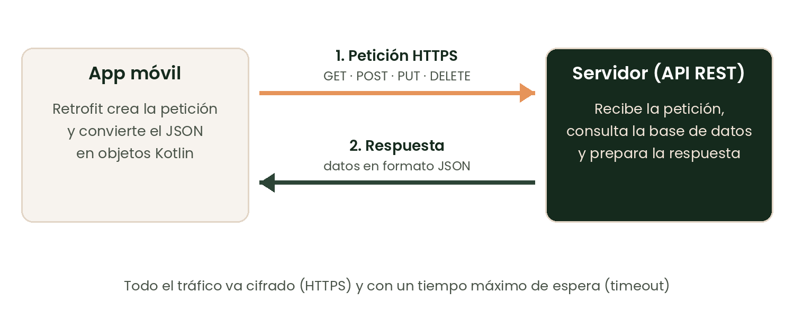
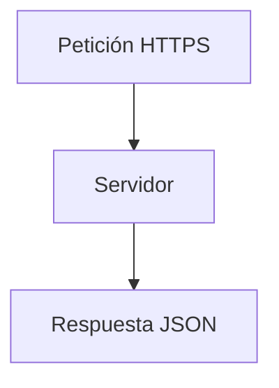

# Unidad 2: Desarrollo de Aplicaciones Móviles

# Objetivos de la unidad

**Al finalizar esta unidad, serás capaz de:**

- Diferenciar el modelo de interfaz imperativo del declarativo.
- Construir una pantalla sencilla con widgets.
- Conectar una aplicación con un servicio REST.

# Introducción

**Preguntas para reflexionar:**

- ¿Qué ocurre entre que tocas un botón y ves la respuesta?
- ¿Por qué una app «se congela»?

Texto de apertura con un **término clave en negrita** la primera vez y una palabra en *cursiva*.

# 1. Interfaz y contenidos

Párrafo de introducción de la sección. Incluye `código en línea` y un [enlace](https://thepower.education).

## 1.1. Modelos de interfaz

| Modelo | Cómo se construye | Ejemplo |
|---|---|---|
| Imperativo | Vistas en XML y código que las modifica | Activity + XML |
| Declarativo | La interfaz se describe según el estado | Compose, Flutter |

### Un widget con estado

```dart
class Contador extends StatefulWidget {
  @override
  State<Contador> createState() => _ContadorState();
}
```

**Importante.** Cada vez que cambia el estado se redibuja el widget.

## 1.2. Listas

- Primer punto
  - Subpunto anidado
- Segundo punto

1. Preparar la petición.
2. Enviarla por HTTPS.
3. Procesar la respuesta.

# 2. Datos y comunicaciones

## 2.1. Servicios REST

La app envía una petición HTTPS y recibe una respuesta en JSON.



> Idea clave: todo el tráfico va cifrado y con un tiempo máximo de espera.

## 2.2. Fórmula y diagrama

El tiempo máximo por fotograma a 60 FPS es $t = \frac{1000}{60} \approx 16{,}7\ \text{ms}$.



# Mini proyecto guiado

- **Paso 1: Diseñar la pantalla.** Esboza la interfaz con tarjetas.
- **Paso 2: Conectar el servicio.** Consume una API REST con Retrofit.

Entregable: una aplicación con interfaz navegable y datos remotos.

# Ejercicio

Describe cómo evitarías que una descarga bloquee la interfaz.

Requisitos:

- Menciona el hilo principal.
- Cita una herramienta de concurrencia.

# Resumen profesionalizante

Con este conocimiento, ahora estás preparado para:

- Elegir entre un modelo imperativo y uno declarativo.
- Mantener la interfaz fluida con tareas en segundo plano.
